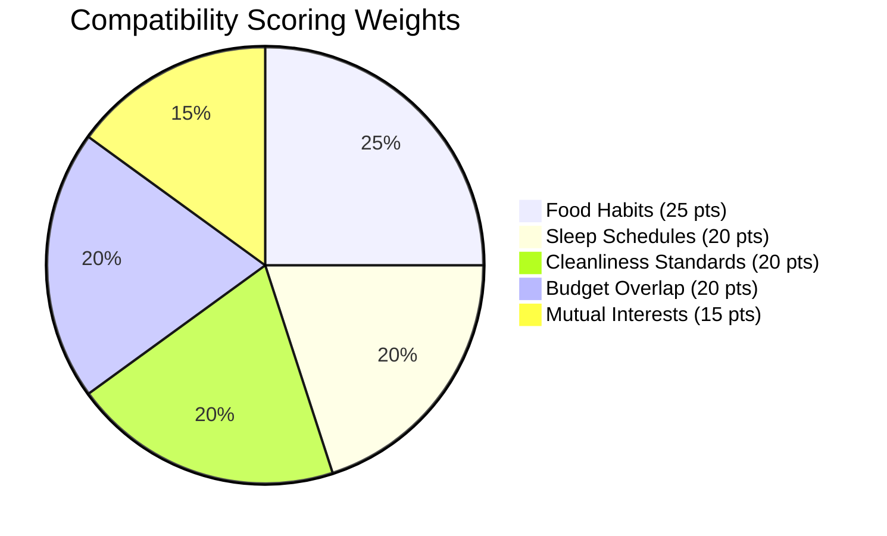
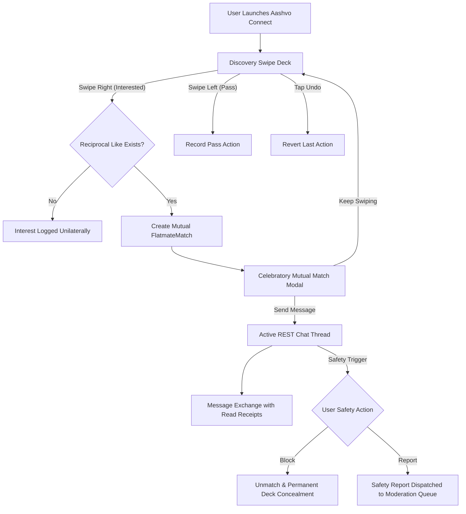

# AASHVO CONNECT — PRODUCT SPECIFICATION
## Swipe-Based Flatmate Discovery & Mutual Matching Engine

**Document Version:** 1.0.0  
**Status:** Approved & Implemented  
**Classification:** Core Marketplace Product Spec  
**Target Release:** RC-1.1.0  

---

## 1. Executive Summary

**Aashvo Connect** is an integrated co-living matching subsystem designed to solve the roommate compatibility crisis in India's major urban rental markets (Delhi NCR, Bengaluru, Mumbai, Pune, Hyderabad). While traditional rental classifieds focus solely on square footage and price, shared accommodation failure is predominantly caused by lifestyle friction: dietary incompatibilities, divergent sleep routines, mismatched hygiene expectations, and unaligned budget capacities.

Aashvo Connect introduces a mobile-first, gesture-driven discovery experience combined with a **5-dimension deterministic compatibility engine**. Candidates express mutual interest through reciprocal consent before unlocking private peer-to-peer conversations.

Crucially, **Aashvo Connect is designed strictly for flatmate teaming and co-living—not dating**. Mutual matching does not replace or restrict direct room or property inquiries; rather, it complements them as a specialized discovery channel.

---

## 2. Product Principles & Boundaries

### 2.1 Co-Living Tone vs. Dating Boundaries
| Attribute | Dating Applications | Aashvo Connect |
| :--- | :--- | :--- |
| **Primary Intent** | Romantic partnership / dating | Shared accommodation teaming & rental co-tenancy |
| **Core Metadata** | Physical appearance, relationship goals | Diet, sleep schedules, cleanliness habits, budget limits |
| **Visual Palette** | Bright pinks, neon purples, dating tropes | Brand Warm Ivory (`#F5F3ED`), Forest Green (`#244737`), Sand (`#D9B98C`) |
| **Trust Badges** | Dating verification selfie | Government ID, Workplace/University, Tenancy verification |
| **Enforcement** | Open conversation guidelines | Zero tolerance for unsolicited romantic advances or harassment |

### 2.2 Independence from Direct Inquiries
- Prospective renters browsing the general property and room inventory may still send standard direct inquiries (with move-in dates, contact details, and custom messages via `POST /api/v1/inquiries`) without any Connect matching requirement.
- A user can inquire directly about a listed property even if they have not swiped or matched with its owner or flatmates.
- Mutual matching provides an opt-in, reciprocal conversation layer for users who want verified mutual interest before exchanging messages.

### 2.3 The Three Flatmate Intentions
Aashvo Connect supports all three real-world flatmate housing intentions:
1. **Has a room and needs a flatmate (`has_room`):** User holds an active tenancy or owns a property and has a vacant bedroom available for rent.
2. **Needs a room and wants a compatible flatmate (`needs_room`):** User is actively seeking a private room in an existing flat with compatible co-tenants.
3. **Find compatible people to rent an entire flat together (`team_up`):** Users team up as prospective co-tenants first, aligning on budgets and areas, to jointly lease a fresh 2BHK/3BHK property on AASHVO.

**Multi-Select & Dynamic Updates:**
- Users can select multiple intentions simultaneously (e.g. both `needs_room` and `team_up`).
- Users can update their declared intentions at any time via `PATCH /api/v1/connect/intentions`.
- The discovery deck provides instant intention filtering chips (`All Intentions`, `Has Room`, `Needs Room`, `Rent Together`) so users can find matches matching their exact search posture.

### 2.4 Independence from Family Stays
- **Family Stays** remains an independent, premium whole-property accommodation category on AASHVO catering to families, groups, and relocation clients.
- Aashvo Connect is strictly decoupled from Family Stays and deals exclusively with individual flatmate teaming and co-living. Under no circumstances are Family Stays listings or workflows merged into the Connect swipe deck.

---

## 3. The 5-Dimension Compatibility Engine

The platform implements an objective, deterministic scoring model calculating total lifestyle alignment ($0–100\%$) across five weighted dimensions:

$$\text{Overall Score} = S_{\text{food}} + S_{\text{sleep}} + S_{\text{clean}} + S_{\text{budget}} + S_{\text{interests}}$$

### 3.1 Dimension 1: Food Habits (25 Pts Max)
- **Exact Match or 'Any' (25 pts):** Both users share identical dietary habits (e.g., both Vegetarian, both Non-Vegetarian) or either profile declares universal flexibility.
- **Compatible Alignment (15 pts):** Vegetarian $\leftrightarrow$ Eggetarian, or Non-Vegetarian $\leftrightarrow$ Eggetarian.
- **Divergent Alignment (5 pts):** Strict Vegetarian $\leftrightarrow$ Non-Vegetarian.

### 3.2 Dimension 2: Sleep Schedules (20 Pts Max)
- **Exact Match (20 pts):** Early Bird $\leftrightarrow$ Early Bird, Night Owl $\leftrightarrow$ Night Owl, or Flexible $\leftrightarrow$ Flexible.
- **Moderate Alignment (15 pts):** Flexible pairing with either Early Bird or Night Owl.
- **Opposing Schedules (5 pts):** Early Bird $\leftrightarrow$ Night Owl.

### 3.3 Dimension 3: Cleanliness Standards (20 Pts Max)
- **Exact Match (20 pts):** Spotless $\leftrightarrow$ Spotless, Moderate $\leftrightarrow$ Moderate, Relaxed $\leftrightarrow$ Relaxed.
- **Adjacent Tolerance (12 pts):** Spotless $\leftrightarrow$ Moderate, or Moderate $\leftrightarrow$ Relaxed.
- **Divergent Standards (4 pts):** Spotless $\leftrightarrow$ Relaxed.

### 3.4 Dimension 4: Budget Overlap (20 Pts Max)
Evaluates mutual financial viability using the normalized ratio between the two budget ceilings:
$$\text{Budget Ratio} = \frac{\min(B_1, B_2)}{\max(B_1, B_2)}$$
$$\text{Budget Score} = \text{round}(\text{Budget Ratio} \times 20)$$

### 3.5 Dimension 5: Mutual Interests & Hobbies (15 Pts Max)
Case-insensitive intersection of declared lifestyle tags (e.g., Yoga, Reading, Specialty Coffee, Tech, Fitness, Cinema, Cycling):
- $\ge 3$ Shared Interests: **15 pts**
- 2 Shared Interests: **10 pts**
- 1 Shared Interest: **5 pts**
- 0 Shared Interests: **0 pts**

---

## 4. End-to-End User Journeys

### 4.1 Discovery Deck
- **Card Presentation:** High-resolution avatar, verified badge, occupation, target localities, room status pill (`Has a Room` / `Needs a Room`), budget ceiling, and compatibility percentage badge.
- **Interactive Gestures:**
  - Pointer/Touch drag with rotation and dynamic stamps (`INTERESTED` in forest green, `PASS` in charcoal).
  - Desktop keyboard controls: Left Arrow (Pass), Right Arrow (Interested), Z or U (Undo last action).
  - Expandable breakdown drawer revealing points breakdown across all 5 dimensions and shared interest tags.

### 4.2 Mutual Matching
- An active match is generated **only when both users have registered reciprocal 'like' actions**.
- Generates a real-time celebration modal showing partner details, shared compatibility, and an immediate message prompt.

### 4.3 Match Messaging Thread
- Dedicated participant-only thread (`user1Id === callerId || user2Id === callerId`).
- Persistent safety banner: *"Keep conversations on Aashvo. Never pay deposits before in-person visits."*
- Read receipt indicators (single check for sent, double check for read).

### 4.4 Safety & Visibility Controls
- **User Block:** Immediately dissolves mutual match, freezes messaging, and hides candidate from discovery.
- **Safety Report:** Escalates user to staff moderation console with selectable violation categories (`Inappropriate communication`, `Scam or payment fraud`, `Misleading flatmate details`, `Harassment`).
- **Pause Discovery (`discoveryHidden`):** Allows users to temporarily pause their profile from appearing in other users' decks while retaining ongoing conversations with existing matches.

