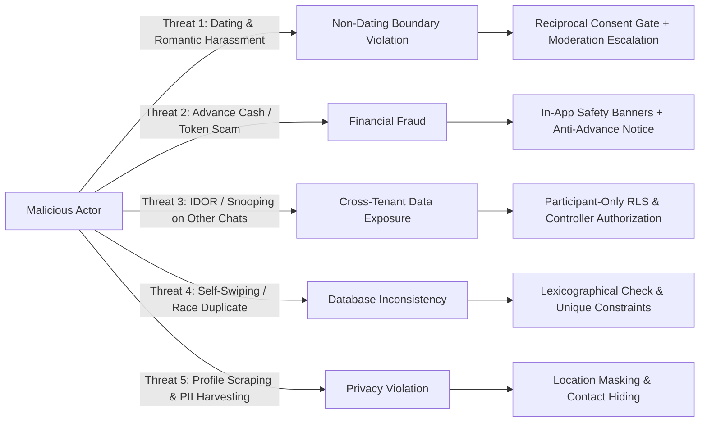

# AASHVO CONNECT — SECURITY REVIEW & THREAT MODEL
## Participant Authorization, Trust Boundaries & Anti-Abuse Defenses

**Document Version:** 1.0.0  
**Status:** Approved & Implemented  
**Classification:** Security Architecture & Review  
**Target Release:** RC-1.1.0  

---

## 1. Threat Modeling for Flatmate Matching

Peer discovery platforms face unique attack vectors that differ from standard e-commerce or rental classifieds. Aashvo Connect has been threat-modeled against the following attack scenarios:



---

## 2. Security Controls & Defensive Implementations

### 2.1 Threat 1: Dating Solicitation & Romantic Advances
- **Defense Mechanism:** 
  1. Reciprocal consent gate: Zero communication can take place until **both** users have affirmatively swiped "Interested" on each other.
  2. Moderation reports: Flatmate reporting options specifically include `Inappropriate communication` and `Harassment`, which automatically escalate to the staff moderation console (`SafetyReport`).
  3. Suspension enforcement: Verified violation results in platform account suspension.

### 2.2 Threat 2: Token Money & Advance Payment Scams
- **Defense Mechanism:**
  1. Prominent safety disclaimer in chat header: *"Co-Living Safety Reminder: Never transfer token money or advance deposits before inspecting a property in person."*
  2. Rental agreements and financial transactions are routed strictly through the audited `RentalTrustModule` ledger, never ad-hoc peer payments.

### 2.3 Threat 3: Broken Object Level Authorization (IDOR) on Chat Threads
- **Defense Mechanism:**
  - In `ConnectService.getMatchById()`, `getMessages()`, and `sendMessage()`:
  ```typescript
  if (match.user1Id !== callerId && match.user2Id !== callerId) {
    throw new ForbiddenException({
      code: 'FORBIDDEN',
      message: 'You are not an authorized participant in this mutual match',
    });
  }
  ```
  - Third-party users attempting to inspect or post messages into arbitrary `matchId`s receive immediate HTTP 403 Forbidden responses. Verified via automated test suite.

### 2.4 Threat 4: Self-Matching & Duplicate Match Race Conditions
- **Defense Mechanism:**
  - **Self-Swiping Prevention:**
    - Service layer rejects `targetUserId === callerId` with HTTP 400 `CANNOT_SWIPE_SELF`.
    - Database layer enforces `CONSTRAINT "ck_flatmate_interests_no_self" CHECK ("user_id" <> "target_user_id")`.
  - **Deterministic Match Uniqueness:**
    - Service automatically sorts IDs lexicographically before upserting:
      `[u1, u2] = callerId < targetUserId ? [callerId, targetUserId] : [targetUserId, callerId]`.
    - Database enforces `CONSTRAINT "ck_flatmate_matches_lexicographical" CHECK ("user_1_id" < "user_2_id")`.
    - Unique index `CREATE UNIQUE INDEX "uq_flatmate_matches_pair" ON "flatmate_matches" ("user_1_id", "user_2_id")`.
    - Impossible for reciprocal swipes to generate concurrent mirrored match rows (`(A, B)` and `(B, A)`).

### 2.5 Threat 5: PII Harvesting & Stalking
- **Defense Mechanism:**
  - Exact addresses, phone numbers, and email addresses are omitted from `ConnectCandidateView`.
  - Only broad localities (e.g. `DLF Phase 4`, `Hauz Khas`) and city names are rendered.
  - Users can enable `discoveryHidden: true` at any time to instantly disappear from all active discovery decks while preserving existing match threads.

### 2.6 Threat 6: Cross-Site Scripting (XSS) & Input Poisoning
- **Defense Mechanism:**
  - Input DTOs validate `content` using `class-validator`: `@IsString()`, `@IsNotEmpty()`, `@MaxLength(1000)`.
  - All rendered content is escaped through React JSX DOM text nodes without `dangerouslySetInnerHTML`.

---

## 3. Audit Logging & Traceability

Every critical interaction in Aashvo Connect is immutably logged into the `audit_logs` table:

| Action | Event Type | Details Recorded | Outcome |
| :--- | :--- | :--- | :--- |
| **Reciprocal Match** | `flatmate_match_created` | `matchId`, `user1Id`, `user2Id` | `success` |
| **Peer Message** | `flatmate_message_sent` | `matchId`, `senderId`, `charLength` | `success` |
| **User Block** | `user_blocked` | `blockerId`, `blockedUserId`, `reason` | `success` |
| **User Report** | `user_reported` | `reporterId`, `reportedUserId`, `reason` | `success` |
| **Visibility Change** | `discovery_visibility_updated` | `userId`, `discoveryHidden` | `success` |
| **IDOR Attempt** | `unauthorized_match_access` | `matchId`, `callerId` | `denied` |

All records capture the client IP, User-Agent, and correlation `requestId` for forensic accountability.

