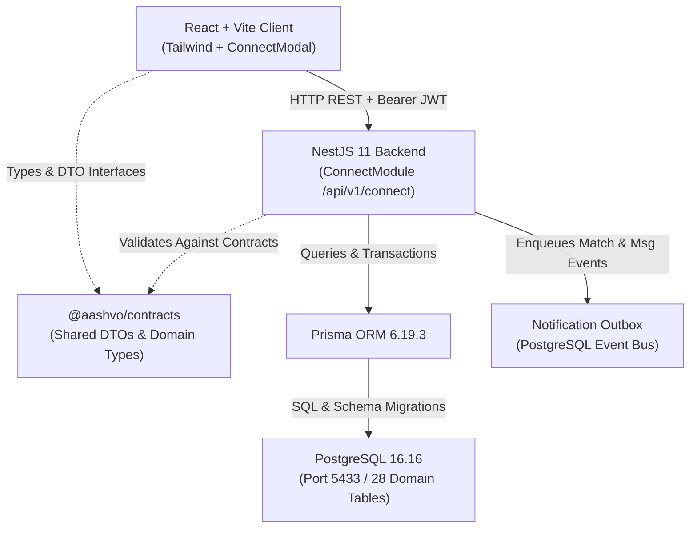
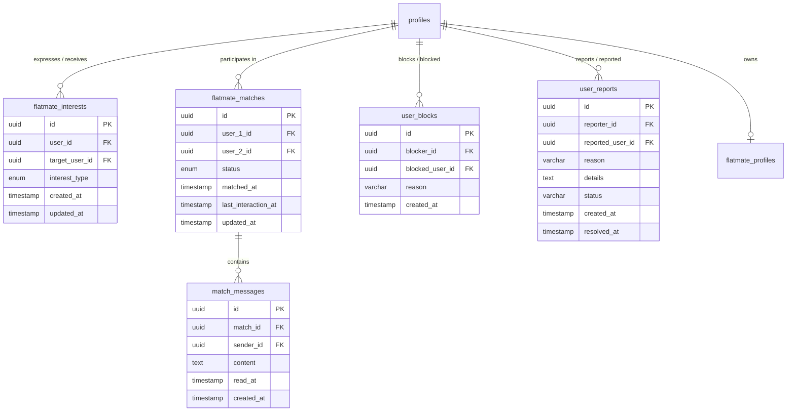
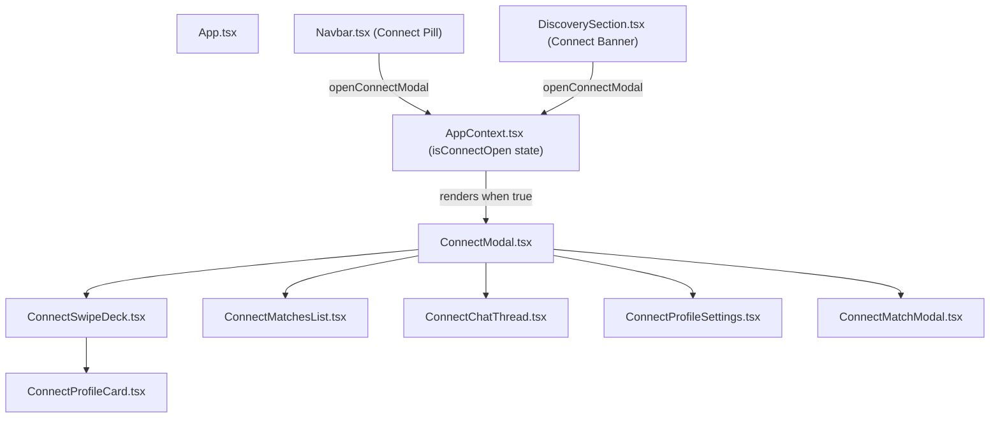

# AASHVO CONNECT — TECHNICAL DESIGN DOCUMENT
## Database Schema, NestJS Engine & Real-Time REST Architecture

**Document Version:** 1.0.0  
**Status:** Approved & Implemented  
**Classification:** Core System Architecture  
**Target Release:** RC-1.1.0  

---

## 1. System Architecture Overview

Aashvo Connect is designed as a modular subsystem within the unified Aashvo monorepo:



---

## 2. Database Schema & Migration Details

A forward-only, additive database migration sequence was generated and applied to local PostgreSQL 16 on port 5433:  
1. `apps/api/prisma/migrations/20261115000000_aashvo_connect_matching/migration.sql` (Tables, relations, and initial enums)
2. `apps/api/prisma/migrations/20261115010000_flatmate_intentions/migration.sql` (Three flatmate intentions support)

This migration series added **5 relational tables** and **3 enum types**, expanding total database domain tables from 23 to **28**.

### 2.1 Enums
- `FlatmateInterestType`: `'like' | 'pass'`
- `FlatmateMatchStatus`: `'active' | 'unmatched' | 'blocked'`
- `FlatmateIntention`: `'has_room' | 'needs_room' | 'team_up'`

### 2.2 Relational Tables



### 2.3 Strict Database Integrity Constraints

1. **Self-Swiping Prevention:**
   ```sql
   CONSTRAINT "ck_flatmate_interests_no_self" CHECK ("user_id" <> "target_user_id")
   ```
2. **Deterministic Match Uniqueness (Lexicographical Ordering):**
   ```sql
   CONSTRAINT "ck_flatmate_matches_lexicographical" CHECK ("user_1_id" < "user_2_id"),
   CONSTRAINT "uq_flatmate_matches_pair" UNIQUE ("user_1_id", "user_2_id")
   ```
   *By strictly enforcing `user_1_id < user_2_id`, the system prevents reciprocal race conditions and duplicate match tuples.*
3. **Self-Blocking Prevention:**
   ```sql
   CONSTRAINT "ck_user_blocks_no_self" CHECK ("blocker_id" <> "blocked_user_id"),
   CONSTRAINT "uq_user_blocks_pair" UNIQUE ("blocker_id", "blocked_user_id")
   ```
4. **Discovery Pausing Column:**
   `discovery_hidden BOOLEAN NOT NULL DEFAULT false` added to `flatmate_profiles`.

### 2.4 Flatmate Intentions Migration (`20261115010000_flatmate_intentions`)
- Created enum type `"FlatmateIntention"`:
  ```sql
  CREATE TYPE "FlatmateIntention" AS ENUM ('has_room', 'needs_room', 'team_up');
  ```
- Altered `flatmate_profiles` table:
  ```sql
  ALTER TABLE "flatmate_profiles" ADD COLUMN "intentions" "FlatmateIntention"[] NOT NULL DEFAULT '{}';
  ```
- Backfilled existing profiles seamlessly:
  - If `has_room = true`: assigned `ARRAY['has_room'::"FlatmateIntention"]`.
  - If `has_room = false`: assigned `ARRAY['needs_room'::"FlatmateIntention", 'team_up'::"FlatmateIntention"]`.
- Added endpoint `PATCH /api/v1/connect/intentions` allowing users to update their multi-select intentions at any time.

### 2.5 Complete Independence of Direct Property Inquiries
- `InquiriesModule` (`POST /api/v1/inquiries`) operates 100% independently of the Connect matching subsystem.
- Inquiries can be submitted by any verified user for any active property or flatmate listing without requiring a prior swipe, like, or mutual match.
- Direct inquiries do NOT generate Connect matches, preserving strict separation of concerns.

---

## 3. Backend NestJS Engine Implementation

The implementation is encapsulated within `apps/api/src/modules/connect/`:
- `connect.controller.ts`: Declares REST endpoints with `@UseGuards(JwtAuthGuard)` and route prefix `@Controller('api/v1/connect')`.
- `connect.service.ts`: Implements business logic, scoring, and transactional operations.
- `dto/connect.dto.ts`: Strict validation DTOs with `class-validator` rules.

### 3.1 Transactional Swipe & Mutual Matching Workflow
When an authorized user calls `POST /api/v1/connect/swipe`:
1. **Self-Check:** Verifies `targetUserId !== caller.id`.
2. **Block-Check:** Verifies neither user has blocked the other.
3. **Interest Upsert:** Creates or updates `flatmate_interests` tuple for `(caller.id, targetUserId)`.
4. **Reciprocal Match Check:** Queries for a reciprocal `like` record where `user_id = targetUserId AND target_user_id = caller.id`.
5. **Atomic Match Creation:** If reciprocal interest is confirmed:
   - Order user IDs lexicographically: `[u1, u2] = caller.id < targetUserId ? [caller.id, targetUserId] : [targetUserId, caller.id]`.
   - Upsert `flatmate_matches` with `status: 'active'`.
   - Enqueue a `flatmate_match_created` event in `notification_outbox`.
   - Record an audit entry in `audit_logs`.
   - Return `{ matched: true, match: item }`.
6. **Undo Support:** If the caller invokes `POST /api/v1/connect/undo`, the service deletes the caller's most recent interest record. If a mutual match was established from that action, it atomically unmatches it (`status: 'unmatched'`).

### 3.2 Participant-Only Messaging Security
- Endpoints `GET /api/v1/connect/matches/:id/messages` and `POST /api/v1/connect/matches/:id/messages`:
  - Fetch match: `user_1_id` and `user_2_id`.
  - Authorize: Enforces `user_1_id === caller.id || user_2_id === caller.id`. If false, throws HTTP 403 Forbidden.
  - Enforce status: If match is `'blocked'` or `'unmatched'`, messaging is rejected with HTTP 403.
  - Auto-Read: When caller retrieves messages, all partner messages with `read_at === null` are atomically stamped with the current timestamp.
  - Enqueues `flatmate_message_received` outbox notifications for the recipient.

---

## 4. Frontend Component Hierarchy & State Flow



### 4.1 Demo Preview Fallback
To ensure smooth unauthenticated testing and client-side resilience:
- `connectService.ts` transparently catches HTTP 401 or network errors and switches to a local in-memory simulation based on `SEED_FLATMATES`.
- Swiping on demo profiles computes real compatibility using the exact 5-dimension engine.
- Swiping right on primary demo profiles (Aarav, Meera) generates an interactive demo match with pre-populated co-living chat messages.

