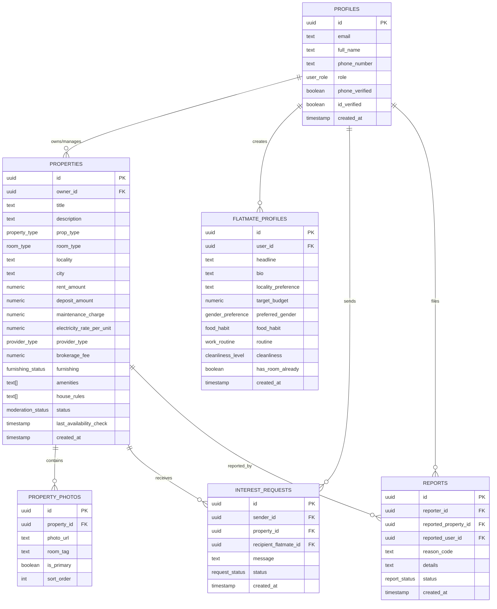

# Aashvo — Database Schema & Security Architecture

**Engine:** PostgreSQL 15+ (Supabase)  
**Security:** Row Level Security (RLS) Enabled on all tables  
**Status:** Approved  

---

## 1. Entity Relationship Overview

---

## 2. Row Level Security (RLS) Policy Declarations

### 1. `properties` Table:
- **SELECT:** Public can read where `status = 'active'`. Owners can read their own regardless of status. Admins can read all.
- **INSERT:** Authenticated users only (`auth.uid() = owner_id`). Default `status = 'pending_review'`.
- **UPDATE:** Owners can update details and mark availability (`auth.uid() = owner_id`). Admins can update `status` and `moderation_notes`.
- **DELETE:** Owners can delete their own draft/paused listings; Admins can purge.

### 2. `flatmate_profiles` Table:
- **SELECT:** Public / Authenticated users can view active flatmate profiles. Contact info is masked unless mutual interest is accepted.
- **INSERT / UPDATE:** Only the profile owner (`auth.uid() = user_id`).

### 3. `interest_requests` Table:
- **SELECT:** Only the sender (`sender_id = auth.uid()`) or the recipient property owner / flatmate recipient.
- **INSERT:** Authenticated users only.

### 4. `reports` Table:
- **INSERT:** Authenticated users can submit reports.
- **SELECT / UPDATE:** Restrained strictly to users with role = `admin`.
