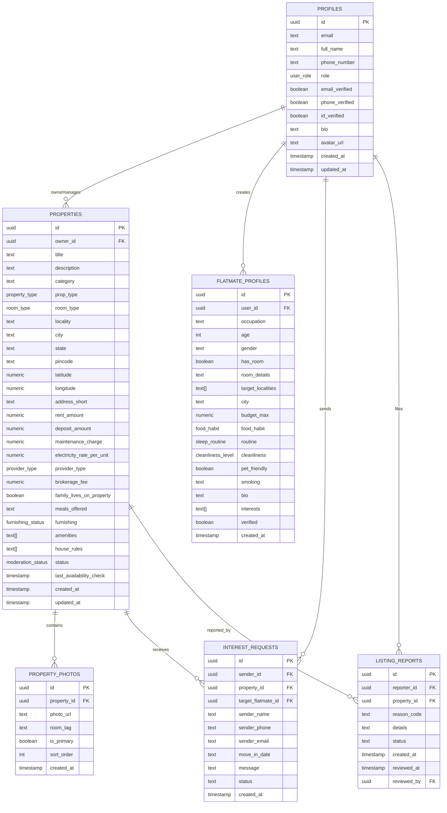

# Aashvo — Database Schema & Security Architecture

**Engine:** PostgreSQL 15+ (Supabase)  
**Security:** Row Level Security (RLS) & Anti-Forgery Triggers Enabled on all tables  
**Version:** 2.0.0-Nationwide  
**Status:** Approved  

---

## 1. Entity Relationship Overview



---

## 2. Integrity Constraints & Anti-Forgery Triggers

### 2.1 Family Stay Eligibility Constraint
Enforces that Family Stays can **only** be published by direct home owners whose families reside on the property:
```sql
ALTER TABLE public.properties ADD CONSTRAINT chk_family_stay_eligibility
CHECK (
  category <> 'family_stays' OR (
    category = 'family_stays' AND 
    family_lives_on_property = TRUE AND 
    provider_type = 'owner' AND
    meals_offered IN ('included', 'optional_extra', 'none')
  )
);
```

### 2.2 Verification Anti-Forgery Trigger (`trg_prevent_verification_forgery`)
Prevents users from updating their own `phone_verified` or `email_verified` columns via direct API requests:
```sql
CREATE TRIGGER trg_prevent_verification_forgery
BEFORE UPDATE OF phone_verified, email_verified ON public.profiles
FOR EACH ROW
EXECUTE FUNCTION public.enforce_verification_integrity();
```

### 2.3 Workflow-Enforced Inquiry & Listing Triggers
- `trg_enforce_inquiry_prerequisites`: Rejects `interest_requests` if sender's email or phone is not verified.
- `trg_enforce_listing_host_prerequisites`: Rejects `properties` creation if host's phone is not verified.

### 2.4 Editorial Moderation Integrity Trigger (`trg_prevent_status_bypass`)
Forces `status := 'pending_review'` if a non-administrator attempts to insert or update a property directly to `'active'`.

---

## 3. Secure Public Views (Data Minimization)

### 3.1 Masked Profiles View (`public.public_profiles`)
Exposes non-sensitive identity metadata for public and authenticated discovery while strictly concealing phone numbers and emails:
```sql
CREATE OR REPLACE VIEW public.public_profiles AS
SELECT 
  id,
  full_name,
  role,
  avatar_url,
  bio,
  id_verified,
  phone_verified,
  created_at
FROM public.profiles;

GRANT SELECT ON public.public_profiles TO anon, authenticated;
```

### 3.2 Address-Masked Properties View (`public.public_properties`)
Exposes active listings across India while concealing exact door, villa, and flat numbers:
```sql
CREATE OR REPLACE VIEW public.public_properties AS
SELECT 
  id, owner_id, title, description, category, property_type, room_type,
  furnishing, rent_amount, deposit_amount, maintenance_charge,
  electricity_rate_per_unit, brokerage_fee, provider_type,
  family_lives_on_property, meals_offered, gender_preference,
  bedrooms, bathrooms, available_from, amenities, house_rules,
  locality, city, state, pincode, status, last_availability_check, created_at
FROM public.properties
WHERE status = 'active';

GRANT SELECT ON public.public_properties TO anon, authenticated;
```

---

## 4. Row Level Security (RLS) Matrix

| Table | Operation | Target Role | Policy Condition |
| :--- | :--- | :--- | :--- |
| `profiles` | `SELECT` | `authenticated` | `auth.uid() = id OR public.is_admin()` |
| `profiles` | `UPDATE` | `authenticated` | `auth.uid() = id` (role & verification protected by triggers) |
| `properties` | `SELECT` | `anon, authenticated` | `status = 'active' OR auth.uid() = owner_id OR public.is_admin()` |
| `properties` | `INSERT` | `authenticated` | `auth.uid() = owner_id` (phone verified check enforced) |
| `properties` | `UPDATE` | `authenticated` | `auth.uid() = owner_id OR public.is_admin()` |
| `interest_requests` | `SELECT` | `authenticated` | `sender_id = auth.uid() OR owner_id = auth.uid() OR target_flatmate = auth.uid() OR is_admin()` |
| `interest_requests` | `INSERT` | `authenticated` | `sender_id = auth.uid()` (email/phone verification checked) |
| `listing_reports` | `INSERT` | `authenticated` | `true` |
| `listing_reports` | `SELECT/UPDATE` | `authenticated` | `public.is_admin()` |
| `storage.objects` | `SELECT` | `public` | `bucket_id IN ('property-photos', 'user-avatars')` |
| `storage.objects` | `INSERT/DELETE` | `authenticated` | `auth.uid()::text = (storage.foldername(name))[1]` |

---

## 5. Help & Support System Schema (`20261021000000_help_and_support_system.sql`)

### 5.1 Tables & Enums

#### 5.1.1 `public.support_tickets`
- `id` (UUID, Primary Key, default `gen_random_uuid()`)
- `ticket_number` (`TEXT`, Unique, `ASH-TKT-XXXXXX`)
- `user_id` (`UUID`, References `auth.users(id)` ON DELETE SET NULL, nullable for guest submissions)
- `user_email` (`TEXT`, Not Null, validated format)
- `user_name` (`TEXT`, Not Null)
- `user_phone` (`TEXT`, Nullable)
- `category` (`TEXT`, Check: `account_login`, `finding_flatmates`, `rooms_listings`, `family_stays_meals`, `location`, `verification`, `privacy_safety`, `technical_issues`, `billing_fraud`, `other`)
- `subject` (`TEXT`, Not Null, 5-120 chars)
- `description` (`TEXT`, Not Null, 10-2000 chars)
- `reference_listing_id` (`UUID`, References `public.properties(id)` ON DELETE SET NULL)
- `reference_user_id` (`UUID`, References `auth.users(id)` ON DELETE SET NULL)
- `priority` (`TEXT`, Check: `urgent`, `high`, `normal`, `low`, default `normal`)
- `status` (`TEXT`, Check: `open`, `in_review`, `awaiting_user`, `resolved`, `closed`, default `open`)
- `assigned_to` (`UUID`, References `auth.users(id)` ON DELETE SET NULL)
- `assigned_name` (`TEXT`)
- `attachments` (`JSONB`, default `'[]'::jsonb`)
- `created_at`, `updated_at`, `resolved_at`, `resolved_by`

#### 5.1.2 `public.ticket_messages`
- `id` (UUID, Primary Key)
- `ticket_id` (`UUID`, References `public.support_tickets(id)` ON DELETE CASCADE)
- `sender_id` (`UUID`, References `auth.users(id)` ON DELETE SET NULL)
- `sender_name` (`TEXT`, Not Null)
- `sender_role` (`TEXT`, Check: `user`, `support`, `admin`)
- `message` (`TEXT`, Not Null)
- `is_internal` (`BOOLEAN`, Not Null, default `false`) — **Staff note isolation flag**
- `attachments` (`JSONB`, default `'[]'::jsonb`)
- `created_at` (`TIMESTAMPTZ`, default `now()`)

#### 5.1.3 `public.ticket_audit_events`
- `id` (UUID, Primary Key)
- `ticket_id` (`UUID`, References `public.support_tickets(id)` ON DELETE CASCADE)
- `actor_id` (`UUID`, References `auth.users(id)` ON DELETE SET NULL)
- `actor_name` (`TEXT`, Not Null)
- `action` (`TEXT`, Not Null: `ticket_created`, `status_changed`, `priority_changed`, `assigned`, `internal_note_added`)
- `old_value`, `new_value`, `notes`, `created_at`

#### 5.1.4 `public.safety_reports`
- `id` (UUID, Primary Key)
- `reporter_id` (`UUID`, References `auth.users(id)` ON DELETE SET NULL)
- `reporter_name` (`TEXT`)
- `reporter_email` (`TEXT`)
- `target_type` (`TEXT`, Check: `listing`, `flatmate`, `user`)
- `target_id` (`TEXT`, Not Null)
- `target_title` (`TEXT`, Not Null)
- `reason_code` (`TEXT`, Check: `scam_fraud`, `misleading_charges`, `unavailable_listing`, `duplicate_fake`, `inappropriate_conduct`, `harassment`, `other`)
- `reason_label` (`TEXT`, Not Null)
- `details` (`TEXT`, Not Null, 10-1500 chars)
- `priority` (`TEXT`, Check: `urgent`, `high`, `normal`)
- `status` (`TEXT`, Check: `pending`, `investigating`, `resolved`, `dismissed`, default `pending`)
- `admin_notes`, `created_at`, `reviewed_at`, `reviewed_by`

### 5.2 State Machine Trigger (`trg_validate_ticket_status_transition`)
Enforces valid forward-only state progression:
- `open` -> `in_review`, `closed`
- `in_review` -> `awaiting_user`, `resolved`, `closed`
- `awaiting_user` -> `in_review`, `resolved`, `closed`
- `resolved` -> `in_review`, `closed`
- `closed` -> *Terminal (no further transitions permitted)*

### 5.3 Help & Support RLS Policies Matrix

| Table | Operation | Target Role | Policy Condition |
| :--- | :--- | :--- | :--- |
| `support_tickets` | `INSERT` | `anon, authenticated` | `true` (Allows anonymous guest support tickets) |
| `support_tickets` | `SELECT` | `authenticated` | `auth.uid() = user_id OR user_email = (auth.jwt() ->> 'email') OR public.is_admin()` |
| `support_tickets` | `UPDATE` | `authenticated` | `public.is_admin()` |
| `ticket_messages` | `SELECT` | `authenticated` | `(EXISTS (SELECT 1 FROM support_tickets WHERE id = ticket_id AND (user_id = auth.uid() OR user_email = auth.jwt()->>'email')) AND is_internal = false) OR public.is_admin()` |
| `ticket_messages` | `INSERT` | `authenticated` | `(EXISTS (SELECT 1 FROM support_tickets WHERE id = ticket_id AND (user_id = auth.uid() OR user_email = auth.jwt()->>'email')) AND is_internal = false) OR public.is_admin()` |
| `ticket_audit_events` | `SELECT/INSERT` | `authenticated` | `public.is_admin()` (Strictly hidden from ordinary users) |
| `safety_reports` | `INSERT` | `anon, authenticated` | `true` |
| `safety_reports` | `SELECT/UPDATE` | `authenticated` | `public.is_admin()` (Reporter and reported identities kept strictly confidential) |
| `storage.objects (support-attachments)` | `INSERT` | `anon, authenticated` | `bucket_id = 'support-attachments'` (5MB cap, MIME whitelist) |
| `storage.objects (support-attachments)` | `SELECT` | `authenticated` | `public.is_admin() OR auth.uid()::text = (storage.foldername(name))[1]` |

