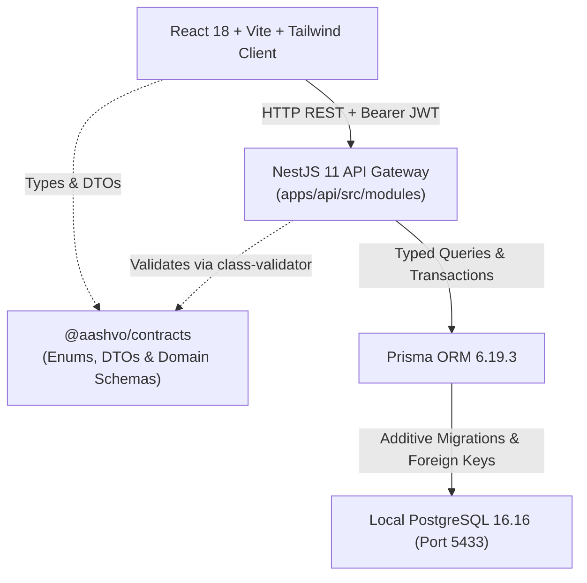
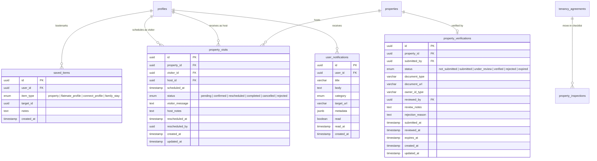

# AASHVO MASTER FEATURE EXPANSION — TECHNICAL DESIGN
## Database Relational Architecture, NestJS Services & Shared Contracts

**Document Version:** 1.0.0  
**Status:** Approved & Architecture Planned  
**Target Release:** RC-1.2.0  
**Classification:** Technical Architecture & Design Document  

---

## 1. System Architecture Overview

The Master Feature Expansion builds cleanly upon the existing NestJS 11 monorepo architecture, extending PostgreSQL 16 schemas with additive migrations and publishing typed contracts through `@aashvo/contracts`.

---

## 2. Database Schema Additions (PostgreSQL 16)

An additive migration sequence `20261115020000_master_feature_expansion` adds the following relational tables and enum types:

### 2.1 New Enums
1. `SavedItemType`: `property`, `flatmate_profile`, `connect_profile`, `family_stay`
2. `VisitStatus`: `pending`, `confirmed`, `rescheduled`, `completed`, `cancelled`, `rejected`
3. `PropertyVerificationStatus`: `not_submitted`, `submitted`, `under_review`, `verified`, `rejected`, `expired`
4. `NotificationCategory`: `connect_match`, `connect_message`, `visit_request`, `visit_update`, `property_inquiry`, `property_verification`, `agreement_update`, `inspection_update`, `listing_alert`, `support_update`

### 2.2 New Relational Models

### 2.3 Strict Database Integrity Constraints
1. **Self-Save Prevention:**
   `CONSTRAINT ck_saved_items_no_self CHECK (user_id <> target_id)`
2. **Saved Item Deduplication:**
   `CONSTRAINT uq_saved_items_user_target UNIQUE (user_id, item_type, target_id)`
3. **Visit Scheduling Conflict Prevention (Application Transaction + Partial Index):**
   `CREATE UNIQUE INDEX uq_property_confirmed_visit ON property_visits (property_id, scheduled_at) WHERE status = 'confirmed';`
4. **Self-Visit Prevention:**
   `CONSTRAINT ck_property_visits_no_self CHECK (visitor_id <> host_id)`

---

## 3. NestJS Modules & Endpoints Architecture

### 3.1 Locations Module (`apps/api/src/modules/locations`)
- `GET /api/v1/locations/cities`: Supports city retrieval with inventory and landmark metrics.
- `GET /api/v1/locations/localities`: Micro-locality search with PIN codes and metro line integration.
- `GET /api/v1/locations/landmarks`: University, office park, and metro station search with coordinate anchors.
- `GET /api/v1/locations/proximity`: Computes Haversine distance from coordinate pair to registered landmarks.

### 3.2 Saved Items Module (`apps/api/src/modules/saved`)
- `POST /api/v1/saved`: Add item to shortlist (validates target exists, prevents self-save).
- `GET /api/v1/saved`: Retrieve caller's saved items, categorized, populated with live availability status.
- `DELETE /api/v1/saved/:id`: Remove item from shortlist.
- `GET /api/v1/saved/check/:itemType/:targetId`: Quick existence check for UI bookmark button.

### 3.3 Visits Module (`apps/api/src/modules/visits`)
- `POST /api/v1/visits`: Request property visit (checks owner status, dispatches notification).
- `GET /api/v1/visits`: List user visits (filtered by role: `as_visitor` or `as_host`).
- `GET /api/v1/visits/:id`: Detailed visit view with host/visitor info and IST timestamps.
- `PATCH /api/v1/visits/:id/status`: Update status (`confirm`, `reject`, `cancel`, `complete`).
- `POST /api/v1/visits/:id/reschedule`: Propose alternate date/time slot.

### 3.4 Verification Module (`apps/api/src/modules/properties/verification`)
- `POST /api/v1/properties/:id/verification`: Submit property ownership & identity documents.
- `GET /api/v1/properties/:id/verification`: View property verification audit history and current status.
- `PATCH /api/v1/properties/:id/verification/review`: Admin-only approval/rejection endpoint with mandatory review notes.

### 3.5 Inspections Extension (`apps/api/src/modules/inspections`)
- `POST /api/v1/inspections/move-in`: Creates comprehensive move-in condition checklist.
- `PATCH /api/v1/inspections/:id/acknowledge`: Counterparty review and digital sign-off.
- `GET /api/v1/inspections/agreement/:agreementId`: Fetches paired move-in and move-out records.

### 3.6 Notifications Module (`apps/api/src/modules/notifications`)
- `GET /api/v1/notifications`: Paginated in-app notifications with unread filter.
- `GET /api/v1/notifications/unread-count`: Fast header badge count.
- `PATCH /api/v1/notifications/:id/read`: Mark single notification as read.
- `POST /api/v1/notifications/read-all`: Mark all caller notifications as read.

