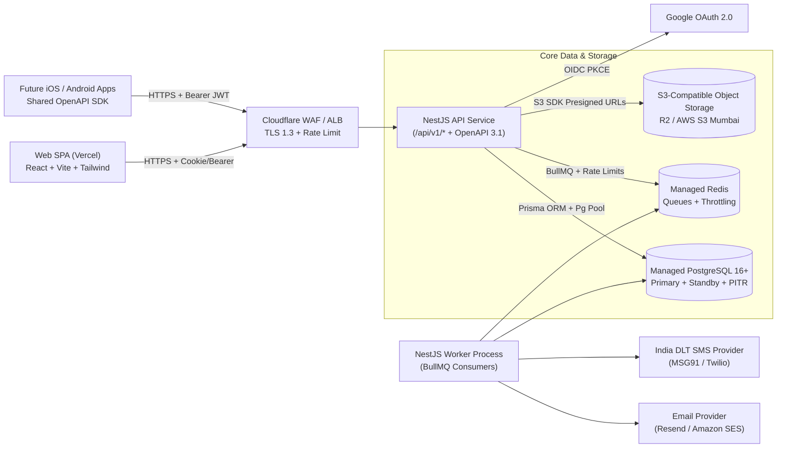

# AASHVO — Independent Backend Architecture (NestJS + PostgreSQL + Prisma)

**Document Status:** CTO Architecture Blueprint (Planning Phase Only)  
**Target Runtime:** Node.js 22 LTS + NestJS 11 + TypeScript (Strict) + Prisma ORM + PostgreSQL 16+  
**Primary Clients:** Existing React + Vite + Tailwind Web SPA (`https://aashvo.vercel.app/`) and future iOS / Android Native Apps  
**Skills Applied:** `architecture-review`, `api-and-interface-design`, `api-designer`, `openapi-spec-generator`, `cc-skill-backend-patterns`, `api-security`, `audit-logging`, `observability-and-instrumentation`, `frontend-data-contracts`

---

## 1. Architectural Principles & Topology

### 1.1 Why a Modular Monolith First
AASHVO is migrating from Supabase (PostgREST + GoTrue + RLS + Triggers) to an owned backend without losing ACID guarantees across closely coupled entities (`users` ↔ `profiles` ↔ `properties` ↔ `interest_requests` ↔ `tenancy_agreements` ↔ `rental_disputes` ↔ `audit_logs`).

A **NestJS Modular Monolith** deployed as stateless containers (with a separate worker process option using the exact same codebase) is the optimal architecture:
- **Single ACID database (`PostgreSQL 16+`)** with Prisma transactions replacing cross-table SQL triggers (`enforce_inquiry_prerequisites`, `enforce_tenancy_parties_integrity`, etc.).
- **Strict module encapsulation:** Modules communicate only through exported service facades or domain events — never directly querying another module's internal Prisma tables across boundaries without explicit contracts.
- **Independent scalability path:** Heavy async I/O (transactional emails, SMS OTPs, media virus/metadata processing, scheduled availability freshness checks) executes via BullMQ workers backed by Redis + PostgreSQL `notification_outbox`.

### 1.2 System Topology Diagram



---

## 2. NestJS Application Structure & All 16 Domain Modules

Proposed directory layout for the future standalone backend service (`apps/api` or `aashvo-api` repository — **do not scaffold until implementation sprint begins**):

```text
src/
├── main.ts                         # Bootstrap: Helmet, CookieParser, CORS, ValidationPipe, OpenAPI
├── app.module.ts                   # Root composition + global APP_GUARD / APP_INTERCEPTOR / APP_FILTER
├── common/                         # Zero-domain shared primitives
│   ├── decorators/                 # @Public(), @Roles(), @CurrentUser(), @Idempotent()
│   ├── dto/                        # PageQueryDto, ApiResponse<T>, ApiErrorResponse
│   ├── filters/                    # GlobalExceptionFilter (Prisma P2002/P2003/P2025 -> HTTP 409/400/404)
│   ├── guards/                     # JwtAuthGuard (default-deny), RolesGuard
│   ├── interceptors/               # RequestIdInterceptor, ResponseEnvelopeInterceptor, AuditInterceptor
│   ├── pipes/                      # Strict Zod / class-validator DTO pipes
│   └── utils/                      # Crypto, Indian phone normalization, geo distance, masking
├── infrastructure/                 # Core technical modules
│   ├── config/                     # Typed env schema validation (fail-fast on boot)
│   ├── prisma/                     # PrismaService + transaction helper + slow query hook
│   ├── redis/                      # Redis client + ThrottlerStorage + BullMQ connection
│   ├── observability/              # Pino JSON logger (PII redaction), OpenTelemetry, Prometheus metrics
│   └── health/                     # /health/live (process) & /health/ready (PG + Redis ping)
└── modules/                        # 16 Domain Modules (strict DAG dependencies)
    ├── auth/                       # 1. AuthModule
    ├── users/                      # 2. UsersModule
    ├── profiles/                   # 3. ProfilesModule
    ├── locations/                  # 4. LocationsModule
    ├── properties/                 # 5. PropertiesModule
    ├── flatmates/                  # 6. FlatmatesModule
    ├── family-stays/               # 7. FamilyStaysModule
    ├── inquiries/                  # 8. InquiriesModule
    ├── media/                      # 9. MediaModule
    ├── tenancy/                    # 10. TenancyModule
    ├── rental-trust/               # 11. RentalTrustModule
    ├── support/                    # 12. SupportModule
    ├── safety/                     # 13. SafetyModule
    ├── admin/                      # 14. AdminModule
    ├── notifications/              # 15. NotificationsModule
    └── audit/                      # 16. AuditModule
```

### 2.1 Detailed Responsibility Matrix for All 16 Modules

| # | Module | Owned Tables / Concepts | Core Responsibilities | Explicitly Replaced Supabase Mechanism |
|---|---|---|---|---|
| 1 | `AuthModule` | `users`, `oauth_identities`, `refresh_sessions`, `verification_tokens`, `phone_otp_challenges` | Email/password Argon2id auth, JWT access tokens, rotating refresh sessions, Google OAuth2 PKCE, email verification, password reset, DLT India SMS OTP (`+91` `[6-9]\d{9}`). | GoTrue (`auth.users`, `auth.identities`) + simulated `requestPhoneOtp`/`verifyPhoneOtp` (`authService.ts:404-493`) |
| 2 | `UsersModule` | `users` | Account status (`active`/`suspended`/`deleted_pending`), role reads, admin role assignment, DPDP 30-day account deletion workflow. | `auth.users` admin API + `enforce_profile_role_integrity()` |
| 3 | `ProfilesModule` | `profiles` | Verified user display name, avatar, phone mask, `phoneVerified` / `emailVerified` / `idVerified` read & strict sanitized updates, public masked projection (`PublicProfileDto`). | `public.profiles`, `public_profiles` view, `handle_new_user()`, `enforce_verification_integrity()` |
| 4 | `LocationsModule` | Reference metro/city/locality metadata & geo utils | Pan-India city normalization (`Delhi`, `Gurugram`, `Bengaluru`, `Mumbai`, etc.), pincode validation, Haversine distance (`calculateGeoDistanceKm`), coarse public address masking (`maskAddressForPublicView`). | Client-side `marketplaceService.ts` helpers + static city lists |
| 5 | `PropertiesModule` | `properties`, `property_photos` | Listing CRUD (`flats_rooms` & base property ops), public filtered feed (excludes `owner_id` & exact address unless unlocked), owner dashboard feed, availability freshness check (`lastAvailabilityCheck`). | `public.properties`, `public.property_photos`, `public.public_properties` view, `enforce_property_moderation_integrity()` |
| 6 | `FlatmatesModule` | `flatmate_profiles` | 1:1 per user flatmate discovery feed (`public_flatmates` projection), user profile upsert, rule-based lifestyle compatibility scoring (`calculateFlatmateCompatibility`). | `public.flatmate_profiles`, `public.public_flatmates` view, `enforce_flatmate_verification_integrity()` |
| 7 | `FamilyStaysModule` | Domain specialization over `properties` (`category = 'family_stays'`) | Enforces Family Stay eligibility (`providerType === 'owner'`, `familyLivesOnProperty === true`, explicit `mealsOffered` & `optionalMealCost` validation), dedicated search/move-in cost projection. | `chk_family_stay_eligibility` + `marketplaceService.ts` + `formatters.ts:calculateMoveInCost` |
| 8 | `InquiriesModule` | `interest_requests` | Tenant-to-listing and flatmate-to-flatmate connection requests; enforces verified email + host/sender phone prerequisite checks; handles `accepted`/`declined` status transitions & selective phone unlock. | `public.interest_requests` + `enforce_inquiry_prerequisites()` + RLS counterparty SELECT/UPDATE |
| 9 | `MediaModule` | `media_assets` | Bucket-scoped S3/R2 presigned upload generation, magic-byte & size validation, orphan media garbage collection, short-TTL signed download authorization for private `support-attachments` and `rental-documents`. | Supabase Storage 4 buckets + `storage.objects` RLS + `storageService.ts` |
| 10 | `TenancyModule` | `tenancy_agreements`, `rent_payment_records` | Agreement creation/lifecycle (`draft` → `active` → `terminated`/`expired`), landlord/tenant distinct party checks, rent/deposit ledger recording, landlord confirmation/rejection. | `tenancy_agreements`, `rent_payment_records`, `enforce_tenancy_parties_integrity()`, `enforce_payment_verification_integrity()` |
| 11 | `RentalTrustModule` | `property_inspections`, `tenancy_reviews`, `rental_disputes` | Move-in/periodic/move-out condition logs + counterparty acknowledgment, one-review-per-party-per-agreement public reputation scoring, itemized dispute filing (`ASH-DSP-XXXX`) & moderator resolution. | `property_inspections`, `tenancy_reviews`, `rental_disputes`, `enforce_review_eligibility()`, `enforce_dispute_integrity()` |
| 12 | `SupportModule` | `support_tickets`, `ticket_messages`, `ticket_audit_events` | Authenticated & guest (`ASH-TKT-XXXXXX`) support tickets, strict state machine (`VALID_STATUS_TRANSITIONS`), internal staff note isolation (`isInternal = false` stripped outside staff roles). | `support_tickets`, `ticket_messages`, `ticket_audit_events`, RPCs `lookup_support_ticket`, `create_guest_support_ticket`, `add_guest_ticket_reply` |
| 13 | `SafetyModule` | `safety_reports`, `listing_reports` (archived) | Confidential safety reporting against listings/flatmates/users, duplicate detection, keyword-driven severity triage (`high`/`medium`/`low`), strict concealment from reported target. | `safety_reports` + `listing_reports` + `getReportPriorityAndLabel()` |
| 14 | `AdminModule` | Orchestration facade over Users, Properties, Support, Safety, RentalTrust | Admin moderation queue for pending listings (`active`/`rejected`), safety report resolution/listing suspension, support ticket triage & assignment, KYC `idVerified` verification, dispute adjudication. | `is_admin()`, `is_support_admin()`, `AdminModerationModal.tsx` multi-table queries |
| 15 | `NotificationsModule` | `notification_outbox` + BullMQ queues | Reliable outbox-to-queue dispatch for verification emails, password resets, SMS OTPs, inquiry alerts, support ticket updates, and safety triage notifications (zero secret logging). | Supabase GoTrue emails + `dispatchSupportNotification()` placeholder |
| 16 | `AuditModule` | `audit_logs` (append-only) | Tamper-evident security & business audit trail (login/OAuth/session events, role changes, moderation decisions, dispute resolutions, private file signed-URL grants). | Partial (`ticket_audit_events` only; previously missing platform-wide) |

### 2.2 Directed Acyclic Dependency Graph (Zero Circular Dependencies)

```text
Layer 0 (Cross-cutting, injected anywhere via Global Modules):
  ConfigModule, PrismaModule, RedisModule, AuditModule, ObservabilityModule

Layer 1 (Identity & Primitives — depend only on Layer 0):
  UsersModule, LocationsModule, NotificationsModule, MediaModule

Layer 2 (Auth & Profiles — depend on Layer 0-1):
  ProfilesModule  --> UsersModule
  AuthModule      --> UsersModule, ProfilesModule, NotificationsModule

Layer 3 (Core Marketplace — depend on Layer 0-2):
  PropertiesModule   --> ProfilesModule, LocationsModule, MediaModule
  FamilyStaysModule  --> PropertiesModule
  FlatmatesModule    --> ProfilesModule, LocationsModule
  InquiriesModule    --> ProfilesModule, PropertiesModule, FlatmatesModule, NotificationsModule

Layer 4 (Trust, Tenancy & Support — depend on Layer 0-3):
  TenancyModule      --> ProfilesModule, PropertiesModule, MediaModule, NotificationsModule
  RentalTrustModule  --> TenancyModule, ProfilesModule, MediaModule, NotificationsModule
  SupportModule      --> ProfilesModule, PropertiesModule, MediaModule, NotificationsModule
  SafetyModule       --> ProfilesModule, PropertiesModule, FlatmatesModule, MediaModule, NotificationsModule

Layer 5 (Staff Orchestration — depends on Layer 0-4; nothing depends on AdminModule):
  AdminModule        --> UsersModule, ProfilesModule, PropertiesModule, SafetyModule, SupportModule, RentalTrustModule, NotificationsModule
```

*Rule:* **No lower layer may import a higher layer**, and sibling modules communicate via exported NestJS service interfaces (e.g., `TenancyModule` calls `PropertiesModule.assertPropertyExistsForTenancy()` instead of accessing `properties` directly across service boundaries).

---

## 3. Standardized API Conventions & Envelopes

Applied directly from `api-and-interface-design`, `api-designer`, `openapi-spec-generator`, and `frontend-data-contracts`:

### 3.1 Versioning & Base URL
- Production base URL: `https://api.aashvo.in/api/v1` (configured behind Cloudflare / ALB; health probes at `/health/live`, `/health/ready`, OpenAPI JSON at `/api/docs-json` disabled or internal-protected in production if desired, enabled in staging).
- All payloads use **strict `camelCase`** JSON matching TypeScript contracts (`src/types/index.ts`, `src/types/rentalTrust.ts`). Snake-case DB columns stay confined inside Prisma/repository mappers on the server.

### 3.2 Success & Pagination Envelope
Single resource (`200 OK`, `201 Created`):
```json
{
  "data": { "id": "uuid", "..." : "..." },
  "meta": {
    "requestId": "req_01J...",
    "timestamp": "2026-11-12T15:00:00.000Z"
  }
}
```

Collection (`200 OK`):
```json
{
  "data": [ ... ],
  "pagination": {
    "total": 142,
    "page": 1,
    "limit": 20,
    "totalPages": 8,
    "hasNext": true
  },
  "meta": {
    "requestId": "req_01J...",
    "timestamp": "2026-11-12T15:00:00.000Z"
  }
}
```

### 3.3 Standardized Error Envelope
All `4xx`/`5xx` errors pass through `GlobalExceptionFilter`:
```json
{
  "error": {
    "code": "INQUIRY_PHONE_VERIFICATION_REQUIRED",
    "message": "Verify your Indian mobile number before sending a listing inquiry.",
    "details": { "missingRequirements": ["phone_verified"] },
    "requestId": "req_01J...",
    "timestamp": "2026-11-12T15:00:00.000Z"
  }
}
```
- **Error hygiene:** Never leak stack traces, Prisma SQL text, Postgres constraint names, or whether an email exists during login/forgot-password.
- **Idempotency:** `Idempotency-Key` header (UUIDv4, cached 24h in Redis keyed by `(userId/ip, method, path, key)`) supported on `POST /inquiries`, `POST /support/tickets`, `POST /safety/reports`, `POST /tenancy/agreements`, `POST /tenancy/agreements/:id/payments`, and `POST /rental-trust/disputes`.

---

## 4. Complete `/api/v1/*` Endpoint Catalog

*(Default security: **Authenticated Bearer JWT** unless marked `Public` or `Admin/Support`)*

### 4.1 Authentication & Sessions (`AuthModule`)
| Method & Path | Auth | Purpose |
|---|---|---|
| `POST /api/v1/auth/register` | Public | Create email/password account, dispatch verification email (`201`). |
| `POST /api/v1/auth/login` | Public | Verify password (Argon2id / bcrypt-upgrade), issue access JWT + refresh cookie/token (`200`). |
| `POST /api/v1/auth/refresh` | Cookie / Refresh Body | Rotate opaque refresh token & detect family reuse (`200`). |
| `POST /api/v1/auth/logout` | Auth / Cookie | Revoke current refresh family & clear web cookies (`204`). |
| `POST /api/v1/auth/logout-all` | Auth | Revoke all active refresh families for user (`204`). |
| `POST /api/v1/auth/verify-email` | Public | Consume single-use hashed email token (`200`). |
| `POST /api/v1/auth/resend-verification` | Public (strict rate limit) | Re-send verification email without user enumeration (`202`). |
| `POST /api/v1/auth/forgot-password` | Public (strict rate limit) | Issue 30m reset link (`202`, constant generic response). |
| `POST /api/v1/auth/reset-password` | Public | Validate reset token, set Argon2id password, revoke ALL sessions (`200`). |
| `POST /api/v1/auth/change-password` | Auth | Verify current password, update hash, revoke sibling sessions (`200`). |
| `GET /api/v1/auth/oauth/google` | Public | Generate server state + PKCE challenge, redirect to Google OAuth (`302`). |
| `GET /api/v1/auth/oauth/google/callback` | Public | Exchange code + verify ID token + `state` + `email_verified`, establish session (`302`). |
| `POST /api/v1/auth/oauth/exchange` | Public | Exchange one-time opaque handoff code for web/mobile token pair (`200`). |
| `POST /api/v1/auth/phone/send-otp` | Auth | Rate-limited DLT India SMS OTP dispatch (60s cooldown, 4/hr cap) (`202`). |
| `POST /api/v1/auth/phone/verify-otp` | Auth | Verify 6-digit hashed OTP (max 5 attempts, 10m TTL), set `phoneVerified=true` (`200`). |
| `GET /api/v1/auth/me` | Auth | Authoritative current `User` + `Profile` state (`200`). |

### 4.2 Profiles & Locations (`ProfilesModule`, `LocationsModule`)
| Method & Path | Auth | Purpose |
|---|---|---|
| `GET /api/v1/profiles/me` | Auth | Full private profile of authenticated user (`200`). |
| `PATCH /api/v1/profiles/me` | Auth | Update allowed fields (`fullName`, `avatarUrl`, `bio`, `phoneNumber` if unverified); rejects `role`/`*Verified` (`403`/`422`). |
| `DELETE /api/v1/profiles/me` | Auth | Initiate DPDP Act 2023 account deletion / 30-day PII purge (`202`). |
| `GET /api/v1/profiles/:id/public` | Public | Masked public card (`PublicProfileDto`: no email, no raw phone) (`200`). |
| `GET /api/v1/locations/cities` | Public | Supported Pan-India cities & locality metadata (`200`). |

### 4.3 Properties & Family Stays (`PropertiesModule`, `FamilyStaysModule`)
| Method & Path | Auth | Purpose |
|---|---|---|
| `GET /api/v1/properties` | Public | Filtered paginated active `public_properties` equivalent (supports `category`, `city`, `locality`, `roomType`, `minRent`, `maxRent`, `genderPreference`, `furnishing`, `noBrokerage`, `lat/lng/radiusKm`). |
| `GET /api/v1/properties/:id` | Public (optional Auth) | Masked listing detail; unlocks full owner phone ONLY if caller is owner, admin, or has an `accepted` inquiry. |
| `GET /api/v1/properties/mine` | Auth | Caller's own listings across all moderation statuses (`200`). |
| `POST /api/v1/properties` | Auth (`emailVerified` + `phoneVerified`) | Atomic `$transaction` creating listing in `pending_review` + `property_photos` rows (`201`). |
| `PATCH /api/v1/properties/:id` | Owner | Update own listing; material content edits return status to `pending_review` unless pause/rented toggle (`200`). |
| `PATCH /api/v1/properties/:id/status` | Owner (`paused`/`rented`/`active` if previously approved) | Host availability toggle (`200`). |
| `POST /api/v1/properties/:id/verify-availability` | Owner | Refresh `lastAvailabilityCheck` timestamp (`200`). |
| `DELETE /api/v1/properties/:id` | Owner / Admin | Soft-delete or cascade delete draft/listing & enqueue media cleanup (`204`). |
| `GET /api/v1/family-stays` | Public | Specialized Family Stays search enforcing meal/host transparency (`200`). |
| `POST /api/v1/family-stays` | Auth (`emailVerified` + `phoneVerified`) | Enforces `providerType='owner'`, `familyLivesOnProperty=true`, `mealsOffered` declaration (`201`). |

### 4.4 Flatmates & Inquiries (`FlatmatesModule`, `InquiriesModule`)
| Method & Path | Auth | Purpose |
|---|---|---|
| `GET /api/v1/flatmates` | Public | Active public flatmate discovery (`public_flatmates` parity, no private email/phone). |
| `GET /api/v1/flatmates/me` | Auth | Caller's own flatmate profile (`200`). |
| `PUT /api/v1/flatmates/me` | Auth (`emailVerified`) | Idempotent upsert (1:1 `userId`); server calculates `verified` flag from user verification (`200`). |
| `POST /api/v1/flatmates/:id/compatibility` | Auth | Server-validated lifestyle compatibility breakdown against caller profile (`200`). |
| `POST /api/v1/inquiries` | Auth (`emailVerified` + policy `phoneVerified`) | Submit listing inquiry or flatmate connect request (exactly one target, no self-inquiry) (`201`). |
| `GET /api/v1/inquiries/sent` | Auth | Inquiries created by caller (`200`). |
| `GET /api/v1/inquiries/received` | Auth | Inquiries targeting caller's properties or flatmate profile (`200`). |
| `PATCH /api/v1/inquiries/:id/status` | Target Owner / Flatmate | Transition `pending` → `accepted` or `declined` (`200`). |

### 4.5 Media & Presigned Storage (`MediaModule`)
| Method & Path | Auth | Purpose |
|---|---|---|
| `POST /api/v1/media/presign-upload` | Auth | Validates bucket (`property-photos`, `user-avatars`, `support-attachments`, `rental-documents`) or guest support ticket token, MIME type, byte size ceiling; returns `mediaId` + 5m S3/R2 presigned PUT (`201`). |
| `POST /api/v1/media/:id/confirm` | Auth | Verifies uploaded object existence, content-length, magic bytes (`file-type`), SHA-256 hash (`200`). |
| `POST /api/v1/media/:id/presign-download` | Auth (or Guest Ticket Auth) | Checks private object authorization (uploader, tenancy counterparty, or admin) & issues 15m presigned GET URL (`200`). |
| `DELETE /api/v1/media/:id` | Owner / Admin | Deletes storage object & marks `media_assets` deleted (`204`). |

### 4.6 Tenancy & Rental Trust (`TenancyModule`, `RentalTrustModule`)
| Method & Path | Auth (Agreement Parties or Admin) | Purpose |
|---|---|---|
| `GET /api/v1/tenancy/agreements` | Auth | Caller's agreements (`landlordId` or `tenantId`) (`200`). |
| `POST /api/v1/tenancy/agreements` | Auth (`emailVerified` + `phoneVerified`) | Create agreement (`landlordId !== tenantId`, valid date range) (`201`). |
| `PATCH /api/v1/tenancy/agreements/:id/status` | Counterparty / Admin | Controlled status transitions (`draft` → `active` → `terminated`/`expired`). |
| `GET /api/v1/tenancy/agreements/:id/payments` | Party / Admin | Rent & deposit payment ledger (`200`). |
| `POST /api/v1/tenancy/agreements/:id/payments` | Party | Record rent/deposit payment (`pending_confirmation`) (`201`). |
| `PATCH /api/v1/tenancy/payments/:paymentId/verify` | Landlord / Recipient | Transition `pending_confirmation` → `confirmed_by_landlord` or `disputed` (`200`). |
| `GET /api/v1/rental-trust/agreements/:id/inspections` | Party / Admin | Condition logs for agreement (`200`). |
| `POST /api/v1/rental-trust/agreements/:id/inspections` | Party | Submit inspection log & evidence photos (`201`). |
| `POST /api/v1/rental-trust/inspections/:inspectionId/acknowledge` | Counterparty (non-author) | Mutual acknowledgment stamp (`200`). |
| `GET /api/v1/rental-trust/agreements/:id/reviews` | Public (if `isPublic` & `approved`) / Party | Mutual tenancy reviews (`200`). |
| `POST /api/v1/rental-trust/agreements/:id/reviews` | Party | Submit once per `(agreementId, reviewerId)` for non-draft agreement (`201`). |
| `GET /api/v1/rental-trust/agreements/:id/disputes` | Party / Admin | Disputes linked to agreement (`200`). |
| `POST /api/v1/rental-trust/agreements/:id/disputes` | Party | File `ASH-DSP-XXXXXX` dispute (max 1 open/under_review per `(agreementId, type)`) (`201`). |

### 4.7 Support, Safety & Admin (`SupportModule`, `SafetyModule`, `AdminModule`)
| Method & Path | Auth | Purpose |
|---|---|---|
| `POST /api/v1/support/tickets` | Optional Auth | Authenticated or Guest ticket (`ASH-TKT-XXXXXX` returned; guest receives short-lived ticket lookup receipt token). |
| `POST /api/v1/support/tickets/guest-lookup` | Public (rate-limited) | Replaces `lookup_support_ticket` RPC; requires `ticketNumber` + `email` exact match; strips `isInternal` messages & `auditEvents` (`200`). |
| `GET /api/v1/support/tickets/mine` | Auth | Authenticated user's tickets (sanitized) (`200`). |
| `POST /api/v1/support/tickets/:id/messages` | Owner / Support / Guest Receipt | Append reply; non-staff `isInternal` forced `false` (`201`). |
| `POST /api/v1/safety/reports` | Auth | Submit confidential safety report against listing/flatmate/user; calculates initial priority server-side; hidden from reported party (`201`). |
| `GET /api/v1/admin/properties` | `Admin` | All properties across all statuses for moderation queue (`200`). |
| `PATCH /api/v1/admin/properties/:id/moderation` | `Admin` | Approve (`active`) or reject (`rejected`) with mandatory reason & audit entry (`200`). |
| `GET /api/v1/admin/safety-reports` | `Admin` | Safety reports queue with target metadata (`200`). |
| `PATCH /api/v1/admin/safety-reports/:id` | `Admin` | Investigating / resolved / dismissed + optional target listing suspension (`200`). |
| `GET /api/v1/admin/support-tickets` | `Admin` / Support | Full ticket queue including internal notes & audit events (`200`). |
| `PATCH /api/v1/admin/support-tickets/:id` | `Admin` / Support | Transition status (`VALID_STATUS_TRANSITIONS`), priority, assignee (`200`). |
| `PATCH /api/v1/admin/users/:id/verification` | `Admin` | Grant/revoke `idVerified` or `accountStatus` (`active`/`suspended`) with audit log (`200`). |
| `PATCH /api/v1/admin/disputes/:id` | `Admin` | Assign moderator & adjudicate `resolved_tenant`/`resolved_landlord`/`dismissed` (`200`). |

---

## 5. Authorization, Validation & Operations Cross-Cutting Layers

### 5.1 Replacing PostgreSQL RLS with Explicit Defense-in-Depth Guards
Instead of implicit `auth.uid()` database row filters:
1. **`JwtAuthGuard` registered globally as `APP_GUARD`:** Every new endpoint is authenticated-by-default. Unauthenticated endpoints require explicit `@Public()`.
2. **`RolesGuard`:** Checks authoritative `user.role` & `user.accountStatus === 'active'` from database/short-TTL Redis cache (rejects suspended accounts immediately even before 15m JWT expiry).
3. **Domain Ownership & Counterparty Services/Guards:**
   - Every single-record read/write passes `(recordId, currentUser)` into a domain authorization helper (e.g., `assertAgreementParticipant(agreement, user.id)` or `assertInquiryTargetOwner(inquiry, user.id)`), returning **404 or 403** without revealing protected existence across accounts.
   - Public catalog queries (`GET /properties`, `GET /flatmates`) select from curated public projection DTOs (`PublicPropertyDto`, `PublicFlatmateDto`) that **physically cannot serialize** `ownerId`, `addressShort` exact house numbers, or raw owner phones.

### 5.2 Multi-Layer Rate Limiting & Security Hardening
- **Helmet** HTTP security headers + strict CORS allowlist (`https://aashvo.vercel.app`, `https://aashvo.in`, configured preview patterns).
- **`@nestjs/throttler` backed by Redis:**
  - Global baseline: `120 req / min / IP`
  - Login / Register / Forgot Password: `10 req / 15 min / IP` + progressive account lockout backoff
  - SMS OTP send: `1 req / 60s` and `4 req / hour` per mobile number & IP
  - Guest ticket lookup: `10 req / 15 min / IP` + `ticketNumber` enumeration delay
- **Observability & Audit:** Every HTTP request gets `X-Request-ID`, Pino structured JSON logging with automatic redaction (`password`, `token`, `otp`, `cookie`, `authorization`, raw Aadhaar/PAN IDs), OpenTelemetry HTTP+Prisma spans, Prometheus `/metrics` (internal network only), and immutable `audit_logs` writes inside the same DB transaction for critical admin/security mutations.

