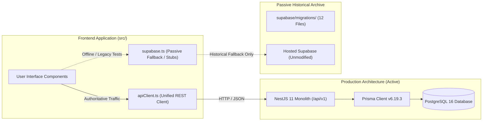

# AASHVO — LEGACY SUPABASE STATUS & DEPENDENCY AUDIT
## Comprehensive Investigation, Classification & Decoupling Strategy

**Document Status:** Approved & Final  
**Classification:** Migration & Architecture Decoupling  
**Date:** November 2026  
**Auditor:** AASHVO Principal Software Architect & Repository Maintainer  
**Release Candidate:** RC-1.0.0  
**Target Runtime:** Independent NestJS 11 + PostgreSQL 16 + Prisma ORM (`apps/api`)  
**Legacy Reference:** Hosted Supabase Project Ref `himtwnwxvnnykafyhysy` (Mumbai, `ap-south-1`)  

---

## 1. Executive Summary & Policy

AASHVO was originally prototyped using Supabase for authentication, database access (PostgREST), and file storage. In accordance with strategic CTO directives, the application has transitioned to an **independent production backend**:
- **API Monolith:** NestJS 11 (`apps/api`) serving REST endpoints under `/api/v1`.
- **Database Engine:** PostgreSQL 16 managed via Prisma ORM (`prisma/schema.prisma`).
- **Object Storage:** Unified multi-cloud `StorageService` using Cloudflare R2 (public photos) and AWS S3 Mumbai (encrypted private KYC).

> [!IMPORTANT]
> **SAFETY & ROLLBACK POLICY:**
> 1. **Hosted Project Untouched:** The hosted Supabase project (`himtwnwxvnnykafyhysy`) is **NOT modified, deleted, or de-provisioned**.
> 2. **Migrations Preserved:** The `supabase/migrations/` directory is **strictly preserved in its entirety** (12 historical migration files) as an authoritative disaster recovery reference and audit trail.
> 3. **Independent Runtime Traffic:** The primary runtime path does not rely on Supabase. All user-facing features (properties, Connect swipe deck, inquiries, visits, move-in checklists, support tickets, admin moderation) communicate with the NestJS API.

---

## 2. Exhaustive Classification of Supabase References

Every Supabase asset and reference has been audited and classified into five formal categories:

| Category | Definition | Application Scope |
| :--- | :--- | :--- |
| **Category 1: Active Runtime Usage** | Fallback / graceful degradation shims | In `src/services/supabase.ts`, initializes only if `VITE_SUPABASE_URL` is configured; primary runtime traffic routes through `apiClient.ts` to NestJS. |
| **Category 2: Testing Usage** | Test suites validating mappers and offline handling | `src/test/supabaseBackendIntegration.test.ts`, `src/test/realAuthenticationRepair.test.ts`, `src/test/gotrueTrustBoundaryE2E.test.ts` verify data mappers and graceful degradation. |
| **Category 3: Legacy Migration History** | Historical DDL, RLS policies, RPC functions | `supabase/migrations/*.sql` (12 files) strictly preserved in repository. |
| **Category 4: Rollback Reference** | Configuration and schema definitions for recovery | `supabase/config.toml` preserved for local Supabase CLI fallback if emergency rollback is required. |
| **Category 5: Unused References (Removed)** | Ephemeral caches and redundant files | Removed `.temp/`, `.branches/`, `snippets/`, and temporary backup files during repository cleanup. |

---

## 3. Inventory of Supabase Assets

### 3.1 Migration History (`supabase/migrations/`) — PRESERVED
The following 12 migration files represent the complete evolutionary schema of the initial prototype:
1. `20261018000000_initial_schema.sql` (Initial tables, enums, and RLS)
2. `20261019000000_security_fixes.sql` (RLS hardening and security policies)
3. `20261020000000_nationwide_auth_and_family_stays.sql` (Multi-city expansion and Family Stays)
4. `20261021000000_help_and_support_system.sql` (Support tickets, audit events)
5. `20261022000000_auth_profile_trigger_and_insert_policy.sql` (Auth triggers)
6. `20261023000000_rental_agreements_and_tenancy_records.sql` (Agreements and tenancies)
7. `20261024000000_rental_reputation_and_disputes.sql` (Dispute management and reputation)
8. `20261025000000_rental_storage_counterparty_access.sql` (Storage security policies)
9. `20261026000000_flatmate_profiles_rls_and_anti_forgery.sql` (Flatmate RLS anti-forgery)
10. `20261027000000_repair_missing_tenancy_agreements.sql` (Tenancy reconciliation)
11. `20261027100000_backend_contract_reconciliation.sql` (Contract alignment)
12. `20261112000000_audit_remediation_and_rls_fixes.sql` (Pre-migration audit fixes)

### 3.2 Root Dependencies (`package.json`)
- `@supabase/supabase-js: ^2.118.0` is maintained in root `package.json` to satisfy TypeScript types and imports for legacy testing and adapter code.
- Notice: `apps/api/package.json` does **not** include `@supabase/supabase-js`. The NestJS backend is 100% independent of Supabase.

### 3.3 Client Services (`src/services/`)
- `src/services/apiClient.ts`: Authoritative REST client targeting NestJS `/api/v1`.
- `src/services/supabase.ts`: Maintained as a passive fallback adapter. When `VITE_SUPABASE_URL` is not set, it safely returns offline stubs without throwing unhandled exceptions.

---

## 4. Decoupling Architecture Diagram

---

## 5. Decommissioning & Rollback Roadmap

1. **Staging Verification:** The independent architecture is verified under staging workloads with automated integration suites.
2. **Data Export:** Complete database dump from hosted Supabase archived to secure S3 bucket before production cutover.
3. **DNS Cutover:** Point all client traffic directly to the independent NestJS API.
4. **Final Decommissioning:** After 60 days of stable production operation with zero incidents, the hosted Supabase project can be cleanly shut down per CTO authorization.
