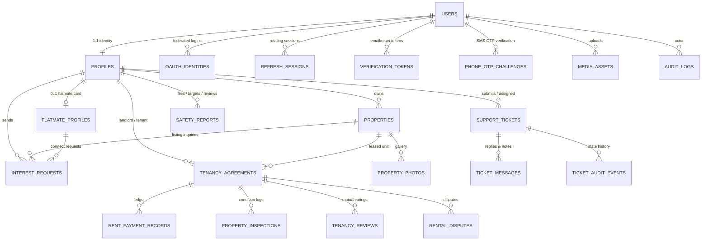

# AASHVO — PostgreSQL Database Design & Prisma Schema

**Database Engine:** PostgreSQL 16+ (Managed RDS / DigitalOcean / Neon)  
**ORM:** Prisma 6 (`prisma/schema.prisma` + versioned raw SQL constraint migrations)  
**Primary Identity Preservation:** Every migrated `users.id` and `profiles.id` preserves the exact existing Supabase `auth.users.id` UUID.  
**Skills Applied:** `supabase-postgres-best-practices`, `postgresql-devsec`, `database-security`, `frontend-data-contracts`

---

## 1. Schema Evolution & Normalization Decisions

### 1.1 Identity Split (`users` vs `profiles`)
Supabase stores credentials and OAuth links inside an opaque `auth.users` / `auth.identities` schema inaccessible to standard ORM queries, causing `support_tickets`, `ticket_messages`, and `safety_reports` to reference `auth.users(id)` while marketplace tables reference `public.profiles(id)`.
In the independent database:
- **`users`** (`public.users`): Owns authentication credentials (`password_hash`), account lifecycle (`account_status`: `active` | `suspended` | `deleted_pending`), authoritative authorization role (`role`: `renter` | `owner` | `broker` | `admin`), `deleted_at`, and `last_login_at`.
- **`profiles`** (`public.profiles`): Shares a **1:1 primary key (`profiles.id` FK → `users.id`)** using the exact preserved UUID. Holds public/marketplace identity (`full_name`, `phone_number`, `avatar_url`, `bio`, verification booleans `email_verified`, `phone_verified`, `id_verified`).
- **Result:** Zero dual-schema joins, every foreign key across all 23 tables resides cleanly inside `public` (or segregated `app` schema), and DPDP Act 2023 soft-deletion/anonymization operates deterministically.

### 1.2 Contract & Drift Fixes Identified During Phase 1 Audit
| Observed Drift in Existing Code / Migrations | Resolution in Target PostgreSQL + Prisma Schema |
|---|---|
| `src/types/index.ts:45` and `src/services/supabase.ts:114` read `featured` boolean, absent from `properties` table. | Add `featured BOOLEAN NOT NULL DEFAULT false` + partial index `WHERE status = 'active' AND featured = true`. |
| `support_tickets.user_id`, `ticket_messages.sender_id`, `safety_reports.reporter_id` pointed to `auth.users(id)` instead of `profiles(id)`. | Retarget all three FKs to `users(id)` (`ON DELETE SET NULL`), preserving `auth.users.id` UUIDs during migration. |
| `supabase.ts:175` leaves `assignedToName` undefined; `safety_reports` lacks `reporterName`. | Project `assignedToProfile.fullName` and `reporter.profile.fullName` via clean Prisma relation selects; keep raw PII off non-admin DTOs. |
| `flatmate_profiles.user_id` lacked `UNIQUE` until `20261112000000_audit_remediation_and_rls_fixes.sql`. | Enforce `user_id UUID UNIQUE NOT NULL` directly on `flatmate_profiles`. |
| `listing_reports` table in `20261018000000` is unused by current `src/services/*` (replaced by `safety_reports`). | Migrate historical rows into `listing_reports` archive table; deprecate writes and expose unified admin read view if records exist. |
| `media_assets` metadata did not exist (only URL strings stored in `property_photos.photo_url`, `avatar_url`, JSONB attachments). | Introduce `media_assets` table tracking `(bucket, object_key, owner_id, mime_type, size_bytes, sha256, status)` to authorize private downloads cleanly. |

---

## 2. Entity Relationship Diagram



---

## 3. Complete `prisma/schema.prisma` Specification

> **Constraint Note:** Prisma 6 handles tables, enums, relations, defaults, unique constraints, and B-tree indexes natively. PostgreSQL-specific `CHECK (...)` constraints, partial unique indexes (`WHERE status IN (...)`), and `GIN` array indexes are maintained in a co-located **custom SQL migration (`0002_postgres_checks_and_gin_indexes.sql`)** immediately after Prisma's initial schema migration.

```prisma
generator client {
  provider = "prisma-client-js"
}

datasource db {
  provider = "postgresql"
  url      = env("DATABASE_URL")
}

// ==================== ENUMS ====================

enum UserRole {
  renter
  owner
  broker
  admin

  @@map("user_role")
}

enum AccountStatus {
  active
  suspended
  deleted_pending

  @@map("account_status")
}

enum PropertyCategory {
  flats_rooms
  family_stays

  @@map("property_category")
}

enum PropertyType {
  apartment
  builder_floor
  villa
  gated_society

  @@map("property_type")
}

enum RoomType {
  private_room
  shared_room
  entire_flat

  @@map("room_type")
}

enum ProviderType {
  owner
  tenant_flatmate
  verified_manager

  @@map("provider_type")
}

enum FurnishingStatus {
  fully_furnished
  semi_furnished
  unfurnished

  @@map("furnishing_status")
}

enum GenderPreference {
  any
  female_only
  male_only

  @@map("gender_preference")
}

enum ModerationStatus {
  pending_review
  active
  paused
  rented
  rejected

  @@map("moderation_status")
}

enum MealsOffered {
  included
  optional_extra
  none

  @@map("meals_offered")
}

enum FoodHabit {
  Vegetarian
  Non_Vegetarian @map("Non-Vegetarian")
  Eggetarian
  Vegan

  @@map("food_habit")
}

enum SleepRoutine {
  Early_Bird @map("Early Bird")
  Night_Owl  @map("Night Owl")
  Flexible

  @@map("sleep_routine")
}

enum CleanlinessLevel {
  Spotless
  Moderate
  Relaxed

  @@map("cleanliness_level")
}

enum InquiryStatus {
  pending
  accepted
  declined

  @@map("inquiry_status")
}

enum TicketStatus {
  open
  in_review
  awaiting_user
  resolved
  closed

  @@map("ticket_status")
}

enum TicketPriority {
  low
  medium
  high
  urgent

  @@map("ticket_priority")
}

enum TicketSenderRole {
  user
  support
  admin

  @@map("ticket_sender_role")
}

enum SafetyTargetType {
  listing
  flatmate
  user

  @@map("safety_target_type")
}

enum SafetyReportStatus {
  pending
  investigating
  resolved
  dismissed

  @@map("safety_report_status")
}

enum AgreementStatus {
  draft
  active
  terminated
  expired

  @@map("agreement_status")
}

enum PaymentCategory {
  monthly_rent
  security_deposit
  maintenance
  utility

  @@map("payment_category")
}

enum PaymentVerificationStatus {
  pending_confirmation
  confirmed_by_landlord
  disputed

  @@map("payment_verification_status")
}

enum InspectionType {
  move_in
  periodic
  move_out

  @@map("inspection_type")
}

enum TenancyReviewerRole {
  landlord
  tenant

  @@map("tenancy_reviewer_role")
}

enum ReviewModerationStatus {
  approved
  flagged
  hidden

  @@map("review_moderation_status")
}

enum DisputeType {
  deposit_deduction
  unpaid_rent
  maintenance_responsibility
  early_termination
  other

  @@map("dispute_type")
}

enum DisputeStatus {
  open
  under_review
  resolved_tenant
  resolved_landlord
  dismissed

  @@map("dispute_status")
}

enum MediaBucket {
  property_photos     @map("property-photos")
  user_avatars        @map("user-avatars")
  support_attachments @map("support-attachments")
  rental_documents    @map("rental-documents")

  @@map("media_bucket")
}

enum MediaStatus {
  pending_upload
  verified
  deleted

  @@map("media_status")
}

enum AuthTokenPurpose {
  email_verification
  password_reset
  guest_ticket_access

  @@map("auth_token_purpose")
}

enum OutboxStatus {
  pending
  dispatched
  failed

  @@map("outbox_status")
}

// ==================== IDENTITY, AUTH & SESSIONS ====================

model User {
  id                     String        @id @default(uuid()) @db.Uuid
  email                  String        @unique @db.Citext
  passwordHash           String?       @map("password_hash")
  passwordHashAlgorithm  String?       @map("password_hash_algorithm") @db.VarChar(24) // 'argon2id' | 'bcrypt_migrated' | 'none'
  passwordResetRequired  Boolean       @default(false) @map("password_reset_required")
  role                   UserRole      @default(renter)
  accountStatus          AccountStatus @default(active) @map("account_status")
  failedLoginAttempts    Int           @default(0) @map("failed_login_attempts")
  lockedUntil            DateTime?     @map("locked_until") @db.Timestamptz(6)
  lastLoginAt            DateTime?     @map("last_login_at") @db.Timestamptz(6)
  deletedAt              DateTime?     @map("deleted_at") @db.Timestamptz(6)
  createdAt              DateTime      @default(now()) @map("created_at") @db.Timestamptz(6)
  updatedAt              DateTime      @updatedAt @map("updated_at") @db.Timestamptz(6)

  profile             Profile?
  oauthIdentities     OAuthIdentity[]
  refreshSessions     RefreshSession[]
  verificationTokens  VerificationToken[]
  phoneOtpChallenges  PhoneOtpChallenge[]
  mediaAssets         MediaAsset[]
  auditLogs           AuditLog[]
  supportTickets      SupportTicket[]      @relation("TicketAuthorUser")
  ticketMessages      TicketMessage[]
  ticketAuditEvents   TicketAuditEvent[]
  safetyReportsFiled  SafetyReport[]       @relation("SafetyReporterUser")

  @@index([accountStatus])
  @@map("users")
}

model Profile {
  id             String    @id @db.Uuid
  email          String    @unique @db.Citext
  fullName       String    @map("full_name") @db.VarChar(120)
  phoneNumber    String?   @map("phone_number") @db.VarChar(20)
  role           UserRole  @default(renter)
  bio            String?   @db.VarChar(1000)
  avatarUrl      String?   @map("avatar_url")
  emailVerified  Boolean   @default(false) @map("email_verified")
  phoneVerified  Boolean   @default(false) @map("phone_verified")
  idVerified     Boolean   @default(false) @map("id_verified")
  createdAt      DateTime  @default(now()) @map("created_at") @db.Timestamptz(6)
  updatedAt      DateTime  @updatedAt @map("updated_at") @db.Timestamptz(6)

  user                     User                  @relation(fields: [id], references: [id], onDelete: Cascade)
  properties               Property[]
  flatmateProfile          FlatmateProfile?
  sentInterestRequests     InterestRequest[]
  listingReportsFiled      ListingReport[]       @relation("ListingReporter")
  listingReportsReviewed   ListingReport[]       @relation("ListingReviewer")
  assignedSupportTickets   SupportTicket[]       @relation("TicketAssignee")
  resolvedSupportTickets   SupportTicket[]       @relation("TicketResolver")
  referencedSupportTickets SupportTicket[]       @relation("TicketReferenceUser")
  reportedInSafetyReports  SafetyReport[]        @relation("SafetyReportedUser")
  assignedSafetyReports    SafetyReport[]        @relation("SafetyAssignee")
  reviewedSafetyReports    SafetyReport[]        @relation("SafetyReviewer")
  landlordAgreements       TenancyAgreement[]    @relation("LandlordAgreements")
  tenantAgreements         TenancyAgreement[]    @relation("TenantAgreements")
  paymentsMade             RentPaymentRecord[]   @relation("PaymentPayer")
  paymentsReceived         RentPaymentRecord[]   @relation("PaymentRecipient")
  inspectionsConducted     PropertyInspection[]
  reviewsWritten           TenancyReview[]       @relation("ReviewAuthor")
  reviewsReceived          TenancyReview[]       @relation("ReviewSubject")
  disputesInitiated        RentalDispute[]       @relation("DisputeInitiator")
  disputesResponded        RentalDispute[]       @relation("DisputeRespondent")
  disputesModerated        RentalDispute[]       @relation("DisputeModerator")

  @@index([phoneNumber])
  @@map("profiles")
}

model OAuthIdentity {
  id              String    @id @default(uuid()) @db.Uuid
  userId          String    @map("user_id") @db.Uuid
  provider        String    @db.VarChar(32) // 'google'
  providerSubject String    @map("provider_subject") @db.VarChar(255)
  providerEmail   String?   @map("provider_email") @db.Citext
  emailVerified   Boolean   @default(false) @map("email_verified")
  rawClaims       Json?     @map("raw_claims")
  lastSignInAt    DateTime? @map("last_sign_in_at") @db.Timestamptz(6)
  createdAt       DateTime  @default(now()) @map("created_at") @db.Timestamptz(6)

  user User @relation(fields: [userId], references: [id], onDelete: Cascade)

  @@unique([provider, providerSubject])
  @@index([userId])
  @@map("oauth_identities")
}

model RefreshSession {
  id               String    @id @default(uuid()) @db.Uuid
  userId           String    @map("user_id") @db.Uuid
  familyId         String    @map("family_id") @db.Uuid
  tokenHash        String    @unique @map("token_hash") @db.VarChar(128)
  replacedByHash   String?   @map("replaced_by_hash") @db.VarChar(128)
  userAgent        String?   @map("user_agent") @db.VarChar(512)
  ipAddress        String?   @map("ip_address") @db.VarChar(64)
  clientPlatform   String    @default("web") @map("client_platform") @db.VarChar(24) // 'web' | 'ios' | 'android'
  expiresAt        DateTime  @map("expires_at") @db.Timestamptz(6)
  revokedAt        DateTime? @map("revoked_at") @db.Timestamptz(6)
  revokedReason    String?   @map("revoked_reason") @db.VarChar(64)
  createdAt        DateTime  @default(now()) @map("created_at") @db.Timestamptz(6)

  user User @relation(fields: [userId], references: [id], onDelete: Cascade)

  @@index([userId, revokedAt])
  @@index([familyId])
  @@index([expiresAt])
  @@map("refresh_sessions")
}

model VerificationToken {
  id         String           @id @default(uuid()) @db.Uuid
  userId     String?          @map("user_id") @db.Uuid
  email      String?          @db.Citext
  purpose    AuthTokenPurpose
  tokenHash  String           @unique @map("token_hash") @db.VarChar(128)
  expiresAt  DateTime         @map("expires_at") @db.Timestamptz(6)
  consumedAt DateTime?        @map("consumed_at") @db.Timestamptz(6)
  createdAt  DateTime         @default(now()) @map("created_at") @db.Timestamptz(6)

  user User? @relation(fields: [userId], references: [id], onDelete: Cascade)

  @@index([userId, purpose])
  @@index([expiresAt])
  @@map("verification_tokens")
}

model PhoneOtpChallenge {
  id                String    @id @default(uuid()) @db.Uuid
  userId            String    @map("user_id") @db.Uuid
  phoneNumber       String    @map("phone_number") @db.VarChar(20)
  otpHash           String    @map("otp_hash") @db.VarChar(128)
  attemptsRemaining Int       @default(5) @map("attempts_remaining")
  expiresAt         DateTime  @map("expires_at") @db.Timestamptz(6)
  verifiedAt        DateTime? @map("verified_at") @db.Timestamptz(6)
  createdAt         DateTime  @default(now()) @map("created_at") @db.Timestamptz(6)

  user User @relation(fields: [userId], references: [id], onDelete: Cascade)

  @@index([phoneNumber, createdAt])
  @@index([userId, createdAt])
  @@map("phone_otp_challenges")
}

// ==================== CORE MARKETPLACE ====================

model Property {
  id                    String           @id @default(uuid()) @db.Uuid
  ownerId               String           @map("owner_id") @db.Uuid
  title                 String           @db.VarChar(160)
  description           String
  category              PropertyCategory @default(flats_rooms)
  propertyType          PropertyType     @map("property_type")
  roomType              RoomType         @map("room_type")
  furnishing            FurnishingStatus
  locality              String           @db.VarChar(120)
  city                  String           @default("Gurugram") @db.VarChar(80)
  state                 String           @default("Haryana") @db.VarChar(80)
  pincode               String?          @db.VarChar(12)
  latitude              Decimal?         @db.Decimal(10, 7)
  longitude             Decimal?         @db.Decimal(10, 7)
  addressShort          String           @map("address_short") @db.VarChar(240)
  rentAmount            Decimal          @map("rent_amount") @db.Decimal(10, 2)
  depositAmount         Decimal          @default(0) @map("deposit_amount") @db.Decimal(10, 2)
  maintenanceCharge     Decimal          @default(0) @map("maintenance_charge") @db.Decimal(10, 2)
  electricityRatePerUnit Decimal?        @map("electricity_rate_per_unit") @db.Decimal(5, 2)
  brokerageFee          Decimal          @default(0) @map("brokerage_fee") @db.Decimal(10, 2)
  providerType          ProviderType     @map("provider_type")
  genderPreference      GenderPreference @default(any) @map("gender_preference")
  bedrooms              Int              @default(1)
  bathrooms             Int              @default(1)
  availableFrom         String           @map("available_from") @db.VarChar(80)
  amenities             String[]         @default([])
  houseRules            String[]         @default([]) @map("house_rules")
  familyLivesOnProperty Boolean          @default(false) @map("family_lives_on_property")
  mealsOffered          MealsOffered     @default(none) @map("meals_offered")
  optionalMealCost      Decimal?         @map("optional_meal_cost") @db.Decimal(10, 2)
  featured              Boolean          @default(false)
  status                ModerationStatus @default(pending_review)
  moderationReason      String?          @map("moderation_reason")
  lastAvailabilityCheck DateTime         @default(now()) @map("last_availability_check") @db.Timestamptz(6)
  createdAt             DateTime         @default(now()) @map("created_at") @db.Timestamptz(6)
  updatedAt             DateTime         @updatedAt @map("updated_at") @db.Timestamptz(6)

  owner            Profile            @relation(fields: [ownerId], references: [id], onDelete: Cascade)
  photos           PropertyPhoto[]
  interestRequests InterestRequest[]
  listingReports   ListingReport[]
  supportTickets   SupportTicket[]
  safetyReports    SafetyReport[]
  tenancyAgreements TenancyAgreement[]

  @@index([status, city, category])
  @@index([ownerId])
  @@index([rentAmount])
  @@index([lastAvailabilityCheck(sort: Desc)])
  @@map("properties")
}

model PropertyPhoto {
  id         String   @id @default(uuid()) @db.Uuid
  propertyId String   @map("property_id") @db.Uuid
  mediaId    String?  @map("media_id") @db.Uuid
  photoUrl   String   @map("photo_url")
  roomTag    String?  @map("room_tag") @db.VarChar(60)
  isPrimary  Boolean  @default(false) @map("is_primary")
  sortOrder  Int      @default(0) @map("sort_order")
  createdAt  DateTime @default(now()) @map("created_at") @db.Timestamptz(6)

  property Property    @relation(fields: [propertyId], references: [id], onDelete: Cascade)
  media    MediaAsset? @relation(fields: [mediaId], references: [id], onDelete: SetNull)

  @@index([propertyId, sortOrder])
  @@map("property_photos")
}

model FlatmateProfile {
  id               String           @id @default(uuid()) @db.Uuid
  userId           String           @unique @map("user_id") @db.Uuid
  occupation       String           @db.VarChar(120)
  age              Int
  gender           String           @db.VarChar(32)
  hasRoom          Boolean          @default(false) @map("has_room")
  roomDetails      String?          @map("room_details")
  targetLocalities String[]         @default([]) @map("target_localities")
  city             String           @default("Gurugram") @db.VarChar(80)
  budgetMax        Decimal          @map("budget_max") @db.Decimal(10, 2)
  foodHabit        FoodHabit        @map("food_habit")
  sleepRoutine     SleepRoutine     @map("sleep_routine")
  cleanliness      CleanlinessLevel
  petFriendly      Boolean          @default(false) @map("pet_friendly")
  smoking          String           @db.VarChar(64)
  bio              String
  interests        String[]         @default([])
  verified         Boolean          @default(false)
  createdAt        DateTime         @default(now()) @map("created_at") @db.Timestamptz(6)
  updatedAt        DateTime         @updatedAt @map("updated_at") @db.Timestamptz(6)

  profile          Profile           @relation(fields: [userId], references: [id], onDelete: Cascade)
  interestRequests InterestRequest[]
  safetyReports    SafetyReport[]

  @@index([city, budgetMax])
  @@map("flatmate_profiles")
}

model InterestRequest {
  id               String        @id @default(uuid()) @db.Uuid
  senderId         String        @map("sender_id") @db.Uuid
  propertyId       String?       @map("property_id") @db.Uuid
  targetFlatmateId String?       @map("target_flatmate_id") @db.Uuid
  senderName       String        @map("sender_name") @db.VarChar(120)
  senderPhone      String        @map("sender_phone") @db.VarChar(20)
  senderEmail      String        @map("sender_email") @db.Citext
  moveInDate       String?       @map("move_in_date") @db.VarChar(60)
  message          String
  status           InquiryStatus @default(pending)
  createdAt        DateTime      @default(now()) @map("created_at") @db.Timestamptz(6)
  updatedAt        DateTime      @updatedAt @map("updated_at") @db.Timestamptz(6)

  sender         Profile          @relation(fields: [senderId], references: [id], onDelete: Cascade)
  property       Property?        @relation(fields: [propertyId], references: [id], onDelete: Cascade)
  targetFlatmate FlatmateProfile? @relation(fields: [targetFlatmateId], references: [id], onDelete: Cascade)

  @@index([senderId, createdAt(sort: Desc)])
  @@index([propertyId, status])
  @@index([targetFlatmateId, status])
  @@map("interest_requests")
}

// ==================== MEDIA STORAGE ====================

model MediaAsset {
  id           String      @id @default(uuid()) @db.Uuid
  ownerId      String?     @map("owner_id") @db.Uuid
  bucket       MediaBucket
  objectKey    String      @map("object_key") @db.VarChar(512)
  mimeType     String      @map("mime_type") @db.VarChar(100)
  sizeBytes    Int         @map("size_bytes")
  sha256       String?     @db.Char(64)
  isPublic     Boolean     @default(false) @map("is_public")
  status       MediaStatus @default(pending_upload)
  sourceOrigin String      @default("s3") @map("source_origin") @db.VarChar(32) // 'supabase_migrated' | 'r2' | 's3'
  createdAt    DateTime    @default(now()) @map("created_at") @db.Timestamptz(6)

  owner          User?           @relation(fields: [ownerId], references: [id], onDelete: SetNull)
  propertyPhotos PropertyPhoto[]

  @@unique([bucket, objectKey])
  @@index([ownerId, bucket])
  @@index([status, createdAt])
  @@map("media_assets")
}

// ==================== TENANCY & RENTAL TRUST ====================

model TenancyAgreement {
  id              String          @id @default(uuid()) @db.Uuid
  propertyId      String?         @map("property_id") @db.Uuid
  landlordId      String          @map("landlord_id") @db.Uuid
  tenantId        String          @map("tenant_id") @db.Uuid
  monthlyRent     Decimal         @map("monthly_rent") @db.Decimal(10, 2)
  securityDeposit Decimal         @map("security_deposit") @db.Decimal(10, 2)
  startDate       DateTime        @map("start_date") @db.Date
  endDate         DateTime?       @map("end_date") @db.Date
  agreementStatus AgreementStatus @default(draft) @map("agreement_status")
  documentUrl     String?         @map("document_url")
  termsSummary    String?         @map("terms_summary")
  createdAt       DateTime        @default(now()) @map("created_at") @db.Timestamptz(6)
  updatedAt       DateTime        @updatedAt @map("updated_at") @db.Timestamptz(6)

  property    Property?            @relation(fields: [propertyId], references: [id], onDelete: SetNull)
  landlord    Profile              @relation("LandlordAgreements", fields: [landlordId], references: [id], onDelete: Restrict)
  tenant      Profile              @relation("TenantAgreements", fields: [tenantId], references: [id], onDelete: Restrict)
  payments    RentPaymentRecord[]
  inspections PropertyInspection[]
  reviews     TenancyReview[]
  disputes    RentalDispute[]

  @@index([landlordId, agreementStatus])
  @@index([tenantId, agreementStatus])
  @@index([propertyId])
  @@map("tenancy_agreements")
}

model RentPaymentRecord {
  id                   String                    @id @default(uuid()) @db.Uuid
  agreementId          String                    @map("agreement_id") @db.Uuid
  payerId              String                    @map("payer_id") @db.Uuid
  recipientId          String                    @map("recipient_id") @db.Uuid
  amount               Decimal                   @db.Decimal(10, 2)
  paymentCategory      PaymentCategory           @map("payment_category")
  paymentDate          DateTime                  @map("payment_date") @db.Date
  receiptUrl           String?                   @map("receipt_url")
  transactionReference String?                   @map("transaction_reference") @db.VarChar(120)
  verificationStatus   PaymentVerificationStatus @default(pending_confirmation) @map("verification_status")
  notes                String?
  createdAt            DateTime                  @default(now()) @map("created_at") @db.Timestamptz(6)

  agreement TenancyAgreement @relation(fields: [agreementId], references: [id], onDelete: Cascade)
  payer     Profile          @relation("PaymentPayer", fields: [payerId], references: [id], onDelete: Restrict)
  recipient Profile          @relation("PaymentRecipient", fields: [recipientId], references: [id], onDelete: Restrict)

  @@index([agreementId, paymentDate(sort: Desc)])
  @@index([payerId])
  @@index([recipientId])
  @@map("rent_payment_records")
}

model PropertyInspection {
  id                        String         @id @default(uuid()) @db.Uuid
  agreementId               String         @map("agreement_id") @db.Uuid
  inspectionType            InspectionType @map("inspection_type")
  conductedBy               String         @map("conducted_by") @db.Uuid
  inspectionDate            DateTime       @map("inspection_date") @db.Date
  roomName                  String         @map("room_name") @db.VarChar(100)
  conditionRating           Int            @map("condition_rating")
  damageNotes               String?        @map("damage_notes")
  photoUrls                 String[]       @default([]) @map("photo_urls")
  acknowledgedByCounterparty Boolean       @default(false) @map("acknowledged_by_counterparty")
  acknowledgedAt            DateTime?      @map("acknowledged_at") @db.Timestamptz(6)
  createdAt                 DateTime       @default(now()) @map("created_at") @db.Timestamptz(6)

  agreement TenancyAgreement @relation(fields: [agreementId], references: [id], onDelete: Cascade)
  conductor Profile          @relation(fields: [conductedBy], references: [id], onDelete: Restrict)

  @@index([agreementId, createdAt(sort: Desc)])
  @@map("property_inspections")
}

model TenancyReview {
  id                     String                 @id @default(uuid()) @db.Uuid
  agreementId            String                 @map("agreement_id") @db.Uuid
  reviewerId             String                 @map("reviewer_id") @db.Uuid
  revieweeId             String                 @map("reviewee_id") @db.Uuid
  reviewerRole           TenancyReviewerRole    @map("reviewer_role")
  communicationRating    Int                    @map("communication_rating")
  maintenanceRating      Int                    @map("maintenance_rating")
  propertyCareRating     Int                    @map("property_care_rating")
  agreementClarityRating Int                    @map("agreement_clarity_rating")
  overallRating          Decimal                @map("overall_rating") @db.Decimal(2, 1)
  reviewTitle            String?                @map("review_title") @db.VarChar(140)
  reviewContent          String                 @map("review_content")
  isPublic               Boolean                @default(true) @map("is_public")
  moderationStatus       ReviewModerationStatus @default(approved) @map("moderation_status")
  createdAt              DateTime               @default(now()) @map("created_at") @db.Timestamptz(6)

  agreement TenancyAgreement @relation(fields: [agreementId], references: [id], onDelete: Cascade)
  reviewer  Profile          @relation("ReviewAuthor", fields: [reviewerId], references: [id], onDelete: Restrict)
  reviewee  Profile          @relation("ReviewSubject", fields: [revieweeId], references: [id], onDelete: Restrict)

  @@unique([agreementId, reviewerId])
  @@index([revieweeId, moderationStatus])
  @@map("tenancy_reviews")
}

model RentalDispute {
  id                  String        @id @default(uuid()) @db.Uuid
  disputeNumber       String        @unique @map("dispute_number") @db.VarChar(32)
  agreementId         String        @map("agreement_id") @db.Uuid
  initiatorId         String        @map("initiator_id") @db.Uuid
  respondentId        String        @map("respondent_id") @db.Uuid
  disputeType         DisputeType   @map("dispute_type")
  disputedAmount      Decimal       @default(0) @map("disputed_amount") @db.Decimal(10, 2)
  title               String        @db.VarChar(180)
  description         String
  status              DisputeStatus @default(open)
  evidenceUrls        String[]      @default([]) @map("evidence_urls")
  resolutionSummary   String?       @map("resolution_summary")
  assignedModeratorId String?       @map("assigned_moderator_id") @db.Uuid
  createdAt           DateTime      @default(now()) @map("created_at") @db.Timestamptz(6)
  resolvedAt          DateTime?     @map("resolved_at") @db.Timestamptz(6)

  agreement         TenancyAgreement @relation(fields: [agreementId], references: [id], onDelete: Cascade)
  initiator         Profile          @relation("DisputeInitiator", fields: [initiatorId], references: [id], onDelete: Restrict)
  respondent        Profile          @relation("DisputeRespondent", fields: [respondentId], references: [id], onDelete: Restrict)
  assignedModerator Profile?         @relation("DisputeModerator", fields: [assignedModeratorId], references: [id], onDelete: SetNull)

  @@index([agreementId, status])
  @@index([initiatorId])
  @@index([status])
  @@map("rental_disputes")
}

// ==================== SUPPORT, SAFETY & LEGACY ARCHIVE ====================

model SupportTicket {
  id                 String         @id @default(uuid()) @db.Uuid
  ticketNumber       String         @unique @map("ticket_number") @db.VarChar(32)
  userId             String?        @map("user_id") @db.Uuid
  userEmail          String         @map("user_email") @db.Citext
  userName           String         @map("user_name") @db.VarChar(120)
  userPhone          String?        @map("user_phone") @db.VarChar(20)
  category           String         @db.VarChar(64)
  subject            String         @db.VarChar(200)
  description        String
  referenceListingId String?        @map("reference_listing_id") @db.Uuid
  referenceUserId    String?        @map("reference_user_id") @db.Uuid
  priority           TicketPriority @default(medium)
  status             TicketStatus   @default(open)
  assignedTo         String?        @map("assigned_to") @db.Uuid
  attachments        Json           @default("[]")
  createdAt          DateTime       @default(now()) @map("created_at") @db.Timestamptz(6)
  updatedAt          DateTime       @updatedAt @map("updated_at") @db.Timestamptz(6)
  resolvedAt         DateTime?      @map("resolved_at") @db.Timestamptz(6)
  resolvedBy         String?        @map("resolved_by") @db.Uuid

  user             User?              @relation("TicketAuthorUser", fields: [userId], references: [id], onDelete: SetNull)
  assignee         Profile?           @relation("TicketAssignee", fields: [assignedTo], references: [id], onDelete: SetNull)
  resolver         Profile?           @relation("TicketResolver", fields: [resolvedBy], references: [id], onDelete: SetNull)
  referenceListing Property?          @relation(fields: [referenceListingId], references: [id], onDelete: SetNull)
  referenceUser    Profile?           @relation("TicketReferenceUser", fields: [referenceUserId], references: [id], onDelete: SetNull)
  messages         TicketMessage[]
  auditEvents      TicketAuditEvent[]

  @@index([userId, createdAt(sort: Desc)])
  @@index([ticketNumber, userEmail])
  @@index([status, priority])
  @@map("support_tickets")
}

model TicketMessage {
  id          String           @id @default(uuid()) @db.Uuid
  ticketId    String           @map("ticket_id") @db.Uuid
  senderId    String?          @map("sender_id") @db.Uuid
  senderName  String           @map("sender_name") @db.VarChar(120)
  senderRole  TicketSenderRole @default(user) @map("sender_role")
  message     String
  isInternal  Boolean          @default(false) @map("is_internal")
  attachments Json             @default("[]")
  createdAt   DateTime         @default(now()) @map("created_at") @db.Timestamptz(6)

  ticket SupportTicket @relation(fields: [ticketId], references: [id], onDelete: Cascade)
  sender User?         @relation(fields: [senderId], references: [id], onDelete: SetNull)

  @@index([ticketId, createdAt(sort: Asc)])
  @@map("ticket_messages")
}

model TicketAuditEvent {
  id        String   @id @default(uuid()) @db.Uuid
  ticketId  String   @map("ticket_id") @db.Uuid
  actorId   String?  @map("actor_id") @db.Uuid
  actorName String   @map("actor_name") @db.VarChar(120)
  action    String   @db.VarChar(64)
  oldValue  String?  @map("old_value")
  newValue  String?  @map("new_value")
  notes     String?
  createdAt DateTime @default(now()) @map("created_at") @db.Timestamptz(6)

  ticket SupportTicket @relation(fields: [ticketId], references: [id], onDelete: Cascade)
  actor  User?         @relation(fields: [actorId], references: [id], onDelete: SetNull)

  @@index([ticketId, createdAt(sort: Asc)])
  @@map("ticket_audit_events")
}

model SafetyReport {
  id                 String             @id @default(uuid()) @db.Uuid
  reporterId         String?            @map("reporter_id") @db.Uuid
  reporterEmail      String?            @map("reporter_email") @db.Citext
  targetType         SafetyTargetType   @map("target_type")
  reportedPropertyId String?            @map("reported_property_id") @db.Uuid
  reportedFlatmateId String?            @map("reported_flatmate_id") @db.Uuid
  reportedUserId     String?            @map("reported_user_id") @db.Uuid
  targetTitle        String             @map("target_title") @db.VarChar(200)
  reasonCode         String             @map("reason_code") @db.VarChar(64)
  details            String
  evidenceUrl        String?            @map("evidence_url")
  priority           TicketPriority     @default(medium)
  status             SafetyReportStatus @default(pending)
  assignedTo         String?            @map("assigned_to") @db.Uuid
  adminNotes         String?            @map("admin_notes")
  createdAt          DateTime           @default(now()) @map("created_at") @db.Timestamptz(6)
  reviewedAt         DateTime?          @map("reviewed_at") @db.Timestamptz(6)
  reviewedBy         String?            @map("reviewed_by") @db.Uuid

  reporter         User?            @relation("SafetyReporterUser", fields: [reporterId], references: [id], onDelete: SetNull)
  reportedProperty Property?        @relation(fields: [reportedPropertyId], references: [id], onDelete: SetNull)
  reportedFlatmate FlatmateProfile? @relation(fields: [reportedFlatmateId], references: [id], onDelete: SetNull)
  reportedUser     Profile?         @relation("SafetyReportedUser", fields: [reportedUserId], references: [id], onDelete: SetNull)
  assignee         Profile?         @relation("SafetyAssignee", fields: [assignedTo], references: [id], onDelete: SetNull)
  reviewer         Profile?         @relation("SafetyReviewer", fields: [reviewedBy], references: [id], onDelete: SetNull)

  @@index([status, priority, createdAt(sort: Desc)])
  @@index([reporterId])
  @@map("safety_reports")
}

// Preserved read-only historical archive from Supabase migration 20261018000000
model ListingReport {
  id         String    @id @default(uuid()) @db.Uuid
  reporterId String?   @map("reporter_id") @db.Uuid
  propertyId String?   @map("property_id") @db.Uuid
  reasonCode String    @map("reason_code") @db.VarChar(64)
  details    String
  status     String    @default("pending") @db.VarChar(32)
  createdAt  DateTime  @default(now()) @map("created_at") @db.Timestamptz(6)
  reviewedAt DateTime? @map("reviewed_at") @db.Timestamptz(6)
  reviewedBy String?   @map("reviewed_by") @db.Uuid

  reporter Profile?  @relation("ListingReporter", fields: [reporterId], references: [id], onDelete: SetNull)
  reviewer Profile?  @relation("ListingReviewer", fields: [reviewedBy], references: [id], onDelete: SetNull)
  property Property? @relation(fields: [propertyId], references: [id], onDelete: SetNull)

  @@map("listing_reports")
}

// ==================== AUDIT & RELIABLE OUTBOX ====================

model AuditLog {
  id          String   @id @default(uuid()) @db.Uuid
  actorId     String?  @map("actor_id") @db.Uuid
  actorRole   String?  @map("actor_role") @db.VarChar(24)
  eventType   String   @map("event_type") @db.VarChar(64) // 'auth.login' | 'moderation.listing' | 'media.presign_download'
  entityType  String   @map("entity_type") @db.VarChar(64)
  entityId    String?  @map("entity_id") @db.VarChar(128)
  outcome     String   @db.VarChar(24) // 'success' | 'denied' | 'failure'
  ipAddress   String?  @map("ip_address") @db.VarChar(64)
  requestId   String?  @map("request_id") @db.VarChar(64)
  metadata    Json     @default("{}") // Explicitly scrubbed of passwords, OTPs, raw tokens, Aadhaar/PAN
  createdAt   DateTime @default(now()) @map("created_at") @db.Timestamptz(6)

  actor User? @relation(fields: [actorId], references: [id], onDelete: SetNull)

  @@index([actorId, createdAt(sort: Desc)])
  @@index([entityType, entityId])
  @@index([eventType, createdAt(sort: Desc)])
  @@map("audit_logs")
}

model NotificationOutbox {
  id           String       @id @default(uuid()) @db.Uuid
  channel      String       @db.VarChar(24) // 'email' | 'sms'
  templateKey  String       @map("template_key") @db.VarChar(64)
  recipient    String       @db.VarChar(255)
  payload      Json         @default("{}")
  status       OutboxStatus @default(pending)
  attempts     Int          @default(0)
  lastError    String?      @map("last_error")
  availableAt  DateTime     @default(now()) @map("available_at") @db.Timestamptz(6)
  dispatchedAt DateTime?    @map("dispatched_at") @db.Timestamptz(6)
  createdAt    DateTime     @default(now()) @map("created_at") @db.Timestamptz(6)

  @@index([status, availableAt])
  @@map("notification_outbox")
}
```

---

## 4. Mandatory Raw SQL Constraint & Index Migration (Co-located with Prisma)

Prisma does not express PostgreSQL `CHECK`, `GIN`, or partial unique constraints directly inside `.prisma`. Every fresh database bootstrap and migration pipeline applies this transaction-wrapped SQL migration (`0002_postgres_checks_and_gin_indexes.sql`):

```sql
BEGIN;

CREATE EXTENSION IF NOT EXISTS citext;

-- Property domain invariants (migrated from Supabase 20261018 & 20261020)
ALTER TABLE properties
  ADD CONSTRAINT chk_properties_non_negative_money
    CHECK (rent_amount >= 0 AND deposit_amount >= 0 AND maintenance_charge >= 0 AND brokerage_fee >= 0),
  ADD CONSTRAINT chk_family_stay_eligibility
    CHECK (
      category = 'flats_rooms'
      OR (
        category = 'family_stays'
        AND provider_type = 'owner'
        AND family_lives_on_property = true
        AND meals_offered IN ('included', 'optional_extra', 'none')
      )
    );

ALTER TABLE flatmate_profiles
  ADD CONSTRAINT chk_flatmate_adult_age CHECK (age >= 18),
  ADD CONSTRAINT chk_flatmate_budget_positive CHECK (budget_max > 0);

ALTER TABLE interest_requests
  ADD CONSTRAINT chk_interest_request_target CHECK (
    (property_id IS NOT NULL AND target_flatmate_id IS NULL)
    OR (property_id IS NULL AND target_flatmate_id IS NOT NULL)
  );

-- Tenancy & Rental Trust invariants (migrated from 20261023 & 20261024)
ALTER TABLE tenancy_agreements
  ADD CONSTRAINT chk_tenancy_distinct_parties CHECK (landlord_id <> tenant_id),
  ADD CONSTRAINT chk_tenancy_date_range CHECK (end_date IS NULL OR end_date >= start_date),
  ADD CONSTRAINT chk_tenancy_amounts CHECK (monthly_rent >= 0 AND security_deposit >= 0);

ALTER TABLE rent_payment_records
  ADD CONSTRAINT chk_payment_distinct_parties CHECK (payer_id <> recipient_id),
  ADD CONSTRAINT chk_payment_positive_amount CHECK (amount > 0);

ALTER TABLE property_inspections
  ADD CONSTRAINT chk_inspection_rating_range CHECK (condition_rating BETWEEN 1 AND 5);

ALTER TABLE tenancy_reviews
  ADD CONSTRAINT chk_review_distinct_parties CHECK (reviewer_id <> reviewee_id),
  ADD CONSTRAINT chk_review_ratings_range CHECK (
    communication_rating BETWEEN 1 AND 5
    AND maintenance_rating BETWEEN 1 AND 5
    AND property_care_rating BETWEEN 1 AND 5
    AND agreement_clarity_rating BETWEEN 1 AND 5
    AND overall_rating BETWEEN 1.0 AND 5.0
  );

ALTER TABLE rental_disputes
  ADD CONSTRAINT chk_dispute_distinct_parties CHECK (initiator_id <> respondent_id),
  ADD CONSTRAINT chk_dispute_non_negative_amount CHECK (disputed_amount >= 0);

-- Prevent duplicate active disputes of same type on same agreement
CREATE UNIQUE INDEX uq_active_dispute_per_agreement_type
  ON rental_disputes (agreement_id, dispute_type)
  WHERE status IN ('open', 'under_review');

-- Performance indexes matching marketplace search & array containment filters
CREATE INDEX idx_properties_active_featured
  ON properties (city, last_availability_check DESC)
  WHERE status = 'active' AND featured = true;

CREATE INDEX idx_properties_amenities_gin ON properties USING GIN (amenities);
CREATE INDEX idx_flatmates_localities_gin ON flatmate_profiles USING GIN (target_localities);
CREATE INDEX idx_flatmates_interests_gin ON flatmate_profiles USING GIN (interests);

COMMIT;
```

---

## 5. Security, Connection Pooling & DPDP Act Retention Policy

1. **Least-Privilege Runtime Database Role:**
   - Migrations execute under a dedicated DDL role (`aashvo_migrator`).
   - The NestJS runtime connects as `aashvo_app` granted strictly `SELECT, INSERT, UPDATE, DELETE` on application tables (no `DROP`, `TRUNCATE`, `ALTER`, or superuser rights), plus **append-only** grants (`SELECT, INSERT` only — no `UPDATE`/`DELETE`) on `audit_logs`.
2. **Connection Pooling:**
   - Enable `PgBouncer` (or RDS Proxy / Neon pooler in transaction mode where supported) + Prisma connection pool limits calibrated cleanly to container count (`connection_limit = (db_max_conn * 0.7) / total_worker_and_api_pods`).
3. **DPDP Act 2023 Data Retention & Anonymization Rules:**
   - **Account deletion (`account_status = 'deleted_pending'`):** Active refresh tokens revoked immediately; PII (`email` rewritten to `deleted+<uuid>@redacted.aashvo.invalid`, `phone_number = NULL`, `full_name = 'Deleted User'`, `avatar_url = NULL`) purged within 30 days, and user media objects scheduled for bucket deletion (except disputed tenancy/payment records retained anonymized as legally mandated audit evidence).
   - **Expired ephemeral credentials:** Daily worker job purges expired `verification_tokens`, `phone_otp_challenges` older than 7 days, and revoked `refresh_sessions` older than 90 days.

