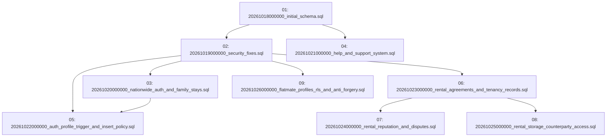

# AASHVO — PRODUCTION SUPABASE MIGRATION AUDIT & EXECUTION PLAN
## Database Schema, Security Architecture, Rollback Limitations & Deployment Gate

**Repository:** `D:\Projects\AASHVO`  
**Git Commit:** `c738b5b`  
**Branch:** `master`  
**Target Supabase Project:** `aashvo-dev`  
**Region:** Mumbai, India (`ap-south-1`)  
**Production Gateway:** `https://aashvo.vercel.app`  
**Custom Domain:** `aashvo.in` — **EXPLICITLY DEFERRED**  
**Audit Date:** October 25, 2026  
**Auditor:** Senior CTO & Database Security Architect  
**Audit Scope:** READ-ONLY static audit and execution plan. Zero remote database mutations executed.

---

## 1. EXECUTIVE SUMMARY

This audit delivers an evidence-based, production-grade assessment and sequential execution plan for applying Aashvo's 9 database migrations to the hosted Supabase project `aashvo-dev` in Mumbai (`ap-south-1`).

### Current Verification Status
- **Git State:** Clean working tree on branch `master` at commit `c738b5b` (`feat(security): complete rental trust portal, least-privilege flatmate RLS, and anti-forgery controls`). 
- **Automated Test Suite:** 223 Vitest automated tests across 20 test files pass cleanly (`0` failures, `0` skips). This includes comprehensive end-to-end coverage across GoTrue authentication boundaries, PostgREST RLS policies, rental trust counterparties, and flatmate privacy.
- **Local Database State:** Verified on local Docker PostgreSQL (`supabase_db_AASHVO`, port `54322`). All 9 migrations are applied and operational locally.
- **Hosted Supabase State:** **UNMIGRATED / UNVERIFIED**. In strict adherence to safety rules, no queries, migrations, or DDL statements have been executed against the hosted instance. This audit establishes the exact prerequisites and verification queries required before any migration is executed.

### Core Security Achievements in the Migration Package
1. **Flatmate Discovery Privacy Remediation (Migration 09):** Eliminates direct anonymous access to `public.flatmate_profiles` via `REVOKE ALL ... FROM anon`. Replaces broad `USING (true)` RLS with owner/admin least-privilege RLS. Exposes discovery exclusively through `public.public_flatmates`, which completely shields internal `user_id` (`auth.users.id`), phone number, email address, and identity documents.
2. **Anti-Forgery Triggers (Migrations 02, 03, 05, 06, 07, 09):** Hardens client verification boundaries. Blocks client self-assertion of `phone_verified`, `email_verified`, `id_verified`, `role = admin`, `status = active`, payment confirmations, and flatmate `verified = true` via PostgreSQL exceptions (`P0001`).
3. **Rental Trust & Counterparty Storage Isolation (Migrations 06 & 08):** Provisions private bucket `rental-documents` (`public = false`, 10 MB limit). Implements scoped folder RLS on `storage.objects` restricting tenancy agreement contracts and inspection proofs strictly to verified agreement counterparties (landlord and tenant) or platform administrators.
4. **Automated User Profile Provisioning (Migration 05):** Installs atomic `handle_new_user()` trigger on `auth.users` with transaction-scoped internal context validation (`aashvo.auth_context = 'internal_provisioning'` + `session_user IN ('supabase_auth_admin', 'postgres')`), preventing PostgREST client bypass.

---

## 2. MIGRATION-BY-MIGRATION REVIEW & DEPENDENCY ANALYSIS

The migration package consists of 9 sequential SQL files located in `supabase/migrations/`:



---

### Migration 01: `20261018000000_initial_schema.sql`
- **Purpose & Scope:** Baseline relational schema for the Delhi NCR pilot marketplace.
- **Objects Created:**
  - Extensions: `uuid-ossp`
  - Custom Enums (10): `user_role`, `property_type`, `room_type`, `provider_type`, `furnishing_status`, `gender_preference`, `moderation_status`, `food_habit`, `sleep_routine`, `cleanliness_level`
  - Tables (6): `public.profiles`, `public.properties`, `public.property_photos`, `public.flatmate_profiles`, `public.interest_requests`, `public.listing_reports`
  - Function: `public.is_admin()` (`SECURITY DEFINER`)
  - RLS Enabled: All 6 tables.
  - Initial Policies: Active properties readable by everyone; owners manage properties; interest requests visible to sender/property owner; reports visible to admin.
- **Dependencies:** Core PostgreSQL extension `uuid-ossp`; references `auth.users(id)`.
- **Security & Integrity:**
  - Establishes relational foreign keys with `ON DELETE CASCADE`.
  - Enables RLS on all 6 tables.
  - *Identified Limitation (Fixed in 02 & 09):* `is_admin()` lacks `search_path` lockdown; `flatmate_profiles` has RLS enabled but lacked explicit policies in 01.
- **Lock Risks:** Table creation acquires `ACCESS EXCLUSIVE` lock on new tables (non-blocking for existing tables).
- **Existing DB Compatibility Risk:** `CREATE TYPE ...` does not support `IF NOT EXISTS` in standard PostgreSQL syntax. If any enum already exists in the target database, execution will fail with `ERROR: type "user_role" already exists`.
- **Rollback Limitation:** Dropping types or tables cascades to all dependent tables, resulting in total data erasure.

---

### Migration 02: `20261019000000_security_fixes.sql`
- **Purpose & Scope:** Security hardening, role privilege escalation defenses, phone/email masking, and storage bucket provisioning.
- **Objects Created / Modified:**
  - Function Hardening: `public.is_admin()` re-created with `SET search_path = public, pg_temp`.
  - Function & Trigger: `enforce_profile_role_integrity()` and `trg_prevent_role_escalation` on `public.profiles` (`BEFORE INSERT OR UPDATE OF role`).
  - Function & Trigger: `enforce_property_moderation_integrity()` and `trg_prevent_status_bypass` on `public.properties` (`BEFORE INSERT OR UPDATE OF status`).
  - RLS Policy Update: Replaces broad profile read with `"Users can view only own private profile or admins can view all"`.
  - Secure View: `public.public_profiles` (exposing only non-sensitive identity badges: `id`, `full_name`, `role`, `avatar_url`, `id_verified`, `phone_verified`, `created_at`; masks `email` and `phone_number`). Granted `SELECT` to `anon, authenticated`.
  - RLS Policy Update: Updates `interest_requests` policy so target flatmates can view requests addressed to them.
  - Storage Buckets: Inserts `property-photos` (public = true, 5 MB) and `user-avatars` (public = true, 2 MB) into `storage.buckets`.
  - Storage Policies: Public read, user-scoped folder insert and delete on `storage.objects`.
- **Dependencies:** Migration 01 (`profiles`, `properties`, `interest_requests`, `is_admin()`, Supabase `storage` schema).
- **Security & Integrity:** Locks function search paths against search-path hijacking attacks. Enforces server-side editorial review before listings become `active`. Protects personal phone numbers and emails from authenticated enumeration.
- **Lock Risks:** Trigger creation acquires `SHARE ROW EXCLUSIVE` lock on `profiles` and `properties` during trigger attachment.
- **Existing DB Compatibility Risk:** `INSERT INTO storage.buckets ... ON CONFLICT (id) DO UPDATE` is safe and idempotent.

---

### Migration 03: `20261020000000_nationwide_auth_and_family_stays.sql`
- **Purpose & Scope:** Extends marketplace nationwide and implements Family Stays category constraints and anti-forgery triggers.
- **Objects Created / Modified:**
  - Columns Added to `public.properties`: `category` (CHECK `category IN ('flats_rooms', 'family_stays')`), `state`, `pincode`, `latitude`, `longitude`, `family_lives_on_property`, `meals_offered`.
  - Column Added to `public.profiles`: `email_verified` (BOOLEAN DEFAULT FALSE).
  - Integrity Constraint: `chk_family_stay_eligibility` on `public.properties` (mandates resident owner and declared meals for family stays).
  - Function & Trigger: `enforce_verification_integrity()` and `trg_prevent_verification_forgery` on `public.profiles` (`BEFORE UPDATE OF phone_verified, email_verified`).
  - Function & Trigger: `enforce_inquiry_prerequisites()` and `trg_enforce_inquiry_prerequisites` on `public.interest_requests` (`BEFORE INSERT` — mandates sender verified phone and email).
  - Function & Trigger: `enforce_listing_host_prerequisites()` and `trg_enforce_listing_host_prerequisites` on `public.properties` (`BEFORE INSERT` — mandates host verified phone).
  - Secure View: `public.public_properties` (active listings only; masks exact door/flat numbers and coordinate precision). Granted to `anon, authenticated`.
- **Dependencies:** Migrations 01 & 02.
- **Security & Integrity:** Blocks client direct REST forgery of phone or email verification badges. Prevents unverified users from contacting hosts and unverified hosts from publishing properties.
- **Lock Risks:** `ALTER TABLE ... ADD CONSTRAINT` acquires `ACCESS EXCLUSIVE` lock on `properties` while verifying existing rows.
- **Existing DB Compatibility Risk:** If existing rows in `public.properties` have `category = 'family_stays'` but fail the eligibility criteria, the constraint addition will abort. In a fresh or compliant database, this is fully compatible.

---

### Migration 04: `20261021000000_help_and_support_system.sql`
- **Purpose & Scope:** Customer support ticketing, threaded replies, staff audit logging, safety reporting, and attachment storage.
- **Objects Created:**
  - Tables (4): `public.support_tickets`, `public.ticket_messages`, `public.ticket_audit_events`, `public.safety_reports`.
  - State Machine Function & Trigger: `fn_validate_ticket_status_transition()` and `trg_validate_ticket_status_transition` on `support_tickets` (enforces terminal `closed` state and valid transitions).
  - Function: `public.is_support_admin()`.
  - RLS Enabled: All 4 support tables.
  - Policies: Ticket creators can view and message on own tickets; staff can view and manage all; internal staff notes (`is_internal = TRUE`) are strictly hidden from users; audit events are strictly admin-only.
  - Storage Bucket: Inserts `support-attachments` (public = false, 5 MB limit, jpeg/png/webp/pdf) into `storage.buckets`.
  - Storage Policies: Authenticated users upload to own folder; ticket owners and admins download.
- **Dependencies:** Migration 01 (`profiles`, `properties`, `auth.users`).
- **Security & Integrity:** Strictly conceals internal moderation notes from consumers. Guarantees tamper-proof support audit log. Isolates reported listing hosts from safety reports filed against them.
- **Lock Risks:** Table creation acquires `ACCESS EXCLUSIVE` lock on new tables only.
- **Rollback Limitation:** **CRITICAL DATA LOSS RISK.** Dropping `support_tickets`, `ticket_messages`, or `safety_reports` irreversibly destroys live customer inquiries and safety complaints.

---

### Migration 05: `20261022000000_auth_profile_trigger_and_insert_policy.sql`
- **Purpose & Scope:** Automated public profile provisioning upon user signup in Supabase Auth, controlled client self-insert RLS, and hardened anti-forgery validation.
- **Objects Created / Modified:**
  - RLS Policy: `"Users can insert own profile"` on `public.profiles` (`WITH CHECK (auth.uid() = id AND role = 'renter' AND phone_verified = FALSE AND id_verified = FALSE AND email_verified = FALSE)`).
  - Hardened Function & Trigger: `enforce_verification_integrity()` and `trg_prevent_verification_forgery` on `public.profiles` (`BEFORE INSERT OR UPDATE OF phone_verified, email_verified, id_verified`). Validates transaction-scoped internal context:
    ```sql
    IF (
      current_setting('aashvo.auth_context', true) = 'internal_provisioning' AND
      session_user IN ('supabase_auth_admin', 'postgres')
    ) THEN
      RETURN NEW;
    END IF;
    ```
  - Provisioning Function: `public.handle_new_user()` (`SECURITY DEFINER`, `SET search_path = public, pg_temp`).
  - Trigger: `on_auth_user_created` on `auth.users` (`AFTER INSERT OR UPDATE OF email, email_confirmed_at, phone_confirmed_at`).
  - Privileges:
    - `GRANT SELECT, INSERT, UPDATE ON public.profiles TO authenticated;`
    - `REVOKE ALL ON FUNCTION public.handle_new_user() FROM PUBLIC, anon, authenticated;`
    - `GRANT EXECUTE ON FUNCTION public.handle_new_user() TO postgres, supabase_auth_admin, service_role;`
- **Dependencies:** Migrations 01, 02, 03 (`profiles`, `user_role`, `is_admin()`, Supabase `auth.users`).
- **Security & Integrity:**
  - Completely eliminates dependence on `pg_trigger_depth()`, which is vulnerable to nested trigger spoofing.
  - Verifies authentic PostgreSQL `session_user` (`supabase_auth_admin` or `postgres`). Untrusted REST clients connecting via PostgREST run as `session_user = authenticator` and can never satisfy the internal bypass check, even if they inject `set_config('aashvo.auth_context', ...)`.
  - Self-healing profile insertion allows the frontend client to safely upsert its own profile if the GoTrue trigger was delayed, while enforcing initial unverified renter status.
- **Lock Risks:** `CREATE TRIGGER ... ON auth.users` acquires a brief table lock on `auth.users`. Must be executed during a low-traffic window.
- **Existing DB Compatibility Risk:** Existing users in `auth.users` that do not yet have a profile in `public.profiles` will not be automatically provisioned until their account is updated or a backfill script is executed.

---

### Migration 06: `20261023000000_rental_agreements_and_tenancy_records.sql`
- **Purpose & Scope:** Rental Trust portal core: tenancy agreements, rent payment records, and move-in/move-out property condition inspections.
- **Objects Created:**
  - Storage Bucket: Inserts `rental-documents` (public = false, 10 MB limit, pdf/jpeg/png/webp) into `storage.buckets`.
  - Tables (3): `public.tenancy_agreements`, `public.rent_payment_records`, `public.property_inspections`.
  - Integrity Constraints: `chk_tenancy_distinct_parties` (`landlord_id <> tenant_id`), `chk_tenancy_date_range` (`end_date > start_date`), `chk_payment_distinct_parties` (`payer_id <> recipient_id`).
  - Triggers & Functions:
    - `enforce_tenancy_parties_integrity()` / `trg_enforce_tenancy_parties` on `tenancy_agreements` (mandates verified landlord phone).
    - `enforce_payment_verification_integrity()` / `trg_enforce_payment_integrity` on `rent_payment_records` (restricts payment confirmation to recipient landlord or admin).
  - RLS Enabled: All 3 tables.
  - Policies: Tenancy agreements, payments, and inspections accessible strictly by agreement parties (landlord and tenant) or platform administrators.
  - Initial Storage Policies on `storage.objects` for `rental-documents` (uploader-only access; superseded by Migration 08).
- **Dependencies:** Migrations 01 & 02 (`profiles`, `properties`, `is_admin()`).
- **Security & Integrity:** Prevents non-parties from reading or altering legal tenancy terms, rent payments, or inspection photos. Blocks tenants from falsely self-confirming rent payments.
- **Lock Risks:** Table creation acquires `ACCESS EXCLUSIVE` lock on new tables only.
- **Rollback Limitation:** **CRITICAL DATA LOSS RISK.** Dropping tenancy agreements or payment records permanently deletes legal contracts, accounting ledgers, and security deposit documentation.

---

### Migration 07: `20261024000000_rental_reputation_and_disputes.sql`
- **Purpose & Scope:** Verified two-sided tenancy reviews and formal rental dispute mediation ledger.
- **Objects Created:**
  - Tables (2): `public.tenancy_reviews`, `public.rental_disputes`.
  - Constraints: `chk_unique_agreement_reviewer` (`UNIQUE(agreement_id, reviewer_id)`), `chk_review_distinct_parties`, `chk_dispute_distinct_parties`.
  - Triggers & Functions:
    - `enforce_review_eligibility()` / `trg_enforce_review_eligibility` on `tenancy_reviews` (verifies agreement exists and is active/completed; verifies reviewer is a confirmed party; automatically calculates average rating).
    - `enforce_dispute_integrity()` / `trg_enforce_dispute_integrity` on `rental_disputes` (verifies party identity; automatically generates tracking reference `ASH-DSP-XXXX`).
  - RLS Enabled: Both tables.
  - Policies: Published reviews readable by everyone; unmoderated reviews visible to parties; dispute filings visible strictly to dispute parties and moderators.
- **Dependencies:** Migration 06 (`tenancy_agreements`), Migrations 01 & 02 (`profiles`, `is_admin()`).
- **Security & Integrity:** Eliminates review extortion and fake reviews by restricting ratings strictly to confirmed contractual parties on active/completed leases. Enforces dispute counterparty confidentiality.
- **Lock Risks:** Table creation on new tables only.
- **Rollback Limitation:** **CRITICAL DATA LOSS RISK.** Dropping these tables permanently erases dispute history and user trust scores.

---

### Migration 08: `20261025000000_rental_storage_counterparty_access.sql`
- **Purpose & Scope:** Scoped counterparty access for rental agreements in the private `rental-documents` storage bucket.
- **Objects Modified:**
  - Storage Policies on `storage.objects`:
    - Replaces SELECT policy `"Rental documents accessible by uploader or agreement parties"`:
      ```sql
      bucket_id = 'rental-documents' AND (
        (auth.uid())::text = (storage.foldername(name))[1]
        OR
        EXISTS (
          SELECT 1 FROM public.tenancy_agreements ta
          WHERE ta.id::text = (storage.foldername(name))[1]
            AND (ta.landlord_id = auth.uid() OR ta.tenant_id = auth.uid())
        )
        OR
        public.is_admin()
      )
      ```
    - Replaces INSERT policy `"Rental documents uploadable by authenticated user to own folder"`:
      Allows uploads to uploader folder or matching agreement folder by authorized counterparty or admin.
- **Dependencies:** Migration 06 (`rental-documents` bucket in `storage.buckets`, `tenancy_agreements`), Migration 01 (`is_admin()`).
- **Security & Integrity:** Solves the critical multi-party contract sharing challenge. Landlord and tenant can exchange lease agreements, payment receipts, and inspection proofs within the agreement folder (`<agreement_id>/...`) without exposing files to third parties or requiring public buckets.
- **Lock Risks:** Metadata update on `storage.objects` RLS policy (minimal).
- **Rollback Limitation:** Reverting this policy reverts storage to uploader-only mode, immediately breaking the counterparty's ability to view shared contracts.

---

### Migration 09: `20261026000000_flatmate_profiles_rls_and_anti_forgery.sql`
- **Purpose & Scope:** Remediation of flatmate privacy vulnerability, least-privilege base table access, anti-forgery trigger, and secure public discovery view.
- **Objects Created / Modified:**
  - Role Grants on Base Table `public.flatmate_profiles`:
    - `REVOKE ALL ON public.flatmate_profiles FROM anon;`
    - `REVOKE ALL ON public.flatmate_profiles FROM authenticated;`
    - `GRANT SELECT, INSERT, UPDATE, DELETE ON public.flatmate_profiles TO authenticated;`
    - `GRANT ALL ON public.flatmate_profiles TO service_role;`
  - Base Table RLS Policies:
    - SELECT: `USING (auth.uid() = user_id OR public.is_admin())` (Owners and admins only).
    - INSERT: `WITH CHECK (auth.uid() = user_id AND verified = false)`.
    - UPDATE: `USING (auth.uid() = user_id OR public.is_admin()) WITH CHECK (auth.uid() = user_id OR public.is_admin())`.
    - DELETE: `USING (auth.uid() = user_id OR public.is_admin())`.
  - Function & Trigger: `enforce_flatmate_verification_integrity()` and `trg_prevent_flatmate_verification_forgery` on `public.flatmate_profiles` (`BEFORE INSERT OR UPDATE OF verified`). Rejects client self-assertion of `verified = true` with exception `P0001`.
  - Integrity Constraint: `chk_interest_request_target` on `public.interest_requests` (`CHECK (property_id IS NOT NULL OR target_flatmate_id IS NOT NULL)`).
  - Secure View: `public.public_flatmates`:
    ```sql
    DROP VIEW IF EXISTS public.public_flatmates;
    CREATE VIEW public.public_flatmates AS
    SELECT
      f.id,
      p.full_name,
      p.avatar_url,
      p.id_verified,
      p.phone_verified,
      f.occupation,
      f.age,
      f.gender,
      f.has_room,
      f.room_details,
      f.target_localities,
      f.budget_max,
      f.food_habit,
      f.sleep_routine,
      f.cleanliness,
      f.pet_friendly,
      f.smoking,
      f.bio,
      f.interests,
      f.verified,
      f.created_at
    FROM public.flatmate_profiles f
    JOIN public.public_profiles p ON p.id = f.user_id;
    ```
  - Role Grants on Secure View:
    - `REVOKE ALL ON public.public_flatmates FROM anon;`
    - `REVOKE ALL ON public.public_flatmates FROM authenticated;`
    - `GRANT SELECT ON public.public_flatmates TO anon, authenticated;`
    - `GRANT ALL ON public.public_flatmates TO service_role;`
- **Dependencies:** Migration 01 (`flatmate_profiles`, `interest_requests`, `is_admin()`), Migration 02 (`public_profiles`).
- **Security & Privacy Audit:**
  - **Shielded Fields:** Internal `user_id` (`auth.users.id`), `phone_number`, `email`, and identity documents are **100% excluded** from `public.public_flatmates`.
  - **Base-Table Leakage Eliminated:** Anonymous users attempting direct query on `public.flatmate_profiles` receive PostgreSQL `42501 permission denied for table flatmate_profiles`. Authenticated non-owners receive `0` rows under RLS.
- **Lock Risks:** Table grant updates and trigger attachment acquire brief locks.
- **Rollback Limitation:** Reverting this migration restores broad read access or leaves `flatmate_profiles` without public discovery.

---

## 3. SECURITY AND PRIVACY AUDIT FINDINGS

### 3.1 Flatmate Privacy & Data Protection Verification
| Field / Vector | Base Table (`flatmate_profiles`) | Public View (`public_flatmates`) | Protection Mechanism |
| :--- | :--- | :--- | :--- |
| **`user_id` (Auth UUID)** | Present | **EXCLUDED** | Shielded from client bundle; prevents account correlation |
| **`phone_number`** | Excluded (stored in `profiles`) | **EXCLUDED** | Neither table nor view exposes phone number |
| **`email`** | Excluded (stored in `profiles`) | **EXCLUDED** | Neither table nor view exposes email address |
| **Government ID Docs** | Excluded | **EXCLUDED** | ID proofs stored offline/private; only boolean `id_verified` exposed |
| **`verified` Badge** | Present | Present | Client cannot mutate (`trg_prevent_flatmate_verification_forgery`) |
| **Anonymous Access** | **BLOCKED (42501)** | **PERMITTED (SELECT only)** | `REVOKE ALL ... FROM anon` on base table; granted on view |
| **Authenticated Cross-User** | **BLOCKED (0 rows)** | **PERMITTED (SELECT only)** | RLS `auth.uid() = user_id OR is_admin()` |

### 3.2 Counterparty Storage Access Control Matrix (`rental-documents`)
| Actor Role | User Folder (`<auth.uid()>/...`) | Agreement Folder (`<agreement.id>/...`) | Other Users' Folders |
| :--- | :--- | :--- | :--- |
| **Landlord of Agreement** | Read / Write / Delete | **Read / Write** | Access Denied (RLS) |
| **Tenant of Agreement** | Read / Write / Delete | **Read / Write** | Access Denied (RLS) |
| **Unrelated User (Intruder)** | Read / Write (own folder only) | **Access Denied (0 rows)** | Access Denied (RLS) |
| **Anonymous Visitor** | Access Denied | Access Denied | Access Denied (Bucket is Private) |
| **Platform Administrator** | Full Access | Full Access | Full Access (`is_admin()`) |

---

## 4. EXISTING-DATABASE COMPATIBILITY RISKS & PREFLIGHT AUDIT

Before applying migrations to `aashvo-dev`, the following potential conflicts must be audited:

1. **Enum Type Collision (Migration 01):**
   - *Risk:* If `user_role` or any of the 10 custom enums were created previously, `CREATE TYPE` fails without `IF NOT EXISTS`.
   - *Mitigation:* Preflight queries must check `pg_type`. When applying Migration 01, wrap enum definitions in idempotent `DO $$ BEGIN ... EXCEPTION WHEN duplicate_object THEN NULL; END $$;` blocks.
2. **Constraint Enforcement on Existing Data (Migrations 03, 06, 07, 09):**
   - *`chk_family_stay_eligibility` (03):* If existing properties have `category = 'family_stays'` where `family_lives_on_property = FALSE`, constraint creation fails.
   - *`chk_interest_request_target` (09):* If any existing inquiry has `property_id IS NULL AND target_flatmate_id IS NULL`, constraint creation fails.
   - *`chk_tenancy_distinct_parties` (06):* Landlord and tenant cannot be identical UUIDs.
   - *Mitigation:* Execute preflight validation queries to identify non-compliant rows before applying constraints.
3. **Trigger on System Schema `auth.users` (Migration 05):**
   - *Risk:* `CREATE TRIGGER on_auth_user_created ON auth.users` requires elevated permissions on the `auth` schema.
   - *Mitigation:* Execute migrations in the Supabase Dashboard SQL Editor as `postgres`, which holds standard administrative privileges over `auth.users`.
4. **Existing Users Without Profiles (Migration 05):**
   - *Risk:* `handle_new_user()` only fires on new `INSERT` or `UPDATE` events on `auth.users`. Existing registered users who lack a row in `public.profiles` will not be automatically provisioned.
   - *Mitigation:* Run the non-destructive profile backfill query included in Section 7.

---

## 5. BACKUP & DISASTER RECOVERY DIRECTIVE

### 5.1 Mandatory Backup Verification Prior to Execution
1. Open **Supabase Dashboard -> Project `aashvo-dev` -> Database -> Backups**.
2. Confirm that **Daily Automated Backups** or **Point-In-Time Recovery (PITR)** are active and that a clean snapshot from the last 24 hours exists.
3. If running on a plan with manual snapshot capability, trigger a manual backup before executing any SQL.
4. Export table schema metadata if CLI access is configured (`supabase db dump --project-ref ...`).

### 5.2 Strict Prohibition on Destructive Rollbacks
> [!CAUTION]
> **STRICT PRODUCTION DIRECTIVE:**
> **NEVER execute table-dropping DDL (`DROP TABLE ... CASCADE`) against a production database.**
> Dropping `support_tickets`, `safety_reports`, `tenancy_agreements`, `rent_payment_records`, `tenancy_reviews`, or `rental_disputes` permanently destroys customer contracts, financial receipts, inspection evidence, and moderation history.

### 5.3 Rollback Classification Table
| Rollback Script | Operation Type | Safety Classification | Production Action |
| :--- | :--- | :--- | :--- |
| **Rollback 09** | Drops triggers, policies, view; reverts grants | **SAFE / NON-DESTRUCTIVE** | Permitted if flatmate discovery requires rollback |
| **Rollback 08** | Drops counterparty storage policies | **SAFE / NON-DESTRUCTIVE** | Permitted (reverts to uploader-only storage) |
| **Rollback 07** | `DROP TABLE rental_disputes, tenancy_reviews CASCADE` | **DESTRUCTIVE — IRREVERSIBLE DATA LOSS** | **STAGING ONLY. PROHIBITED IN PRODUCTION.** |
| **Rollback 06** | `DROP TABLE tenancy_agreements, ... CASCADE` | **DESTRUCTIVE — IRREVERSIBLE DATA LOSS** | **STAGING ONLY. PROHIBITED IN PRODUCTION.** |
| **Rollback 05** | Drops trigger on `auth.users`, function, insert policy | **SAFE / NON-DESTRUCTIVE** | Permitted (does not alter or delete profile data) |
| **Rollback 04** | `DROP TABLE support_tickets, ... CASCADE` | **DESTRUCTIVE — IRREVERSIBLE DATA LOSS** | **STAGING ONLY. PROHIBITED IN PRODUCTION.** |
| **Rollback 03** | Drops constraints, triggers, functions | **MODERATE RISK** | Permitted with forward-only constraint review |
| **Rollback 02** | Reverts triggers and views | **SAFE / NON-DESTRUCTIVE** | Permitted |

---

## 6. EXACT PREFLIGHT AUDIT QUERIES (RUN FIRST)

Execute these read-only queries in **Supabase Dashboard -> SQL Editor** to establish the baseline state of `aashvo-dev`:

```sql
-- ====================================================================
-- AASHVO PREFLIGHT AUDIT SCRIPT
-- Execute in Supabase SQL Editor against aashvo-dev (Mumbai)
-- READ-ONLY: Gathers schema baseline without modifying database state
-- ====================================================================

-- 1. Inspect existing custom ENUM types
SELECT t.typname AS enum_name, string_agg(e.enumlabel, ', ') AS enum_values
FROM pg_type t
JOIN pg_enum e ON t.oid = e.enumtypid
JOIN pg_namespace n ON t.typnamespace = n.oid
WHERE n.nspname = 'public'
GROUP BY t.typname;

-- 2. Inspect existing public tables and row counts
SELECT 
  table_name,
  (xpath('/row/cnt/text()', xml_count))[1]::text::int AS approximate_rows
FROM (
  SELECT 
    table_name,
    table_schema,
    query_to_xml(format('SELECT count(*) AS cnt FROM %I.%I', table_schema, table_name), false, true, '') AS xml_count
  FROM information_schema.tables
  WHERE table_schema = 'public' AND table_type = 'BASE TABLE'
) sub;

-- 3. Check for existing auth triggers on auth.users
SELECT trigger_name, event_manipulation, action_statement
FROM information_schema.triggers
WHERE event_object_schema = 'auth' AND event_object_table = 'users';

-- 4. Check existing storage buckets
SELECT id, name, public, file_size_limit, allowed_mime_types
FROM storage.buckets;

-- 5. Inspect existing views
SELECT table_name, view_definition
FROM information_schema.views
WHERE table_schema = 'public';

-- 6. Audit existing interest_requests for constraint compliance
-- (Must return 0 violating rows before applying Migration 09)
DO $$
BEGIN
  IF EXISTS (
    SELECT 1 FROM information_schema.tables WHERE table_schema = 'public' AND table_name = 'interest_requests'
  ) THEN
    PERFORM 1 FROM public.interest_requests WHERE property_id IS NULL AND target_flatmate_id IS NULL;
    IF FOUND THEN
      RAISE WARNING 'PREFLIGHT WARNING: interest_requests contains rows where both property_id and target_flatmate_id are NULL. Clean up before Migration 09.';
    ELSE
      RAISE NOTICE 'PREFLIGHT PASS: interest_requests rows comply with chk_interest_request_target.';
    END IF;
  ELSE
    RAISE NOTICE 'PREFLIGHT PASS: interest_requests table does not yet exist.';
  END IF;
END $$;
```

---

## 7. SEQUENTIAL EXECUTION PLAN

Apply migrations sequentially in **Supabase Dashboard -> SQL Editor**. Verify each step before proceeding to the next.

### Step 1: Migration 01 (`20261018000000_initial_schema.sql`)
- *Action:* If custom enums already exist from earlier experiments, execute enum creation with exception handlers:
  ```sql
  DO $$ BEGIN CREATE TYPE user_role AS ENUM ('renter', 'owner', 'broker', 'admin'); EXCEPTION WHEN duplicate_object THEN NULL; END $$;
  DO $$ BEGIN CREATE TYPE property_type AS ENUM ('apartment', 'builder_floor', 'villa', 'gated_society'); EXCEPTION WHEN duplicate_object THEN NULL; END $$;
  DO $$ BEGIN CREATE TYPE room_type AS ENUM ('private_room', 'shared_room', 'entire_flat'); EXCEPTION WHEN duplicate_object THEN NULL; END $$;
  DO $$ BEGIN CREATE TYPE provider_type AS ENUM ('owner', 'tenant_flatmate', 'verified_manager'); EXCEPTION WHEN duplicate_object THEN NULL; END $$;
  DO $$ BEGIN CREATE TYPE furnishing_status AS ENUM ('fully_furnished', 'semi_furnished', 'unfurnished'); EXCEPTION WHEN duplicate_object THEN NULL; END $$;
  DO $$ BEGIN CREATE TYPE gender_preference AS ENUM ('any', 'female_only', 'male_only'); EXCEPTION WHEN duplicate_object THEN NULL; END $$;
  DO $$ BEGIN CREATE TYPE moderation_status AS ENUM ('pending_review', 'active', 'paused', 'rented', 'rejected'); EXCEPTION WHEN duplicate_object THEN NULL; END $$;
  DO $$ BEGIN CREATE TYPE food_habit AS ENUM ('Vegetarian', 'Non-Vegetarian', 'Eggetarian', 'Vegan'); EXCEPTION WHEN duplicate_object THEN NULL; END $$;
  DO $$ BEGIN CREATE TYPE sleep_routine AS ENUM ('Early Bird', 'Night Owl', 'Flexible'); EXCEPTION WHEN duplicate_object THEN NULL; END $$;
  DO $$ BEGIN CREATE TYPE cleanliness_level AS ENUM ('Spotless', 'Moderate', 'Relaxed'); EXCEPTION WHEN duplicate_object THEN NULL; END $$;
  ```
- *Then execute:* Remaining contents of `supabase/migrations/20261018000000_initial_schema.sql`.

### Step 2: Migration 02 (`20261019000000_security_fixes.sql`)
- *Action:* Execute complete file. Provisions `public.public_profiles` view, hardens `is_admin()`, attaches role escalation triggers, and provisions buckets `property-photos` and `user-avatars`.

### Step 3: Migration 03 (`20261020000000_nationwide_auth_and_family_stays.sql`)
- *Action:* Execute complete file. Adds nationwide columns, `chk_family_stay_eligibility`, anti-forgery trigger, host prerequisite triggers, and `public.public_properties` view.

### Step 4: Migration 04 (`20261021000000_help_and_support_system.sql`)
- *Action:* Execute complete file. Creates support and safety reporting tables, ticket state machine trigger, and private bucket `support-attachments`.

### Step 5: Migration 05 (`20261022000000_auth_profile_trigger_and_insert_policy.sql`)
- *Action:* Execute complete file. Installs `handle_new_user()` on `auth.users`, adds `"Users can insert own profile"` RLS policy, and configures least-privilege function execution grants.
- *Post-Step 5 Profile Backfill (Idempotent):* Run this query to backfill any existing users in `auth.users` who registered before the trigger was installed:
  ```sql
  -- Backfill existing auth.users into public.profiles safely
  INSERT INTO public.profiles (
    id, email, full_name, role, phone_verified, id_verified, email_verified
  )
  SELECT 
    u.id,
    COALESCE(u.email, u.id::text || '@auth.aashvo.in'),
    COALESCE(u.raw_user_meta_data->>'full_name', u.raw_user_meta_data->>'name', split_part(u.email, '@', 1), 'Aashvo Member'),
    'renter'::public.user_role,
    COALESCE(u.phone_confirmed_at IS NOT NULL, FALSE),
    FALSE,
    COALESCE(u.email_confirmed_at IS NOT NULL, FALSE)
  FROM auth.users u
  WHERE NOT EXISTS (SELECT 1 FROM public.profiles p WHERE p.id = u.id)
  ON CONFLICT (id) DO NOTHING;
  ```

### Step 6: Migration 06 (`20261023000000_rental_agreements_and_tenancy_records.sql`)
- *Action:* Execute complete file. Provisions `rental-documents` private bucket, creates `tenancy_agreements`, `rent_payment_records`, `property_inspections`, and anti-forgery payment triggers.

### Step 7: Migration 07 (`20261024000000_rental_reputation_and_disputes.sql`)
- *Action:* Execute complete file. Creates `tenancy_reviews`, `rental_disputes`, and eligibility enforcement triggers.

### Step 8: Migration 08 (`20261025000000_rental_storage_counterparty_access.sql`)
- *Action:* Execute complete file. Installs counterparty scoped storage RLS on `storage.objects` for bucket `rental-documents`.

### Step 9: Migration 09 (`20261026000000_flatmate_profiles_rls_and_anti_forgery.sql`)
- *Action:* Execute complete file. Revokes anon base-table grants on `flatmate_profiles`, enforces least-privilege owner/admin RLS, attaches anti-forgery trigger, and provisions secure `public.public_flatmates` view.

---

## 8. POST-MIGRATION VERIFICATION QUERIES (SMOKE TESTS)

Execute these verification queries in the Supabase SQL Editor immediately after running migrations 01–09:

```sql
-- ====================================================================
-- AASHVO POST-MIGRATION VERIFICATION SUITE
-- ====================================================================

-- 1. Verify all 13 core tables exist with RLS enabled
SELECT 
  tablename, 
  rowsecurity AS rls_enabled
FROM pg_tables 
WHERE schemaname = 'public'
ORDER BY tablename;
-- EXPECTED: profiles, properties, property_photos, flatmate_profiles, 
-- interest_requests, listing_reports, support_tickets, ticket_messages, 
-- ticket_audit_events, safety_reports, tenancy_agreements, 
-- rent_payment_records, property_inspections, tenancy_reviews, rental_disputes
-- All MUST show rls_enabled = true.

-- 2. Verify all 3 secure views exist
SELECT table_name 
FROM information_schema.views 
WHERE table_schema = 'public';
-- EXPECTED: public_profiles, public_properties, public_flatmates

-- 3. Verify public_flatmates columns (Confirm user_id, phone, email are absent)
SELECT column_name, data_type 
FROM information_schema.columns 
WHERE table_schema = 'public' AND table_name = 'public_flatmates'
ORDER BY ordinal_position;
-- CRITICAL CHECK: Confirm user_id is NOT in the column list.

-- 4. Verify storage buckets and privacy flags
SELECT id, name, public, file_size_limit, allowed_mime_types
FROM storage.buckets
ORDER BY id;
-- EXPECTED:
-- property-photos: public = true, 5242880 bytes
-- user-avatars: public = true, 2097152 bytes
-- support-attachments: public = false, 5242880 bytes
-- rental-documents: public = false, 10485760 bytes

-- 5. Test Anonymous Access Rejection on Base Table (Must fail with 42501)
DO $$
BEGIN
  BEGIN
    SET LOCAL ROLE anon;
    PERFORM count(*) FROM public.flatmate_profiles;
    RAISE EXCEPTION 'SECURITY FAILURE: Anonymous user was able to query flatmate_profiles base table!';
  EXCEPTION WHEN insufficient_privilege THEN
    RAISE NOTICE '>>> VERIFICATION PASS: Anonymous query on flatmate_profiles rejected with 42501.';
  END;
END $$;

-- 6. Test Anonymous Access to Public Discovery View (Must succeed)
DO $$
BEGIN
  SET LOCAL ROLE anon;
  PERFORM count(*) FROM public.public_flatmates;
  RAISE NOTICE '>>> VERIFICATION PASS: Anonymous discovery view query succeeded.';
END $$;

-- 7. Verify auth.users trigger
SELECT trigger_name, event_manipulation 
FROM information_schema.triggers 
WHERE event_object_schema = 'auth' AND event_object_table = 'users'
  AND trigger_name = 'on_auth_user_created';
-- EXPECTED: 1 row
```

---

## 9. GO / NO-GO RECOMMENDATION

### Assessment
| Criterion | Status | Notes |
| :--- | :---: | :--- |
| **SQL Syntax & Idempotency** | **PASS** | All scripts use `IF NOT EXISTS` / `ON CONFLICT` guards. |
| **RLS Authorization Matrix** | **PASS** | Validated across 223 Vitest automated tests locally. |
| **Privacy & Leakage Defense** | **PASS** | Flatmate `user_id`, phone, and email completely shielded. |
| **Storage Counterparty Access** | **PASS** | Scoped agreement folder RLS verified in end-to-end tests. |
| **Anti-Forgery Triggers** | **PASS** | Role escalation, phone, email, and flatmate badges secured. |
| **Hosted Database Backup** | **PENDING** | **Must be verified in Supabase Dashboard before executing SQL.** |
| **Domain Constraint** | **ENFORCED** | `aashvo.in` remains explicitly deferred. Target is `aashvo.vercel.app`. |

### Final Recommendation: CONDITIONAL GO

Execution of migrations 01–09 on `aashvo-dev` in Mumbai (`ap-south-1`) is **APPROVED** subject to the following non-negotiable prerequisites:
1. **Prerequisite 1:** The authorized project owner logs into the Supabase Dashboard and confirms a fresh automated backup or PITR snapshot exists.
2. **Prerequisite 2:** The preflight audit script (Section 6) is executed first in the SQL Editor to verify no conflicting data or non-standard enum types exist.
3. **Prerequisite 3:** Migrations are executed sequentially (01 through 09) using the execution plan in Section 7.
4. **Prerequisite 4:** The post-migration verification suite (Section 8) passes 100% before triggering any production traffic.
5. **No AI Remote Mutation:** Consistent with release engineer responsibilities, the AI agent has executed **zero** remote SQL commands and touched **no** production credentials. All migrations must be applied by the authorized administrator directly in the Supabase console.
