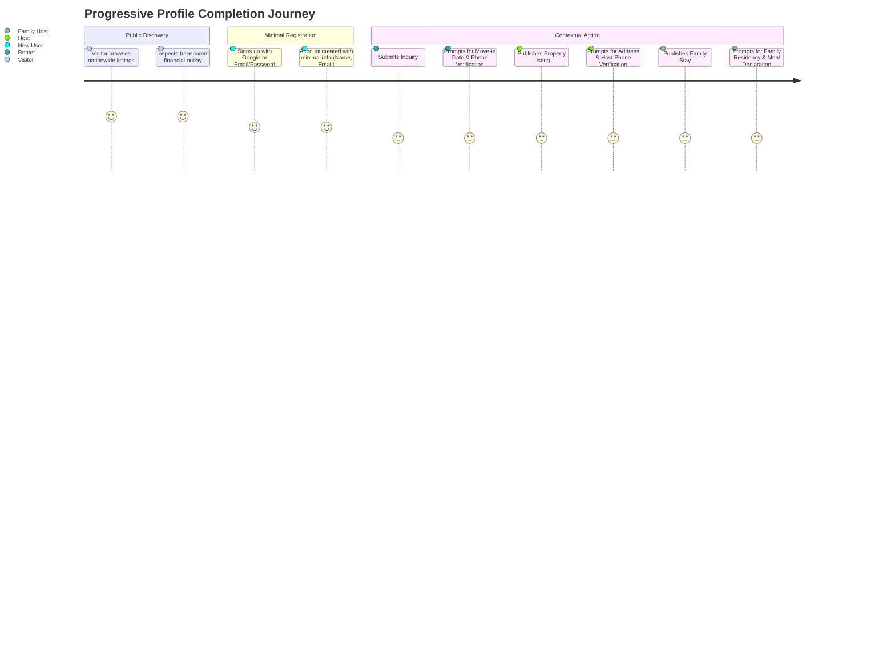

# Aashvo — Product Requirements Document (PRD)

**Version:** 2.0.0-Nationwide  
**Status:** Approved  
**Author:** Founding CTO & Product Team, Aashvo  
**Target Market:** Nationwide Marketplace across India (Pilot Cluster: Delhi NCR — Gurugram Cyber Hub, DLF Phases, South Delhi Corridor; Expansion: Bengaluru, Mumbai, Pune, Hyderabad, Jaipur, and beyond)

---

## 1. Vision & Core Value Proposition

**Aashvo** is a website-first accommodation and flatmate discovery platform engineered for college students, young working professionals, and resident families across India.

The traditional rental and shared accommodation market in India is plagued by:
1. **Fake, stale, or bait-and-switch listings** by aggressive intermediaries and unverified brokers.
2. **Hidden costs** revealed only after contract signing (inflated security deposits, maintenance fees, electricity per-unit surcharges).
3. **Mismatched living habits, food preferences, and lifestyle conflicts** between flatmates.
4. **Privacy invasion and contact scraping**, where renters' phone numbers are blasted to dozens of aggressive lead brokers.
5. **Lack of safe, home-like family environments** for students moving out for the first time.

**Aashvo's Mission:** Make finding a room, flat, flatmate, or family stay transparent, safe, and dignified.

> **Tagline:** Find your place. Find your people.  
> **Promise:** Simple. Safe. Built for real people.

---

## 2. Nationwide Marketplace Categories

Aashvo categorizes all accommodations into three distinct, mutually exclusive pillars:

```
┌────────────────────────────────────────────────────────────────────────┐
│                        AASHVO NATIONWIDE MARKETPLACE                   │
├────────────────────┬────────────────────┬──────────────────────────────┤
│   Flats & Rooms    │     Flatmates      │         Family Stays         │
├────────────────────┼────────────────────┼──────────────────────────────┤
│ • Entire Flats     │ • Seeking room     │ • Resident families ONLY     │
│ • Private Rooms    │ • Has room vacant  │ • Host family lives in home  │
│ • Shared Rooms     │ • Lifestyle match  │ • Home-cooked meals policy   │
│ • Owners & Brokers │ • Team-up search   │ • Zero brokers permitted     │
└────────────────────┴────────────────────┴──────────────────────────────┘
```

### 2.1 Flats & Rooms
- **Inventory:** Entire flats (1BHK–4BHK), private bedrooms in shared flats, and shared occupancy rooms.
- **Permitted Providers:** Direct property owners (`owner`), current tenants seeking lease transfer (`tenant_flatmate`), and registered property managers (`verified_manager`).
- **Transparency Rules:** ₹0 brokerage for direct owners; mandatory commission disclosure for property managers. Complete itemized move-in outlay (Rent, Deposit, Maintenance, Electricity).

### 2.2 Flatmates
- **Inventory:** Room seekers looking to team up, or occupants with a spare room looking for a compatible roommate.
- **Compatibility Dimensions:** Dietary openness (Vegetarian, Non-Veg, Eggetarian, Vegan), sleep/work routines, cleanliness standards, pet friendliness, and smoking rules.
- **Contact Flow:** Gated introductory connect requests with mutual consent before contact exchange.

### 2.3 Family Stays (Distinct Category)
- **Concept:** Safe, home-like rooms offered exclusively by resident families living in the same house. Tailored especially for young students and early-career professionals moving away from home.
- **Strict Eligibility Criteria:**
  1. **Direct Resident Owner Only:** Only the property owner whose family actually resides in the home can publish. Non-resident landlords, brokers, agents, and commercial hostel operators are strictly prohibited.
  2. **Co-living Declaration:** The host must explicitly declare that their family lives in the same house as the offered room.
  3. **Meal Policy Declaration:** Clear disclosure of food arrangements:
     - `included`: Home-cooked meals included in the monthly rent.
     - `optional_extra`: Home-cooked meals available at an explicit additional monthly fee.
     - `none`: Self-catering or meal services not provided.
- **Safety Guarantee:** Verified family hosts, strict guest guidelines, and neighborhood references.

---

## 3. Confirmed Authentication & Account Architecture

### 3.1 Authentication Methods (Supabase Auth)
1. **Google OAuth (Sign up and Sign in):**
   - PKCE (Proof Key for Code Exchange) flow with state parameter validation to protect against CSRF and authorization code interception.
   - Minimal OAuth scope (`openid`, `email`, `profile`).
   - Email is marked as verified by Google OAuth provider.
2. **Email & Password (Sign up and Sign in):**
   - Secure registration with minimum 8 characters, requiring at least one digit or special symbol.
   - **Mandatory Email Verification:** Newly registered accounts remain in an `unverified` state (`email_confirmed_at = null`) until the user clicks the cryptographic link dispatched to their inbox.
   - Unverified accounts cannot perform inquiries, send connection notes, or publish listings.
3. **Password Recovery & Session Management:**
   - Secure email-based password reset using one-time cryptographic tokens.
   - Rate-limited reset requests with neutral messaging to prevent user enumeration attacks.
   - Automatic session refresh with rolling JWT tokens; explicit token revocation upon logout.
4. **One Aashvo Account per Identity:**
   - Single unified profile supporting multiple simultaneous activities (e.g., a user can browse as a renter, look for a flatmate, and list a room as an owner).
   - Presentation switcher in local development is strictly separated from backend authorization.

### 3.2 Public vs. Authenticated Boundaries
- **Public (Anonymous) Browsing:** Complete, unhindered browsing across all listings, flatmate cards, filters, and cost breakdowns without registration or profile completion.
- **Authenticated Access:** Mandatory for protected actions (submitting visit requests, sending flatmate notes, creating listings, and moderating content).

---

## 4. Progressive Profile Design

Aashvo rejects monolithic, high-friction onboarding forms. Initial registration is kept strictly minimal:



1. **At Signup:** Collect only what is essential (OAuth identity or Name, Email, Password).
2. **At Inquiry Submission:** Prompt for move-in timeframe and verify phone number if required by the listing's verification policy.
3. **At Flatmate Profile Creation:** Collect living habits, routine, food preferences, and budget.
4. **At Listing Creation:** Collect property specifications, financial itemization, photos, and host declarations.
5. **Server-Derived Profile Completion:** Profile completion is dynamically derived by backend rules (`evaluateActionEligibility`) from active data, **never a client-controlled boolean flag**.

---

## 5. Phone Verification Policy & Gateway Architecture

Phone verification is applied **contextually**, not as a universal barrier at signup:

1. **When Phone Verification is Mandatory:**
   - Submitting an inquiry or visit request to a verified listing or host.
   - Publishing a property listing (Flats & Rooms, Family Stays).
   - Creating a flatmate profile with a vacant room available.
2. **Provider-Backed Verification:**
   - Phone verification must reflect a valid OTP handshake via a certified SMS provider (Twilio, Exotel, or MessageBird), managed server-side via Supabase Auth Phone.
   - User-submitted flags (`phone_verified: true`) are stripped and rejected at both API and database trigger levels.
3. **Abuse Protection & Rate Limiting:**
   - **Cooldown:** 60-second mandatory cooldown between consecutive OTP dispatches to the same number.
   - **Hourly Cap:** Maximum 4 OTP dispatches per hour per phone number.
   - **Brute-Force Lockout:** OTP sessions are invalidated after 5 failed verification attempts.
   - **Code Expiration:** Codes expire after 10 minutes.
4. **Contact Privacy:**
   - Phone numbers are never exposed in public views or HTML source code.
   - Unlocked only upon mutual agreement or confirmed visit request.

---

## 6. Location Architecture: Nationwide & Privacy-Preserving

1. **Nationwide Geography:**
   - Open geographic fields (`city`, `locality`, `state`, `pincode`, `coordinates`).
   - Free-text fuzzy search capable of resolving any Indian municipality, tier-1 metro, or tier-2 university town without hardcoded enum restrictions.
2. **Device Location Assistance:**
   - Browser Geolocation API provides distance calculation and map centering convenience.
   - Device location is treated as convenience, **never proof of property ownership or family residency**.
3. **Exact Address Masking:**
   - Public listing pages display only Locality, City, and Nearby Landmarks (e.g. *"Near DLF Cyber Hub, Sector 24, Gurugram"*).
   - Exact building numbers, tower names, and flat doors are stored privately in PostgreSQL base tables and disclosed only upon approved visit scheduling.

---

## 7. Acceptance Criteria

### AC 1: Registration & Email Verification
- [ ] User can register with valid email, name, and strong password (min 8 chars, 1 digit or special char).
- [ ] System sends verification email and records `email_confirmed_at = null`.
- [ ] User cannot perform protected actions (inquiry, listing) while email remains unverified.
- [ ] Clicking verification link transitions user to `emailVerified = true` and `accountStatus = 'active'`.

### AC 2: Google OAuth & Redirect Security
- [ ] OAuth flow initiates with PKCE challenge, state parameter, and verified redirect URI.
- [ ] Rejects redirect URIs from unapproved origins outside the whitelist.
- [ ] Callback handles state verification; rejects on state mismatch with clear CSRF defense message.
- [ ] Successful Google OAuth sets `emailVerified = true` without requesting unnecessary scopes.

### AC 3: Password Reset & Session Management
- [ ] Password reset dispatches token email and displays a neutral success message regardless of whether the email exists.
- [ ] Password reset token expires after 15 minutes.
- [ ] Logout invalidates session tokens and purges cached auth state.
- [ ] Prohibits automatic merging of unverified email accounts with incoming Google OAuth accounts.

### AC 4: Progressive Profile Completion
- [ ] Anonymous users can browse all listings and flatmates without prompt or forced profile fields.
- [ ] Profile requirements are evaluated server-side per action type.
- [ ] Inquiries prompt only for move-in date, intro message, and phone verification.
- [ ] Listing creation prompts for property data, financials, photos, and host verification.

### AC 5: Phone Verification & Gateway Security
- [ ] OTP dispatch enforces 60-second cooldown and max 4 sends per hour.
- [ ] Verification fails on incorrect code, showing remaining attempts.
- [ ] 5 consecutive incorrect attempts lock the verification session.
- [ ] Direct API requests attempting to update `phone_verified` are rejected with `403 Forbidden` / trigger exception.

### AC 6: Family Stay Eligibility & Meal Declarations
- [ ] Family Stay listings require `providerType = 'owner'`. Commercial managers and brokers are rejected with explicit error message.
- [ ] Host must declare `familyLivesOnProperty = true`.
- [ ] Host must select `mealsOffered` from `'included'`, `'optional_extra'`, or `'none'`.
- [ ] Database check constraint `chk_family_stay_eligibility` rejects invalid Family Stay inserts/updates at the SQL kernel level.

### AC 7: Nationwide Search & Address Masking
- [ ] Search functions seamlessly for any Indian city (Bengaluru, Mumbai, Pune, Gurugram, etc.) via free-text query.
- [ ] Public listing view suppresses flat and building numbers, displaying only locality and landmark.
- [ ] Geolocation distances are calculated accurately via Haversine algorithm.

### AC 8: Cross-Account Privacy & Anti-Tampering
- [ ] User A cannot view User B's private profile, email, or phone number.
- [ ] Inquiries are accessible only to the sender, the target host, and authorized administrators.
- [ ] Regular users cannot elevate their role to `admin` or `verified_manager` via client payloads.

---

## 7. Help & Support, Safety Reporting & Admin Operations

### AC 9: Knowledge Base & Community Safety Advisory
- [x] Responsive Help Centre accessible from main navigation, profile menu, and footer.
- [x] Searchable FAQs categorized into 8 core areas: Account & Login, Finding Flatmates, Rooms & Listings, Family Stays & Meals, Location, Verification, Privacy & Safety, and Technical Issues.
- [x] FAQ content is accurate, realistic, and explicitly avoids promising 24/7 call centers or false response times.
- [x] Prominent safety advisory against advance token money without in-person inspection, UPI QR scams, and never sharing OTPs or passwords.

### AC 10: Validated Support Ticket Submission & Multi-Tenant Tracking
- [x] Validated support form capturing category, subject (5-120 chars), description (10-2000 chars), optional listing reference, and optional evidence attachments.
- [x] Strict attachment controls: maximum 3 files, maximum 5MB each, restricted to JPG, PNG, WebP, and PDF.
- [x] Generates unique ticket reference code with `ASH-TKT-[A-Z0-9]{6}` pattern.
- [x] Multi-tenant ticket tracking for authenticated users showing status, timestamps, and public conversation threads.
- [x] Secure guest lookup allowing unauthenticated users to track tickets using reference number + matching email.
- [x] State machine enforces valid transitions (`open -> in_review -> awaiting_user | resolved | closed`), with `closed` as terminal.

### AC 11: Contextual Safety & Fraud Reporting
- [x] Contextual reporting triggers embedded directly in property detail and flatmate detail modals.
- [x] Standardized reason codes: `scam_fraud`, `misleading_charges`, `unavailable_listing`, `duplicate_fake`, `inappropriate_conduct`, `harassment`, and `other`.
- [x] Auto-captures entity context (listing ID/title, flatmate ID/name) and reporter identity.
- [x] Anti-spam duplicate prevention: blocks repeated submissions for the same target by the same reporter within 24 hours (unless previously dismissed).
- [x] Separate high-priority moderation queue for suspected fraud, advance scams, and harassment.
- [x] Explicit disclaimer that reporting initiates confidential review and does not automatically convict or delete listings.

### AC 12: Admin Moderation Console & Internal Staff Notes
- [x] Protected staff interface guarded by database RLS and role checks; ordinary users receive unauthorized shield screens.
- [x] Ticket filtering by status (Open, In Review, Awaiting User, Resolved, Closed) and priority (Urgent, High, Normal, Low).
- [x] Two-channel messaging: public replies to user vs. private internal staff notes (`is_internal = true`).
- [x] Internal staff notes and audit logs are strictly concealed from non-admin clients via database RLS and server sanitization.
- [x] Auditable log of all administrative actions (ticket created, status changed, priority changed, assigned, note added).
