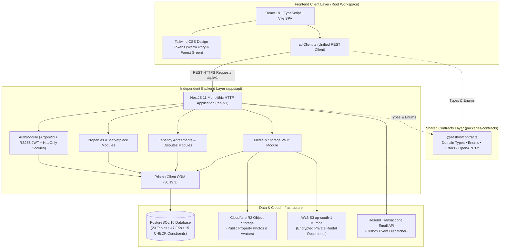

# AASHVO — REPOSITORY ARCHITECTURE SPECIFICATION
## RC-1.0.0 Monorepo Structure, Module Boundaries & Active Architecture

| Specification Metadata | Details |
| :--- | :--- |
| **Document Version** | 1.0.0 (Consolidated Master Architecture) |
| **Release Candidate** | AASHVO RC-1.0.0 |
| **Repository Topology** | Monorepo managed via npm workspaces |
| **Primary Workspaces** | Root (`aashvo`), `apps/api` (`@aashvo/api`), `packages/contracts` (`@aashvo/contracts`) |
| **Active Backend Engine** | Independent NestJS 11 + PostgreSQL 16 + Prisma ORM |

---

## 1. Confirmed Active System Architecture



---

## 2. Monorepo Directory Structure & Component Registry

```
D:\Projects\AASHVO\
├── .github/
│   └── workflows/
│       └── api-ci.yml             # Automated CI workflow for backend tests & linting
├── apps/
│   └── api/                       # Independent NestJS 11 Backend Application
│       ├── prisma/
│       │   ├── migrations/        # PostgreSQL 16 version-controlled DDL migrations
│       │   └── schema.prisma      # Authoritative database model (23 tables, relations, enums)
│       ├── src/
│       │   ├── common/            # Cross-cutting decorators, filters, guards, interceptors
│       │   ├── infrastructure/    # Config (Zod), Database (Prisma), Logger (Pino), Storage
│       │   ├── modules/           # Domain feature modules (Auth, Properties, Agreements, etc.)
│       │   ├── app.factory.ts     # Express application bootstrapper & security middleware
│       │   ├── app.module.ts      # Root NestJS dependency injection module
│       │   └── main.ts            # Production runtime entry point
│       ├── test/                  # 8 Jest integration test suites against PostgreSQL 16
│       ├── docker-compose.yml     # Local isolated PostgreSQL 16 container definition
│       ├── package.json           # Backend dependencies and scripts
│       └── tsconfig.json          # Backend TypeScript configuration
├── packages/
│   └── contracts/                 # Shared API Contracts & Schemas
│       ├── src/                   # Domain interfaces, enums, standardized error payloads
│       ├── openapi.json           # Generated OpenAPI 3.x specification (55 paths, 62 operations)
│       ├── package.json           # Contracts manifest (CJS + ESM dual export)
│       └── tsconfig.json          # Shared compiler configuration
├── public/                        # Static Assets & Crawl Directives
│   ├── llms.txt                   # LLM context & crawl instructions
│   ├── robots.txt                 # Search engine robots configuration
│   └── sitemap.xml                # SEO sitemap with canonical URLs
├── src/                           # Root React 18 Frontend Application
│   ├── components/                # Modular React UI components
│   │   ├── about/                 # OurFounders section component
│   │   ├── admin/                 # AdminModerationModal moderation interface
│   │   ├── auth/                  # AuthModal authentication & profile modals
│   │   ├── discovery/             # DiscoverySection filter & browse layout
│   │   ├── features/              # TrustFeatures trust badges & explainers
│   │   ├── flatmate/              # FlatmateCard & FlatmateDetailModal
│   │   ├── help/                  # HelpCenterModal & ReportModal
│   │   ├── hero/                  # ArchitecturalLandscape & Hero banners
│   │   ├── layout/                # Navbar & Footer
│   │   ├── listing/               # ListPropertyModal 5-step wizard
│   │   ├── property/              # PropertyCard, PropertyDetailModal, PropertyFilters
│   │   ├── rental/                # RentalTrustModal digital tenancy flows
│   │   └── ui/                    # Reusable atom components (Toast, etc.)
│   ├── context/                   # Global React state (AppContext.tsx)
│   ├── data/                      # Deterministic offline seeds & FAQ fixtures
│   ├── services/                  # Frontend service adapters
│   │   ├── apiClient.ts           # Unified REST client for NestJS backend
│   │   ├── authService.ts         # User authentication service
│   │   ├── marketplaceService.ts  # Listings, search, flatmate queries
│   │   ├── rentalTrustService.ts  # Agreements, payments, disputes
│   │   ├── storageService.ts      # Presigned media upload client
│   │   ├── supabase.ts            # Legacy adapter & test stubs
│   │   └── supportService.ts      # Customer support ticket operations
│   ├── styles/                    # Tailwind CSS custom styles & font definitions
│   ├── test/                      # 21 Vitest integration test suites (232 tests)
│   ├── types/                     # Core frontend TypeScript interfaces
│   ├── utils/                     # Formatting & currency utilities
│   ├── App.tsx                    # Root React router and modal container
│   ├── main.tsx                   # Frontend entry point
│   └── vite-env.d.ts              # Vite environment variable type declarations
├── supabase/                      # Legacy Supabase Archive & Rollback Target
│   ├── migrations/                # 12 historical SQL migrations (authoritative DDL history)
│   ├── .gitignore                 # Supabase CLI exclusions
│   └── config.toml                # Supabase CLI project settings (himtwnwxvnnykafyhysy)
├── docs/                          # Architecture & Engineering Documentation
│   ├── STAGING_*.md               # Staging runbooks, architecture, variables, acceptance
│   ├── MASTER_RELEASE_*.md        # Master release audit, completion, and QA reports
│   ├── INDEPENDENT_BACKEND_*.md   # Comprehensive backend design specifications
│   ├── POSTGRESQL_DATABASE_*.md   # Comprehensive PostgreSQL schema specifications
│   └── SPRINT_*.md                # Historical sprint logs and milestone audits
├── index.html                     # HTML5 single-page application entry point
├── package.json                   # Root monorepo workspace manifest
├── package-lock.json              # Version-controlled lockfile (npm v3 format)
├── tailwind.config.js             # Tailwind CSS tokens & color palette
├── tsconfig.json                  # Root TypeScript compiler options
├── vercel.json                    # Vercel deployment routing & preview configuration
└── vite.config.ts                 # Vite bundler build settings & test runner config
```

---

## 3. Strict Architectural Boundaries

1. **Frontend-to-Backend Interface:**
   - The React frontend communicates with the NestJS API strictly over HTTP/HTTPS at `/api/v1/*`.
   - Direct database connections from the browser are strictly prohibited.
2. **Database Boundary:**
   - PostgreSQL 16 is accessible only by the NestJS backend via internal VPC networking in staging/production, and local host loopback (`127.0.0.1:5433`) during development.
   - All schema mutations are version-controlled in `apps/api/prisma/migrations/`.
3. **Storage Boundary:**
   - Direct binary streaming through the NestJS compute instance is prohibited for property photos and documents.
   - The backend generates short-lived, pre-signed PUT URLs. The client uploads binaries directly to Cloudflare R2 or AWS S3.
4. **Legacy Supabase Boundary:**
   - The `supabase/` folder is retained strictly as an immutable archive of legacy migration files and configuration.
   - Staging and production configurations completely omit Supabase URLs and service keys.

