# Aashvo — Security Hardening & Test Verification Results

**Sprint:** Sprint 2 (Security Hardening and Test Foundation)  
**Date:** October 19, 2026  
**Auditor:** Interim CTO & Principal Application Security Engineer  
**Codebase:** `d:\Projects\AASHVO`  
**Execution Environment:** Node `v24.15.0`, npm `11.12.1`, Vite `6.0.11`, Vitest `5.0.5`, TypeScript `5.7.2`  

---

## 1. Executive Summary

During Sprint 2, the engineering team conducted an exhaustive application-security review and established a modern, automated test foundation for **Aashvo**. 

### Key Deliverables & Outcomes:
1. **Automated Test Foundation:** Installed and configured **Vitest** and **React Testing Library** with a dedicated test environment. Added 41 automated tests across 6 comprehensive test suites spanning cost calculations, multi-dimensional search filters, listing wizard validation, client state persistence, component rendering, and database authorization models. **Test pass rate: 100% (41/41 passing).**
2. **PostgreSQL / Supabase Security Hardening:** Conducted a deep static security analysis of migration scripts. Identified and mitigated direct-API bypasses, search path vulnerabilities, and contact scraping risks. Updated [`supabase/migrations/20261019000000_security_fixes.sql`](file:///d:/Projects/AASHVO/supabase/migrations/20261019000000_security_fixes.sql) with idempotent, defense-in-depth triggers and RLS policies.
3. **Database Architecture & Regional Evaluation:** Analyzed the current Supabase project located in Tokyo (`ap-northeast-1`). Evaluated network latency, Indian DPDP Act compliance, and architectural constraints. Formulated a zero-risk recommendation: retain Tokyo as a dev/CI sandbox, while provisioning an AWS Mumbai (`ap-south-1`) project for the live pilot.
4. **Clear Separation of Concerns:** Formally documented and tested the distinction between frontend presentation-only simulated personas (`localStorage`) and backend cryptographic authorization (PostgreSQL RLS & Supabase JWT).

---

## 2. Skills & Workflows Applied

In strict accordance with the audit directives, installed skills were discovered, inspected, and genuinely applied:

| Skill | Reference | Application in Sprint 2 |
| :--- | :--- | :--- |
| `agy-customizations` | [SKILL.md](file:///C:/Users/Lenovo/.gemini/antigravity-ide/builtin/skills/agy-customizations/SKILL.md) | Verified workspace configuration rules and prevented non-standard config drift. |
| `antigravity-guide` | [SKILL.md](file:///C:/Users/Lenovo/.gemini/antigravity-ide/builtin/skills/antigravity_guide/SKILL.md) | Used for background task orchestration, test process monitoring, and build execution. |
| `permissioned-github` | [SKILL.md](file:///C:/Users/Lenovo/.gemini/antigravity-ide/builtin/skills/permissioned-github/SKILL.md) | Governed safe local git state management; ensured zero uncommitted data loss and zero unauthorized external publication. |
| *Native AppSec & Test Workflows* | Vitest, JSDOM, React Testing Library, TypeScript | Built test infrastructure, component unit tests, and database authorization model tests. |

---

## 3. SQL Security & Defense-in-Depth Analysis

A real database security review must treat triggers and RLS policies as defensive layers that can be probed via direct PostgREST HTTP calls (e.g. via `curl`, Postman, or client SDKs), completely bypassing frontend UI restrictions.

### 3.1 Security Definer Search Path Hardening
* **Vulnerability:** `SECURITY DEFINER` functions in PostgreSQL execute with the privileges of the function owner (typically `postgres` or `supabase_admin`). Without an explicit `search_path`, malicious schemas in search paths can lead to privilege escalation.
* **Remediation:** Added `SET search_path = public, pg_temp;` to all security definer functions:
  * `public.is_admin()`
  * `public.enforce_profile_role_integrity()`
  * `public.enforce_property_moderation_integrity()`

### 3.2 Role Escalation Defense (INSERT & UPDATE)
* **Vulnerability:** The initial schema allowed authenticated users to update their own profile, permitting any renter to execute `UPDATE profiles SET role = 'admin' WHERE id = auth.uid();`. Furthermore, an initial trigger only checked `UPDATE OF role`, which left direct `INSERT` open if an insert policy were added.
* **Remediation:** Trigger `trg_prevent_role_escalation` now runs `BEFORE INSERT OR UPDATE OF role ON public.profiles`. Any attempt by a non-admin to set or change `role` to anything other than `'renter'` raises a hard PostgreSQL exception.

### 3.3 Listing Moderation Bypass Defense (Direct API INSERT & UPDATE)
* **Vulnerability:** In `20261018000000_initial_schema.sql`, the RLS `INSERT` policy checked only `auth.uid() = owner_id`. An attacker could send a direct `POST /rest/v1/properties` with `"status": "active"`, bypassing the editorial review queue.
* **Remediation:** Trigger `trg_prevent_status_bypass` now executes on `BEFORE INSERT OR UPDATE OF status ON public.properties`. If a non-admin attempts to insert or update a listing with `status = 'active'`, the database forcibly overrides `NEW.status := 'pending_review'::public.moderation_status`.

### 3.4 Contact Data Scraping & Secure Public View
* **Vulnerability:** The initial policy `Public profiles are readable by authenticated users` permitted any logged-in user to query `SELECT phone_number, email FROM public.profiles;`.
* **Remediation:**
  1. Restricted `public.profiles` SELECT policy strictly to `auth.uid() = id OR public.is_admin()`.
  2. Created a secure public view `public.public_profiles` exposing only `id`, `full_name`, `avatar_url`, `role`, `id_verified`, and `phone_verified` (zero phone numbers or emails).
  3. Granted `SELECT ON public.public_profiles TO anon, authenticated`.

### 3.5 Flatmate Connection Inquiry Access
* **Vulnerability:** The initial `interest_requests` RLS SELECT policy only allowed the sender, property owner, or admin to view inquiries, completely locking out flatmates receiving connection requests (`target_flatmate_id`).
* **Remediation:** Updated RLS policy to include:
  ```sql
  EXISTS (
    SELECT 1 FROM public.flatmate_profiles f
    WHERE f.id = interest_requests.target_flatmate_id AND f.user_id = auth.uid()
  )
  ```

### 3.6 Storage Bucket Isolation & Ownership Restrictions
* **Remediation in [supabase/migrations/20261019000000_security_fixes.sql](file:///d:/Projects/AASHVO/supabase/migrations/20261019000000_security_fixes.sql):**
  * `property-photos` bucket: Public read, 5MB file size limit, allowed MIME types (`image/jpeg`, `image/png`, `image/webp`), authenticated upload scoped to `(storage.foldername(name))[1] = auth.uid()::text`, and delete restricted to uploader or admin.
  * `user-avatars` bucket: Public read, 2MB file size limit, upload and update/delete restricted to `(storage.foldername(name))[1] = auth.uid()::text`.

---

## 4. Frontend State vs. Real Database Enforcement

A fundamental security finding of this audit is the distinction between frontend simulation and backend enforcement:

* **Presentation-Only Simulation:** In [src/context/AppContext.tsx](file:///d:/Projects/AASHVO/src/context/AppContext.tsx), `loginAs(role)` stores a mock user object in browser `localStorage` (`aashvo_current_user`). This allows stakeholders to evaluate different UI perspectives (Renter, Owner, Broker, Admin) during development.
* **Zero Backend Trust:** The browser's `localStorage` is **never trusted** by the database. In production, Supabase Auth issues cryptographically signed JWTs containing user claims (`auth.uid()`). The PostgreSQL RLS engine evaluates policies against the validated JWT, rendering client-side tampering completely ineffective against the database.

---

## 5. Automated Test Foundation & Test Results

A test foundation using **Vitest** and **React Testing Library** was integrated without dependency bloat.

### 5.1 Test Suites Summary
```text
Test Files:  6 passed (6)
Tests:       41 passed (41)
Duration:    4.68s
```

| Test File | Focus Area | Tests | Status |
| :--- | :--- | :---: | :---: |
| [`src/test/costCalculations.test.ts`](file:///d:/Projects/AASHVO/src/test/costCalculations.test.ts) | INR formatting, itemized outlay calculator, freshness badges, provider badges | 8 | **PASS** |
| [`src/test/searchFilters.test.ts`](file:///d:/Projects/AASHVO/src/test/searchFilters.test.ts) | Locality clusters, room type, budget slider, provider filters, empty states | 8 | **PASS** |
| [`src/test/listingValidation.test.ts`](file:///d:/Projects/AASHVO/src/test/listingValidation.test.ts) | Step 1–5 form validation (title, address, rent > 0, declaration agreement) | 4 | **PASS** |
| [`src/test/stateAndSecurity.test.ts`](file:///d:/Projects/AASHVO/src/test/stateAndSecurity.test.ts) | Persona switching, localStorage sync, visit inquiries, report resolution | 4 | **PASS** |
| [`src/test/authorizationPolicies.test.ts`](file:///d:/Projects/AASHVO/src/test/authorizationPolicies.test.ts) | Database RLS & Trigger authorization model across 5 roles | 15 | **PASS** |
| [`src/test/PropertyCard.test.tsx`](file:///d:/Projects/AASHVO/src/test/PropertyCard.test.tsx) | React Testing Library component rendering, accessibility, and click/key events | 2 | **PASS** |

### 5.2 Quality Gates Execution
* **TypeScript Compiler (`npm run typecheck`):** Clean exit code `0` (`tsc --noEmit`, strict mode).
* **Production Build (`npm run build`):** Clean exit code `0` (Compiled in `4.09s`).
* **Linting Setup Decision:** Strict TypeScript (`strict: true`, `noUnusedLocals: true`, `noUnusedParameters: true`) already enforces code cleanliness. Heavyweight ESLint packages were intentionally avoided to prevent dependency bloat and version conflicts with Vite 6.

---

## 6. Database Regional Architecture: Tokyo vs. Mumbai

### 6.1 Current Status
Dashboard information indicates that the currently provisioned Supabase development project is hosted in **Tokyo (`ap-northeast-1`)**.

### 6.2 Technical Constraints
* **Immutability of Region:** In Supabase, the underlying AWS RDS PostgreSQL instance is deployed in a fixed availability zone. **A project's region cannot be changed in place.** Relocating a project requires creating a new project in the target region and running the database migrations.
* **Credentials Security:** No secret keys or service-role keys are exposed or printed in this repository.

### 6.3 Regional Comparison Matrix (Tokyo vs. Mumbai)

| Evaluation Dimension | Current Development (Tokyo `ap-northeast-1`) | Target Production (Mumbai `ap-south-1`) |
| :--- | :--- | :--- |
| **Network Round-Trip Latency** | **130ms – 180ms** (Delhi NCR to Tokyo ~5,800 km) | **15ms – 28ms** (Delhi NCR to Mumbai ~1,150 km) |
| **User Experience (Mobile 4G/5G)** | Noticeable lag on search filters, auth checks, and listing clicks. | Near-instantaneous response times, essential for high conversion. |
| **Data Residency & DPDP Act 2023** | User data resides in Japan. Requires cross-border data transfer review. | Direct compliance with Indian data sovereignty principles for rental data. |
| **Database Connection Pool Overhead** | Higher handshake overhead on cold connections. | Low-latency connection pooling via Supavisor. |
| **Current Project Status** | Already provisioned; safe for staging and CI testing. | Requires provisioning approval prior to launch. |

### 6.4 Strategic Recommendation
1. **Preserve Current Tokyo Project:** Keep the Tokyo project intact as a zero-cost development sandbox for testing schema migrations and continuous integration. Do **not** delete it.
2. **Provision Mumbai for Production Pilot:** When moving to real user onboarding in Delhi NCR, provision a fresh project in **AWS Mumbai (`ap-south-1`)**. Apply `20261018000000_initial_schema.sql` followed by `20261019000000_security_fixes.sql`.

---

## 7. Repeatable Verification Plan Across 5 Personas

Prior to production release, execute the following verification matrix:

```mermaid
flowchart TD
    Anon[1. Anonymous User] -->|Can View| ActiveListings[Active Listings & Photos]
    Anon -->|Blocked| PendingListings[Pending / Paused Listings]
    Anon -->|Blocked| RawPhones[Unmasked Phone Numbers]
    
    Renter[2. Authenticated Renter] -->|Can Submit| Inquiries[Interest Requests]
    Renter -->|Blocked| RoleEscalation[Elevating to Admin]
    
    Owner[3. Listing Owner] -->|Can Update| OwnListing[Own Property Details]
    Owner -->|Blocked| DirectApprove[Setting status = 'active']
    
    Flatmate[4. Flatmate Recipient] -->|Can View| ReceivedRequests[Inquiries sent to their ID]
    Flatmate -->|Blocked| ThirdPartyInquiries[Other Users' Inquiries]
    
    Admin[5. Administrator] -->|Can Access| ModConsole[Safety & Moderation Console]
    Admin -->|Can Perform| StatusApproval[Approve / Pause Listings & Resolve Reports]
```



### Test Scenarios:
1. **Anonymous User:**
   - Query `public.properties` without JWT → Returns only `status = 'active'`.
   - Query `public.profiles` without JWT → RLS denies access; query `public.public_profiles` view succeeds with masked data.
2. **Authenticated Renter:**
   - Attempt `UPDATE profiles SET role = 'admin'` → Blocked with exception: *"Privilege escalation rejected"*.
   - Send interest request to a property → Successfully creates row with `sender_id = auth.uid()`.
3. **Listing Owner:**
   - Submit new property listing → Successfully creates row with `status = 'pending_review'`.
   - Attempt direct API `UPDATE properties SET status = 'active'` → Trigger overrides status back to `'pending_review'`.
4. **Inquiry Recipient (Flatmate):**
   - Query `interest_requests` as target flatmate → Row is visible.
   - Query `interest_requests` as an unrelated third party → Empty result set.
5. **Administrator:**
   - Open Moderation Console → Views all pending community reports and inventory.
   - Update property status to `'active'` → Succeeds.
   - Dismiss community report → Successfully resolves and persists status.

---

## 8. Prioritized Next Steps

1. **Step 1:** Maintain current working tree and verified test foundation.
2. **Step 2:** Request stakeholder approval for provisioning the production Supabase instance in Mumbai (`ap-south-1`).
3. **Step 3:** Install `@supabase/supabase-js` and configure the client SDK adapter in `src/services/supabase.ts` with local fallback support.
4. **Step 4:** Execute the repeatable 5-persona verification plan against the live Mumbai database staging instance.
