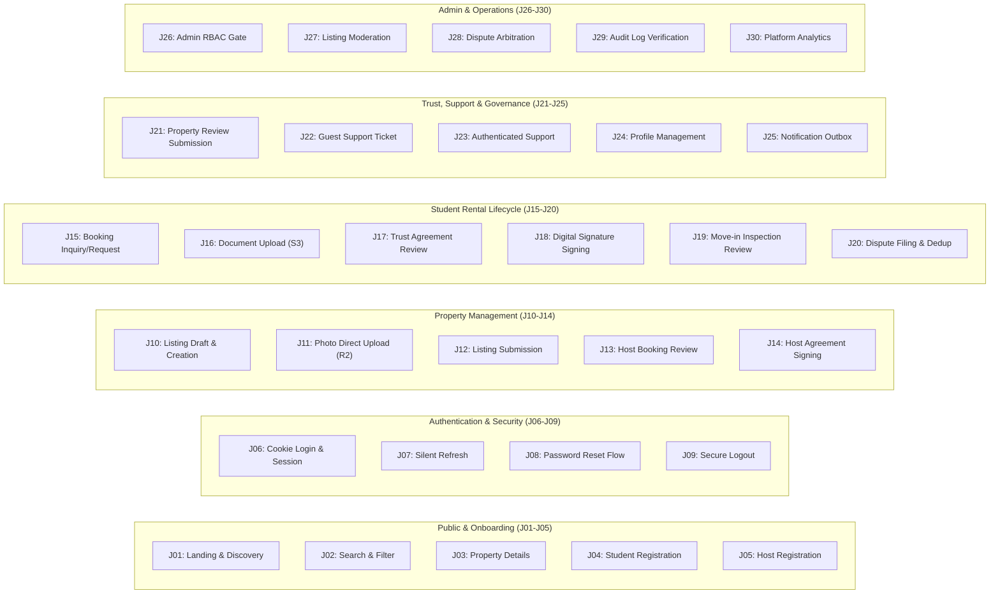

# AASHVO STAGING ACCEPTANCE TEST PLAN
## RC-1.0.0 End-to-End Verification Matrix & Smoke Test Suite

| Document Metadata | Specification |
| :--- | :--- |
| **Document Version** | 1.0.0 (Master Release Candidate) |
| **Frontend Staging Target** | `https://staging.aashvo.vercel.app` |
| **Backend API Staging Target** | `https://api-staging.aashvo.com/api/v1` |
| **OpenAPI Specification** | `https://api-staging.aashvo.com/api/v1/docs` (55 paths, 62 operations) |
| **Acceptance Threshold** | 100% of P0 & P1 test journeys must pass; 0 unhandled HTTP 500 errors |
| **Performance SLA** | P95 latency < 200ms for read endpoints; P95 latency < 500ms for write endpoints |

---

## 1. Testing Personas & Test Credentials

The staging environment utilizes dedicated test accounts seeded into the staging PostgreSQL database. No production user data is utilized.

| Persona ID | Role | Staging Email | Purpose & Capability |
| :--- | :--- | :--- | :--- |
| **PER-01** | Student / Tenant | `staging-student@aashvo.internal` | Browsing, booking requests, rental agreement signing, inspection review, dispute filing, reviews. |
| **PER-02** | Host / Landlord | `staging-host@aashvo.internal` | Property listing creation, media upload, booking acceptance/rejection, agreement counter-signing, inspection checklists. |
| **PER-03** | Operational Staff | `staging-staff@aashvo.internal` | Moderation queue processing, listing verification, inspection verification. |
| **PER-04** | Admin | `staging-admin@aashvo.internal` | Platform governance, dispute arbitration, user suspension, audit log review, metrics. |
| **PER-05** | Guest (Unauthenticated) | Anonymous / Unregistered | Public landing page, search/filter properties, view property details, contact support ticket. |

---

## 2. The 30-Journey End-to-End Acceptance Matrix



### Detailed Journey Specifications

| ID | Domain | User Persona | Journey Description | Critical Endpoint(s) | Expected Outcome | Priority |
| :--- | :--- | :--- | :--- | :--- | :--- | :--- |
| **J-01** | Discovery | Guest | Navigate to staging landing page, view hero, featured properties, and city pills. | `GET /` | Fast initial render (< 1.5s LCP), zero console errors, responsive layout. | P0 |
| **J-02** | Search | Guest | Search properties with filters: Bangalore, ₹8,000–₹15,000, Private Room, WiFi amenity. | `GET /api/v1/properties/search` | Correct filtered listings returned in < 150ms; pagination links valid. | P0 |
| **J-03** | Details | Guest | View full property details page, photo gallery, amenities, host profile card, and map pin. | `GET /api/v1/properties/:slug` | Property payload rendered cleanly; images load with Cloudflare CDN caching. | P0 |
| **J-04** | Onboarding | Guest | Register new student account with valid credentials. | `POST /api/v1/auth/register` | 201 Created; verification email queued; returns sanitised user entity (no password hash). | P0 |
| **J-05** | Onboarding | Guest | Register new host account with phone number and institutional details. | `POST /api/v1/auth/register` | 201 Created; user role set to `HOST`; profile row initialized. | P0 |
| **J-06** | Auth | Student | Log in with email and password; verify HttpOnly cookies. | `POST /api/v1/auth/login` | 200 OK; `Set-Cookie` contains `aashvo_access_token` and `aashvo_refresh_token` with `HttpOnly; Secure; SameSite=None`. | P0 |
| **J-07** | Auth | Student | Access protected endpoint, allow access token expiry, trigger silent refresh. | `POST /api/v1/auth/refresh` | 200 OK; new access token cookie issued transparently without user re-authentication. | P0 |
| **J-08** | Auth | Student | Request password reset email, retrieve token, submit new password. | `POST /api/v1/auth/forgot-password`<br>`POST /api/v1/auth/reset-password` | Password updated; old sessions invalidated; successful subsequent login with new password. | P1 |
| **J-09** | Auth | Student | Log out from staging app. | `POST /api/v1/auth/logout` | 200 OK; access and refresh cookies expired (Max-Age=0); session marked revoked in DB. | P0 |
| **J-10** | Host | Host | Create new draft property listing with title, description, rent, deposit, and address. | `POST /api/v1/properties` | 201 Created; listing status is `DRAFT`; ownership assigned to host. | P0 |
| **J-11** | Storage | Host | Request presigned upload URL for property photo and upload binary to Cloudflare R2. | `POST /api/v1/storage/presign`<br>`PUT <R2_PRESIGNED_URL>` | Presigned URL generated; direct client-to-R2 upload succeeds with 200 OK; photo attached to listing. | P0 |
| **J-12** | Host | Host | Submit draft property for operational review and moderation. | `POST /api/v1/properties/:id/submit` | 200 OK; status transitions to `PENDING_REVIEW`; listing appears in staff moderation queue. | P0 |
| **J-13** | Host | Host | View incoming booking requests, accept an inquiry, and generate draft agreement. | `GET /api/v1/bookings/host`<br>`POST /api/v1/bookings/:id/accept` | Booking status changes to `ACCEPTED`; agreement entity auto-spawned in DB. | P0 |
| **J-14** | Host | Host | Review agreement terms, apply digital signature, and submit counter-signature. | `POST /api/v1/agreements/:id/sign` | Digital signature recorded with host IP, timestamp, user-agent; status transitions if both signed. | P0 |
| **J-15** | Booking | Student | Submit booking request for an active property with selected move-in date. | `POST /api/v1/bookings` | 201 Created; status `REQUESTED`; host notified via outbox. | P0 |
| **J-16** | Storage | Student | Upload sensitive identity document (Government ID / Student ID) to AWS S3 Mumbai. | `POST /api/v1/storage/presign`<br>`PUT <S3_PRESIGNED_URL>` | Direct presigned upload to S3 `ap-south-1`; private ACL verified (cannot be fetched via public URL). | P0 |
| **J-17** | Trust | Student | View generated standard rental trust agreement with room inventory and house rules. | `GET /api/v1/agreements/:id` | Agreement clauses loaded cleanly; parties verified (student and host IDs match). | P0 |
| **J-18** | Trust | Student | Electronically sign the rental trust agreement. | `POST /api/v1/agreements/:id/sign` | Signature hash computed; agreement record updated; audit event logged. | P0 |
| **J-19** | Trust | Student | Complete move-in condition inspection checklist with photographic evidence. | `POST /api/v1/inspections/:id/acknowledge` | Inspection items marked verified; digital acknowledgement stored with timestamp. | P1 |
| **J-20** | Trust | Student | File a dispute regarding security deposit; attempt duplicate submission to verify dedup. | `POST /api/v1/disputes` | First submission creates dispute ticket; duplicate request within 5s returns 409 Conflict. | P0 |
| **J-21** | Review | Student | Submit rating (1–5 stars) and textual review for completed stay. | `POST /api/v1/reviews` | 201 Created; property aggregate rating recalculated; review visible on property details. | P1 |
| **J-22** | Support | Guest | Submit support inquiry from unauthenticated contact form with email, subject, message. | `POST /api/v1/support/tickets` | 201 Created; ticket status `OPEN`; acknowledgment email sent via Resend. | P1 |
| **J-23** | Support | Student | Submit authenticated support ticket, attach screenshot, view ticket response history. | `POST /api/v1/support/tickets`<br>`GET /api/v1/support/tickets` | Ticket associated with student account; audit trail updated. | P1 |
| **J-24** | Profile | Student | Update profile name, phone number, bio, and emergency contact details. | `PATCH /api/v1/users/me` | 200 OK; profile updated; email change requires re-verification. | P1 |
| **J-25** | System | System | Trigger async notification (email/in-app) and verify outbox processing. | Internal worker process | Event written to `outbox_events` and dispatched without dropping messages. | P1 |
| **J-26** | Admin | Student | Attempt to access admin endpoints as student (unauthorized check). | `GET /api/v1/admin/users` | 403 Forbidden; attempt logged in security audit table. | P0 |
| **J-27** | Admin | Staff/Admin | Review pending property listing, verify safety checklist, and approve listing. | `POST /api/v1/admin/properties/:id/approve` | Listing status changes to `ACTIVE`; property immediately appears in public search. | P0 |
| **J-28** | Admin | Admin | Arbitrate an open rental dispute, review evidence, award partial refund, close dispute. | `POST /api/v1/admin/disputes/:id/resolve` | Dispute status updated to `RESOLVED`; both tenant and host receive notification. | P1 |
| **J-29** | Admin | Admin | Query platform security and audit logs with date and action filters. | `GET /api/v1/admin/audit-logs` | Structured audit trail returned with actor ID, IP, user-agent, entity, and diff. | P1 |
| **J-30** | Admin | Admin | Access platform operational dashboard (active listings, GMV, disputes, uptime). | `GET /api/v1/admin/analytics/summary` | Aggregate metrics computed accurately in < 200ms without full-table locks. | P1 |

---

## 3. Dedicated Security & Smoke Test Procedures

### Test 1: Cross-Domain Cookie Verification (HttpOnly / Secure / SameSite=None)
Execute via terminal against the staging API:
```bash
curl -i -X POST https://api-staging.aashvo.com/api/v1/auth/login \
  -H "Content-Type: application/json" \
  -d '{"email":"staging-student@aashvo.internal","password":"StagingPassword123!"}' \
  | grep -i "set-cookie"
```
**Verification Requirements:**
- Must contain `aashvo_access_token=...; HttpOnly; Secure; SameSite=None; Path=/; Max-Age=900`.
- Must contain `aashvo_refresh_token=...; HttpOnly; Secure; SameSite=None; Path=/; Max-Age=604800`.
- Browser JavaScript (`document.cookie`) must NOT be able to read these tokens.

### Test 2: Direct Storage Uploads (Cloudflare R2 Public & AWS S3 Private)
1. **R2 Public Upload:**
   - Request presigned URL: `POST /api/v1/storage/presign` with `{"bucket":"public","filename":"test_photo.jpg","contentType":"image/jpeg"}`.
   - Upload sample JPEG using `PUT <presigned_url>`.
   - Access uploaded file via public CDN domain: `https://public.aashvo.com/<key>`. Verify status 200 OK and valid image header.
2. **S3 Private Upload:**
   - Request presigned URL: `POST /api/v1/storage/presign` with `{"bucket":"private","filename":"test_id.pdf","contentType":"application/pdf"}`.
   - Upload sample PDF using `PUT <presigned_url>`.
   - Attempt to access the S3 URL directly without signature: Must return **403 AccessDenied**.
   - Request temporary download URL via backend: `GET /api/v1/storage/download?key=<key>`: Must return temporary signed URL that downloads successfully.

### Test 3: Dispute Deduplication & Idempotency
Execute two rapid concurrent dispute creation requests with the same booking ID:
```bash
# Request 1:
curl -X POST https://api-staging.aashvo.com/api/v1/disputes \
  -H "Cookie: aashvo_access_token=..." \
  -H "Content-Type: application/json" \
  -d '{"bookingId":"bkg_123","category":"DEPOSIT","description":"Dispute test"}'
# Response: 201 Created

# Request 2 (immediate re-submission):
curl -X POST https://api-staging.aashvo.com/api/v1/disputes \
  -H "Cookie: aashvo_access_token=..." \
  -H "Content-Type: application/json" \
  -d '{"bookingId":"bkg_123","category":"DEPOSIT","description":"Dispute test"}'
# Response: 409 Conflict {"message":"An active dispute already exists for this booking"}
```

---

## 4. Staging Acceptance Pass / Fail Criteria

| Evaluation Area | Passing Standard | Failing Condition |
| :--- | :--- | :--- |
| **P0 User Journeys (18/18)** | 100% of P0 journeys execute without failure. | Any P0 journey fails, halts, or causes data corruption. |
| **P1 User Journeys (12/12)** | ≥ 95% passing (at most 1 non-blocking edge-case issue). | > 1 P1 journey fails. |
| **API Error Rate** | Overall 5xx error rate < 0.1% during smoke test suite. | Any unhandled 500 Internal Server Error observed. |
| **Response Latency** | P95 latency < 200ms (read), < 500ms (write). | P95 latency > 1,000ms. |
| **Security Audit** | 0 critical or high CVEs exposed to untrusted input; all endpoints enforce JWT/RBAC. | Any unauthenticated access to private data. |
| **Data Integrity** | Zero schema divergences; all foreign keys, CHECK constraints, and audit logs active. | Orphaned records or schema violations detected. |

---

## 5. Sign-Off Authorization Block

Execution of this acceptance test plan will be conducted immediately following staging deployment provisioning. Upon 100% pass rate of P0/P1 criteria, the team will issue the official **Staging Verification Certificate** clearing AASHVO for live beta onboarding.

