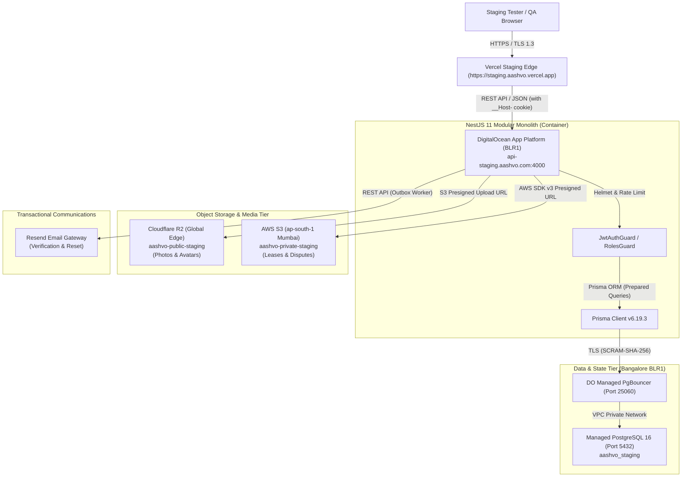
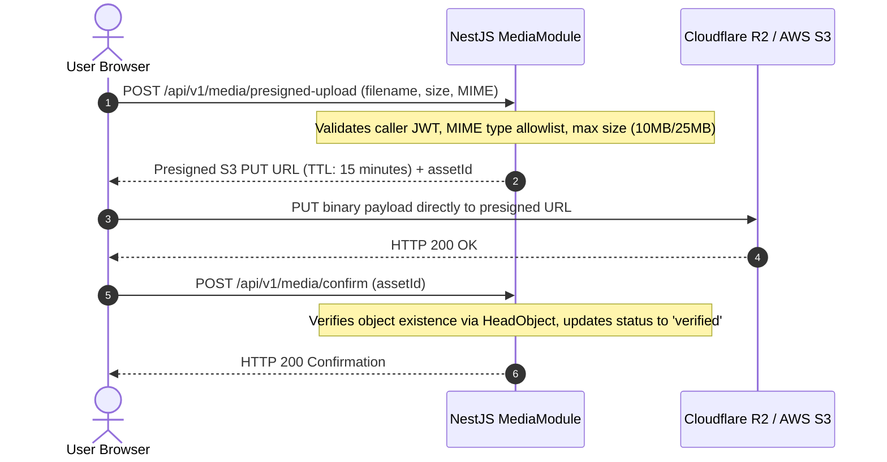

# AASHVO — STAGING INFRASTRUCTURE ARCHITECTURE
## End-to-End System Topology, Network Security, Secrets Management & Data Isolation

**Author:** Chief Technology Officer & Principal Infrastructure Architect  
**Project:** AASHVO Platform  
**Target Release Candidate:** `rc-1.0.0-independent`  
**Date:** November 15, 2026  
**Architecture Status:** **PLANNED & VERIFIED — READY FOR PROVISIONING**

---

## 1. END-TO-END STAGING TOPOLOGY

The staging environment replicates the complete production micro-architecture while maintaining strict data and credential isolation from legacy Supabase and production systems:

---

## 2. NETWORK & ACCESS-CONTROL ARCHITECTURE

### A. Ingress & TLS Termination
1. **Frontend:** Hosted on Vercel staging preview branch (`staging.aashvo.vercel.app`), terminated with TLS 1.3 certificates automatically managed by Let's Encrypt.
2. **Backend API:** Hosted on DigitalOcean App Platform (`api-staging.aashvo.com`), terminated with automated Cloudflare/DigitalOcean managed TLS 1.3 certificates.
3. **CORS Enforcement:** The API rejects any origin not listed in `CORS_ALLOWED_ORIGINS` (`https://staging.aashvo.vercel.app`). Wildcard `*` origins are blocked at startup.

### B. Database Network Isolation
1. **VPC Peering:** Managed PostgreSQL is placed inside the DigitalOcean **Bangalore VPC** (`10.120.0.0/16`).
2. **Trusted Sources (Firewall):** Incoming connections to PostgreSQL port 25060 are restricted strictly to:
   - DigitalOcean App Platform VPC internal IP range.
   - The specific authorized deployment CI runner IP address.
3. **Transport Security:** All connections enforce `sslmode=require` using the DigitalOcean root CA certificate (`ca-certificate.crt`).

---

## 3. SECRETS MANAGEMENT & CONFIGURATION PLAN

Under the Twelve-Factor App methodology, zero secrets or credentials exist in Git repositories, documentation, or client-side bundles:

| Secret Name | Storage Location | Rotation Interval | Injected Scope |
| :--- | :--- | :--- | :--- |
| `DATABASE_URL` | DigitalOcean App Platform Encrypted Env | 90 Days | Backend Runtime |
| `JWT_SIGNING_PRIVATE_KEY` | DigitalOcean App Platform Encrypted Env | 180 Days | Backend Runtime |
| `JWT_SIGNING_PUBLIC_KEY` | DigitalOcean App Platform Encrypted Env | 180 Days | Backend Runtime |
| `COOKIE_SECRET` | DigitalOcean App Platform Encrypted Env | 90 Days | Backend Runtime |
| `CLOUDFLARE_R2_SECRET_ACCESS_KEY` | DigitalOcean App Platform Encrypted Env | 90 Days | Backend Runtime |
| `AWS_SECRET_ACCESS_KEY` | DigitalOcean App Platform Encrypted Env | 90 Days | Backend Runtime |
| `RESEND_API_KEY` | DigitalOcean App Platform Encrypted Env | 90 Days | Backend Runtime |

**Environment Separation Rule:**
- Staging credentials MUST NOT share any key, secret, or database with production or hosted Supabase (`himtwnwxvnnykafyhysy`).
- All staging database names are suffixed with `_staging`.
- All staging storage buckets are suffixed with `-staging`.

---

## 4. STORAGE ACCESS & UPLOAD SECURITY ARCHITECTURE

### Security Controls:
1. **Direct-to-Storage Uploads:** File streams bypass the Node.js application server, eliminating memory exhaustion vulnerabilities.
2. **MIME & Extension Enforcement:** Only `image/jpeg`, `image/png`, `image/webp`, and `application/pdf` are accepted. Executables (`.exe`, `.sh`, `.php`, `.js`) are strictly rejected.
3. **Private Document Protection:** Rental agreements and dispute evidence in AWS S3 are stored with **Block All Public Access = ON**. Access requires a short-lived presigned GET URL (TTL: 10 minutes) generated by `MediaModule` only after verifying that the caller is a party to the lease or an administrator.

---

## 5. LOGGING, OBSERVABILITY & HEALTH MONITORING

1. **Structured Logging (Pino):**
   - High-performance asynchronous JSON logging via `nestjs-pino`.
   - Automatic redaction of sensitive fields: `password`, `accessToken`, `cookie`, `authorization`.
   - Every log record binds the request correlation ID (`X-Request-ID`).
2. **Health Endpoints:**
   - Liveness Check: `GET /api/v1/health` (Reports process uptime and memory usage).
   - Readiness Check: `GET /api/v1/health/ready` (Executes `SELECT 1` on PostgreSQL to confirm active connection).
3. **Alerting Thresholds:**
   - DigitalOcean App Platform CPU > 80% for 5 minutes.
   - App Platform Memory > 85% for 3 minutes.
   - Database Connection Pool Usage > 80%.

---

## 6. BACKUP & CONTINUITY ARCHITECTURE

- **Staging Database Backups:** Automated daily snapshots enabled on DigitalOcean Managed PostgreSQL with a 7-day retention window.
- **Rollback Safety:** The legacy Supabase project (`himtwnwxvnnykafyhysy`) remains completely untouched in read-only mode, serving as the ultimate historical fallback.

