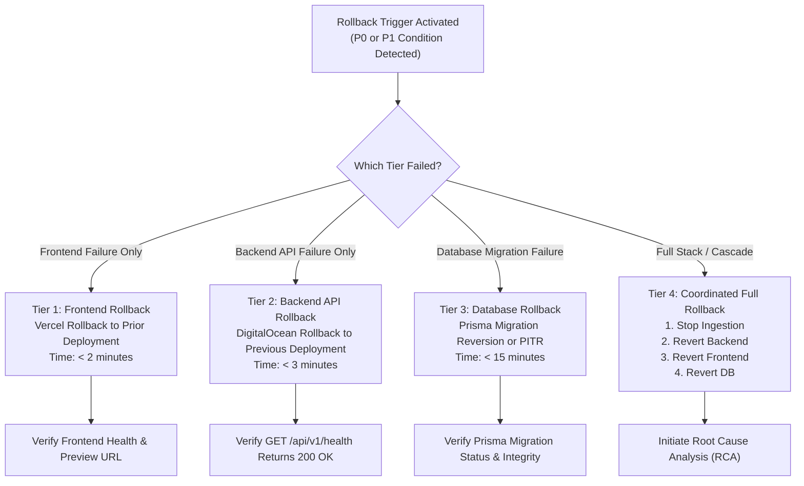

# AASHVO STAGING ROLLBACK PLAN
## Rapid Incident Recovery, Rollback Automation & Zero-Impact Protocol

| Document Metadata | Specification |
| :--- | :--- |
| **Document Version** | 1.0.0 (Staging Readiness) |
| **Target Infrastructure** | Staging (DigitalOcean App Platform BLR1, DO Managed PostgreSQL BLR1, Vercel Preview) |
| **Target Recovery Time Objective (RTO)** | Frontend: < 2 minutes \| Backend: < 5 minutes \| Database: < 15 minutes |
| **Target Recovery Point Objective (RPO)** | Data: RPO = 0 for backward-compatible schema; RPO < 5 minutes for point-in-time restore |
| **System Isolation Boundary** | Production Supabase (`himtwnwxvnnykafyhysy`) is strictly Air-Gapped / Isolated |

---

## 1. Rollback Trigger Criteria

An automated or manual rollback must be triggered immediately if any of the following conditions are met during staging deployment or post-deployment acceptance testing:

| Severity | Rollback Trigger Metric | Evaluation Window | Response SLA | Action Initiator |
| :--- | :--- | :--- | :--- | :--- |
| **P0 (Blocker)** | Health check endpoint (`GET /api/v1/health`) fails 3 consecutive times (returns non-200 or times out > 5s). | 60 seconds | Immediate (< 60s) | Automated (DO App Platform) / DevOps |
| **P0 (Blocker)** | Database migration failure (`prisma migrate deploy` exits with code > 0 or deadlocks). | During deploy step 6 | Immediate (< 30s) | Deployment Pipeline / Manual Script |
| **P0 (Blocker)** | Authentication cascade failure (HttpOnly cookie cannot be decrypted, refresh tokens fail 100%). | 3 minutes | < 2 minutes | QA Lead / DevOps |
| **P1 (Critical)** | HTTP 5xx error rate exceeds 2.0% across all API requests during smoke tests. | 5 minutes | < 5 minutes | QA Lead / Backend Lead |
| **P1 (Critical)** | P95 API response latency exceeds 1,500ms under nominal single-user smoke testing. | 5 minutes | < 5 minutes | DevOps / QA Lead |
| **P1 (Critical)** | Storage upload failure (100% presigned URL generation fails or R2/S3 signatures rejected). | 5 minutes | < 5 minutes | QA Lead |
| **P2 (Major)** | Frontend asset loading failure (Vite chunk 404, white-screen React crash on entry). | 2 minutes | < 2 minutes | QA Lead / Frontend Lead |

---

## 2. Multi-Tier Rollback Procedures



---

### Tier 1: Frontend Rollback (Vercel Preview / Staging)
*Target RTO: < 2 minutes*

When frontend errors occur (white screens, broken bundle chunks, routing errors) but the backend API is healthy:

1. **Identify Previous Stable Deployment ID:**
   ```bash
   vercel deployment ls --scope=aashvo-team
   ```
2. **Instant Instantaneous Aliasing:**
   Promote the previous verified staging deployment alias:
   ```bash
   vercel alias set <previous-stable-deployment-url> staging.aashvo.vercel.app
   ```
   *Alternatively in Vercel UI:*
   - Navigate to **Project > Deployments**.
   - Locate the previous successful deployment.
   - Click the three dots `...` and select **Promote to Staging** / **Instant Rollback**.
3. **Verify Frontend Availability:**
   - Execute HTTP status check:
     ```bash
     curl -I -s https://staging.aashvo.vercel.app | grep "HTTP/"
     ```
   - Verify bundle asset loading:
     Open browser in incognito mode and confirm login page renders without JavaScript console errors.

---

### Tier 2: Backend API Rollback (DigitalOcean App Platform)
*Target RTO: < 3 minutes*

When the NestJS API container fails health checks, crashes on boot, or exhibits high 5xx error rates:

1. **Revert Deployment via DigitalOcean CLI (doctl):**
   ```bash
   # List recent deployments for the app
   doctl apps list-deployments $DO_APP_ID

   # Rollback to the previous deployment ID
   doctl apps create-deployment $DO_APP_ID --deployment-id <previous-deployment-id>
   ```
2. **Revert via DigitalOcean Web Console:**
   - Go to **DigitalOcean Console > Apps > `aashvo-api-staging`**.
   - Navigate to the **Activity** or **Deployments** tab.
   - Click on the previous successful deployment.
   - Click **Actions > Rollback to this deployment**.
3. **Container Traffic Cutover:**
   DigitalOcean App Platform performs zero-downtime blue/green rollbacks: traffic is only routed to the rolled-back container once its health check (`GET /api/v1/health`) passes.
4. **Verify Backend Health:**
   ```bash
   curl -i https://api-staging.aashvo.com/api/v1/health
   # Expected response: HTTP/1.1 200 OK {"status":"ok","timestamp":"..."}
   ```

---

### Tier 3: Database Rollback (PostgreSQL 16 on DigitalOcean)
*Target RTO: < 15 minutes*

Database rollbacks require careful handling depending on whether the failed migration caused a broken state or partial execution.

#### Scenario A: Backward-Compatible Migration Failure (Zero Data Loss)
In accordance with our zero-downtime migration policy, all migrations are strictly additive (no destructive drops or renames without multi-phase deprecation).
1. **Identify Failed Migration State:**
   ```bash
   npx prisma migrate status --schema=apps/api/prisma/schema.prisma
   ```
2. **Mark Migration as Rolled Back (if failed midway):**
   ```bash
   npx prisma migrate resolve --rolled-back "<migration_folder_name>" --schema=apps/api/prisma/schema.prisma
   ```
3. **Apply Compensating Down Migration (if tables or columns were created):**
   If an additive migration created a table or constraint that needs explicit removal, execute a compensating SQL statement:
   ```sql
   -- Example compensating teardown (if applicable):
   DROP TABLE IF EXISTS "target_table" CASCADE;
   ```

#### Scenario B: Severe Schema Corruption or Unrecoverable Migration Failure (Point-in-Time Restore)
If data was modified or corrupted by a faulty script:
1. **Initiate DigitalOcean Managed PostgreSQL PITR (Point-In-Time Recovery):**
   - In DigitalOcean Cloud Console:
     - Navigate to **Databases > `aashvo-staging-db` > Settings**.
     - Under **Restore from backup**, select **Restore to a new database cluster**.
     - Choose the recovery timestamp: select **Point in time** exactly 5 minutes prior to the deployment start time.
     - Select target name: `aashvo-staging-db-restored`.
   - Via `doctl`:
     ```bash
     doctl databases create aashvo-staging-db-restored \
       --engine pg \
       --version 16 \
       --size db-s-1vcpu-1gb \
       --region blr1 \
       --restore-from-cluster-id $DO_DB_CLUSTER_ID \
       --restore-from-timestamp "2026-11-15T01:30:00Z"
     ```
2. **Switch Connection String:**
   Update `DATABASE_URL` in App Platform to point to `aashvo-staging-db-restored`.
3. **Re-run Safe Migration Suite:**
   ```bash
   npx prisma migrate deploy --schema=apps/api/prisma/schema.prisma
   ```

---

## 3. Legacy Supabase Air-Gap Isolation Guarantee

During any staging failure or rollback:

> [!CAUTION]
> **STRICT ISOLATION PROTOCOL:**
> 1. Under NO circumstances shall any staging rollback script connect to, query, rollback, or alter the hosted Supabase project (`himtwnwxvnnykafyhysy`).
> 2. The Supabase service role key, database URL, and management tokens are strictly prohibited from staging environment configurations.
> 3. Even in a catastrophic staging database failure, the hosted Supabase instance remains untouched and functioning as an independent historical source of record.

---

## 4. Post-Rollback Verification Checklist

Immediately following any rollback execution, the Technical Lead must execute the following automated validation checks:

```bash
# 1. API Health Check
curl -s -f https://api-staging.aashvo.com/api/v1/health || echo "API Rollback FAILED"

# 2. Database Connectivity Check
curl -s -f https://api-staging.aashvo.com/api/v1/health/db || echo "Database Connectivity FAILED"

# 3. Frontend Landing Page Check
curl -s -I https://staging.aashvo.vercel.app | head -n 5

# 4. Auth Endpoint Response Check
curl -s -X POST https://api-staging.aashvo.com/api/v1/auth/login \
  -H "Content-Type: application/json" \
  -d '{"email":"invalid@check.com","password":"test"}' \
  | grep -q "Invalid email or password" && echo "Auth Validation SUCCESS"
```

---

## 5. Escalation & Incident Review Protocol

1. **Immediate Notification:**
   - Post an incident alert to the engineering channel:
     - Component rolled back (Frontend / API / Database).
     - Trigger metric that violated threshold.
     - Current state (Stable previous build active).
2. **Deployment Freeze:**
   - Freeze all staging and production deployments until a Root Cause Analysis (RCA) is conducted.
3. **Post-Mortem Requirements:**
   - Document the exact commit hash that triggered the rollback.
   - Capture container crash logs via:
     ```bash
     doctl apps logs $DO_APP_ID --type run --tail 500 > rollback_logs_$(date +%Y%m%d_%H%M%S).log
     ```
   - Formulate remediation unit or integration tests replicating the failure before re-attempting deployment.

