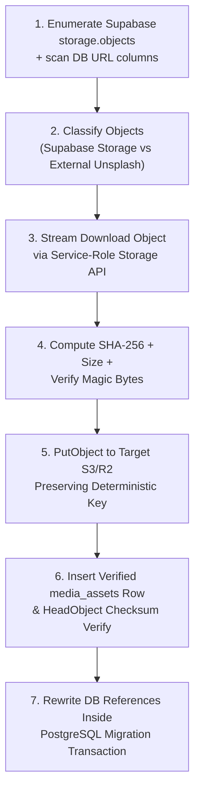

# AASHVO — Object Storage & Media Migration Plan

**Scope:** Migrating all 4 Supabase Storage buckets (`property-photos`, `user-avatars`, `support-attachments`, `rental-documents`) to managed S3-compatible object storage while hardening upload validation, enforcing counterparty authorization on private files, and preserving existing object references.  
**Skills Applied:** `object-storage`, `cloudflare-r2`, `aws-s3`, `api-security`, `cc-skill-security-review`

---

## 1. Current Supabase Storage Inventory (Verified)

From `src/services/storageService.ts` and `supabase/migrations/20261018`, `20261021`, `20261023`, `20261025`:

| Bucket | Visibility | Max File Size | Allowed MIME Types | Database Reference Columns |
|---|---|---|---|---|
| `property-photos` | Public read | 5 MB (`5 * 1024 * 1024`) | `image/jpeg`, `image/png`, `image/webp` | `property_photos.photo_url` (also external Unsplash seed URLs exist) |
| `user-avatars` | Public read | 2 MB (`2 * 1024 * 1024`) | `image/jpeg`, `image/png`, `image/webp` | `profiles.avatar_url` |
| `support-attachments` | Private read | 5 MB | `image/jpeg`, `image/png`, `image/webp`, `application/pdf` | `support_tickets.attachments` (JSONB), `ticket_messages.attachments` (JSONB), `safety_reports.evidence_url` |
| `rental-documents` | Private read | 10 MB | `image/jpeg`, `image/png`, `image/webp`, `application/pdf` | `tenancy_agreements.document_url`, `rent_payment_records.receipt_url`, `property_inspections.photo_urls[]`, `rental_disputes.evidence_urls[]` |

---

## 2. Target Storage Topology (S3-Compatible)

Because `MediaModule` uses the standard AWS SDK v3 (`@aws-sdk/client-s3` + `@aws-sdk/s3-request-presigner`), **zero application code locks into a vendor**.
- **Recommended Storage Backend:** **Cloudflare R2** (`$0.015/GB-month`, **zero internet egress fees**, 10 GB/month permanent free tier) OR **Amazon S3 (`ap-south-1` Mumbai)** (`$0.025/GB-month`, KMS encryption, strict Indian data residency).
- **Logical Bucket Split:**
  1. `aashvo-public-media` (Custom CDN domain `https://media.aashvo.in/`, `Cache-Control: public, max-age=31536000, immutable`), partitioned by key prefix:
     - `property-photos/<ownerUserId>/<propertyOrTempId>/<uuid>.<ext>`
     - `user-avatars/<userId>/<uuid>.<ext>`
  2. `aashvo-private-vault` (**Block ALL Public Access**, no CDN public domain, SSE-KMS/AES-256 encryption at rest), partitioned by prefix:
     - `support-attachments/<uploaderOrGuestId>/<ticketNumber>/<uuid>.<ext>`
     - `rental-documents/<uploaderUserId>/<agreementId>/<uuid>.<ext>`
  *(Alternative: 4 identically named buckets `aashvo-property-photos`, `aashvo-user-avatars`, `aashvo-support-attachments`, `aashvo-rental-documents` for strict IAM isolation per bucket — both work identically behind `MediaModule`.)*

---

## 3. Hardened Upload & Private Download Lifecycle

### 3.1 Presigned Upload & Content Inspection Flow (`POST /api/v1/media/presign-upload`)
1. Client sends `{ bucket, fileName, mimeType, sizeBytes, contextId }` (authenticated JWT, or validated guest support captcha/rate-limited token for anonymous support attachment).
2. `MediaModule` strictly enforces bucket allowlists (`image/jpeg`, `image/png`, `image/webp`, plus `application/pdf` for private buckets — **rejects `image/svg+xml`, HTML, JS, ZIP, executables** to eliminate stored XSS).
3. `MediaModule` rejects oversized `sizeBytes` upfront, reserves a `media_assets` row (`status = 'pending_upload'`), and returns:
   - `mediaId` (UUID)
   - `uploadUrl` (presigned `PutObjectCommand` valid for **5 minutes**, locked to exact `Content-Type` and `Content-Length` bounds)
   - `objectKey`
4. Client uploads binary directly from browser/mobile to R2/S3 (zero large-binary memory buffering in NestJS API containers).
5. Client calls `POST /api/v1/media/:id/confirm`:
   - Backend performs `HeadObjectCommand` + streams first **4 KB header bytes** via `GetObjectCommand` (`Range: bytes=0-4095`) to verify actual **magic bytes** (`file-type` library) match declared MIME!
   - If spoofed (e.g., HTML disguised as `.jpg`) → deletes S3 object immediately, marks `media_assets.status = 'deleted'`, logs security event, returns `422`.
   - Computes/records SHA-256 digest and transitions `media_assets.status = 'verified'`.

### 3.2 Private Document Access Control (`POST /api/v1/media/:id/presign-download`)
Private `support-attachments` and `rental-documents` **never store long-lived public URLs**. Domain columns store canonical `media://<mediaId>` or normalized object keys; UI displays metadata and requests a **15-minute presigned GET URL** when the user clicks "View / Download":
- **`rental-documents` authorization matrix:**
  - Caller `role === 'admin'` → **Allow**
  - Caller === `media_asset.owner_id` → **Allow**
  - Caller is `landlord_id` OR `tenant_id` on the referenced `tenancy_agreements`, `rent_payment_records`, `property_inspections`, or `rental_disputes` row → **Allow**
  - Anyone else → **403 Forbidden** + `AuditLog` entry.
- **`support-attachments` authorization matrix:**
  - Caller `role === 'admin'` (or staff role) → **Allow**
  - Caller === `support_tickets.user_id` → **Allow**
  - Validated guest ticket lookup session (`ticketNumber` + `userEmail` matching non-internal message/ticket) → **Allow**
  - Anyone else → **403 Forbidden**.
- Presigned download URLs enforce `ResponseContentDisposition: attachment` (or `inline` for safe raster images only, never HTML/SVG) and `ExpiresIn: 900` (15 minutes).

---

## 4. Storage Migration & Integrity Verification Pipeline

### 4.1 Step-by-Step Migration Guarantees
1. **Inventory Export:** Query `storage.objects` in hosted Supabase (`bucket_id`, `name`, `metadata->>'size'`, `metadata->>'mimetype'`, `owner`) and export manifest JSON. Also scan DB columns (`property_photos.photo_url`, `profiles.avatar_url`, `tenancy_agreements.document_url`, `rent_payment_records.receipt_url`, `property_inspections.photo_urls`, `rental_disputes.evidence_urls`, `support_tickets.attachments`, `ticket_messages.attachments`, `safety_reports.evidence_url`) to ensure **no referenced object is missed** and track orphaned files separately.
2. **Idempotent Streaming Transfer Script (`scripts/migrate-storage.ts`):**
   - Workers stream each object from Supabase Storage to R2/S3 (concurrency = 8), verify `byteLength` matches and compute `SHA-256`.
   - Upserts `media_assets` row (`source_origin = 'supabase_migrated'`, `sha256`, `status = 'verified'`).
   - Records a deterministic mapping manifest `supabase_path → { mediaId, bucket, objectKey, publicUrl, sha256 }`.
   - **External URLs (`https://images.unsplash.com/...`):** Untouched (`source_origin = 'external'`, kept verbatim in `property_photos.photo_url` so curated/demo photography does not break).
3. **Database Reference Rewriting:**
   - Inside PostgreSQL migration verification pass, rewrite any `https://<ref>.supabase.co/storage/v1/object/public/<bucket>/<key>` to `https://media.aashvo.in/<bucket>/<key>` and populate `property_photos.media_id`.
   - Rewrite any private bucket paths/URLs in `rental_documents` and `support_attachments` to `media://<mediaId>` (or normalized key matched by `MediaModule`) so legacy signed URLs that expired cleanly resolve dynamically through the new `presign-download` endpoint!
4. **Lifecycle Cleanup:**
   - R2/S3 lifecycle rule automatically aborts incomplete multipart uploads after **7 days** and purges `pending_upload` objects never confirmed via `/confirm` after **24 hours** (worker sweeps stale `media_assets` daily).
5. **Rollback Preservation:** Supabase buckets remain **untouched and read-only** during cutover (`>= 30 days` cooling period); rolling back frontend/API pointers restores original Supabase URLs seamlessly.

