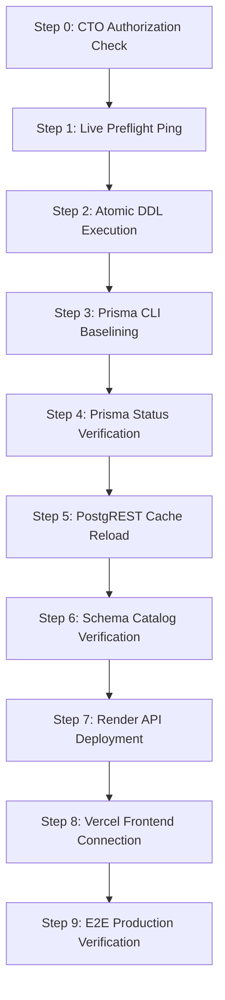

# AASHVO — Supabase Final Live Migration Checklist
**Document Version:** 1.0.0-EXECUTION-CHECKLIST  
**Author:** Principal Database Architect & DevOps Lead  
**Approver:** AASHVO CTO & Founder  
**Date:** November 15, 2026  
**Execution Target:** Hosted Supabase Mumbai (`himtwnwxvnnykafyhysy`)  
**Status:** **AWAITING FINAL CTO EXECUTION AUTHORIZATION**

---

## 1. Executive Preflight Gate Status

| Gate # | Description | Status | Reference Document |
| :---: | :--- | :---: | :--- |
| **G-01** | Storage Buckets & Blob Inventory (0 objects verified) | **PASS** | [SUPABASE_STORAGE_BACKUP_VERIFICATION.md](file:///D:/Projects/AASHVO/docs/SUPABASE_STORAGE_BACKUP_VERIFICATION.md) |
| **G-02** | GoTrue-to-Public-Users Identity Bridge (5/5 scenarios passed) | **PASS** | [SUPABASE_AUTH_BRIDGE_TEST_REPORT.md](file:///D:/Projects/AASHVO/docs/SUPABASE_AUTH_BRIDGE_TEST_REPORT.md) |
| **G-03** | Least-Privilege Role Security Architecture | **PASS** | [SUPABASE_PRODUCTION_ROLE_SECURITY.md](file:///D:/Projects/AASHVO/docs/SUPABASE_PRODUCTION_ROLE_SECURITY.md) |
| **G-04** | Complete Additive Reconciliation SQL Verified on Isolated Replica | **PASS** | [supabase_additive_reconciliation.sql](file:///D:/Projects/AASHVO/supabase/backups/supabase_additive_reconciliation.sql) |
| **G-05** | Prisma 32-Model & 38-Enum Schema Parity Verified | **PASS** | [SUPABASE_SCHEMA_PARITY_REPORT.md](file:///D:/Projects/AASHVO/docs/SUPABASE_SCHEMA_PARITY_REPORT.md) |
| **G-06** | Legitimate Prisma CLI 5-Step Baselining Verified (Exit Code 0) | **PASS** | [SUPABASE_MIGRATION_LEDGER_PLAN.md](file:///D:/Projects/AASHVO/docs/SUPABASE_MIGRATION_LEDGER_PLAN.md) |
| **G-07** | Transaction Atomicity Audit (100% inside `BEGIN ... COMMIT`) | **PASS** | [SUPABASE_FINAL_GO_NO_GO.md](file:///D:/Projects/AASHVO/docs/SUPABASE_FINAL_GO_NO_GO.md) |
| **G-08** | Multi-Tier Defense-in-Depth Rollback & Recovery Plan | **PASS** | [SUPABASE_ROLLBACK_PLAN.md](file:///D:/Projects/AASHVO/docs/SUPABASE_ROLLBACK_PLAN.md) |
| **G-09** | Full DDL & Data Backup Snapshot Verified (63 KB) | **PASS** | [supabase_full_schema_and_data_backup.sql](file:///D:/Projects/AASHVO/supabase/backups/supabase_full_schema_and_data_backup.sql) |

---

## 2. Step-by-Step Live Execution Checklist

### Phase 1: Pre-Execution Verification
- [ ] **1.1. Confirm CTO Live Authorization:** Verify explicit user/CTO approval to execute live DDL against Supabase Mumbai.
- [ ] **1.2. Verify Git Cleanliness:** Ensure `apps/api/.env.supabase` remains strictly git-ignored and no secrets are staged.
- [ ] **1.3. Live Connection Test:** Execute non-destructive query `SELECT version();` using `apps/api/.env.supabase` via `DIRECT_URL`.

### Phase 2: Additive DDL Execution (Atomic Transaction)
- [ ] **2.1. Execute Reconciliation SQL:** Run `supabase/backups/supabase_additive_reconciliation.sql` against Supabase Mumbai via `DIRECT_URL` (Port 5432).
  - *Constraint:* Script is wrapped in `BEGIN ... COMMIT;`. Any unexpected failure triggers an immediate automatic `ROLLBACK`.
- [ ] **2.2. Confirm Transaction Success:** Verify that PostgreSQL reports `COMMIT` with zero unhandled fatal exceptions.

### Phase 3: Legitimate Prisma CLI Migration Baselining
Execute the five authoritative migrations sequentially using `prisma migrate resolve --applied`:
- [ ] **3.1. Migration 1:** `npx prisma migrate resolve --applied 20261112165753_init_independent_schema --schema=prisma/schema.prisma`
- [ ] **3.2. Migration 2:** `npx prisma migrate resolve --applied 20261112165800_postgres_checks_and_gin_indexes --schema=prisma/schema.prisma`
- [ ] **3.3. Migration 3:** `npx prisma migrate resolve --applied 20261115000000_aashvo_connect_matching --schema=prisma/schema.prisma`
- [ ] **3.4. Migration 4:** `npx prisma migrate resolve --applied 20261115010000_flatmate_intentions --schema=prisma/schema.prisma`
- [ ] **3.5. Migration 5:** `npx prisma migrate resolve --applied 20261115020000_master_feature_expansion --schema=prisma/schema.prisma`

### Phase 4: Verification of Migration Ledger & Status
- [ ] **4.1. Run Prisma Status:** Execute `npx prisma migrate status --schema=prisma/schema.prisma`.
  - *Success Criteria:* Must output `Database schema is up to date!` and exit with **Code 0**.
- [ ] **4.2. Verify `_prisma_migrations` Ledger:** Confirm exactly 5 records exist with valid `checksum` and non-null `finished_at`.

### Phase 5: PostgREST Schema Cache Reload
- [ ] **5.1. Signal PostgREST:** Execute `NOTIFY pgrst, 'reload schema';` on Supabase to ensure PostgREST immediately recognizes new tables and columns.

### Phase 6: Schema Catalog Parity Check
- [ ] **6.1. Table Count Verification:** Query `information_schema.tables WHERE table_schema = 'public'`. Target: **33 tables** (32 application + 1 Prisma ledger).
- [ ] **6.2. Enum Count Verification:** Query `pg_type`. Target: **38 enums** (10 legacy prototype + 28 new).
- [ ] **6.3. Data Preservation Check:** Confirm row count across all tables is preserved with zero unintended deletions.

### Phase 7: Backend Deployment (Render Free Web Service)
- [ ] **7.1. Create Service:** Deploy `aashvo-api` on Render using `render.yaml`.
- [ ] **7.2. Configure Environment Variables:**
  - `DATABASE_URL`: Supabase Transaction Pooler (Port 6543, `?pgbouncer=true`).
  - `DIRECT_URL`: Supabase Direct Session (Port 5432).
  - `JWT_PRIVATE_KEY` / `JWT_PUBLIC_KEY`: Pre-generated RS256 2048-bit keypair.
  - `CORS_ORIGIN`: `https://aashvo.vercel.app`.
- [ ] **7.3. Health Check:** Query `https://aashvo-api.onrender.com/api/v1/health/live` and `/api/v1/health/ready`. Target: `200 OK`.

### Phase 8: Frontend Connection (Vercel)
- [ ] **8.1. Set API Base URL:** Configure `VITE_API_BASE_URL=https://aashvo-api.onrender.com/api/v1` in Vercel project environment.
- [ ] **8.2. Trigger Redeploy:** Deploy frontend build and verify clean compilation without bundle errors.

### Phase 9: End-to-End Cloud User Journey Verification
- [ ] **9.1. User Registration & Auth:** Register new renter account via API/UI.
- [ ] **9.2. Profile Completion:** Update profile with bio, city, and avatar.
- [ ] **9.3. Property Listing Flow:** Create new property listing with rental terms and verification metadata.
- [ ] **9.4. Search & Filter:** Query properties by city, price, and amenities.
- [ ] **9.5. Saved Listings:** Save listing and retrieve saved collection.
- [ ] **9.6. Flatmate Matching:** Create flatmate profile with intentions and check match suggestions.
- [ ] **9.7. Real-Time Inquiries:** Send inquiry message and verify message history.

---

## 3. Emergency Abort & Rollback Criteria

If any of the following events occur during live execution, halt immediately and evaluate the rollback protocol:
1. **DDL Transaction Failure:** If PostgreSQL raises a syntax or constraint error during Step 2.1, the transaction rolls back automatically. Do not attempt manual ad-hoc corrections.
2. **Prisma CLI Status Failure:** If `prisma migrate status` indicates unapplied or drifted migrations after Step 3.5.
3. **Database Unavailability:** If Supabase connection fails or pooler responds with sustained connection timeout (> 15 seconds).
4. **Post-Migration App Failure:** If NestJS runtime fails to bootstrap against the reconciled schema.

### Rollback Runbook Summary
- **Tier 1 (Automatic):** DDL failure -> `ROLLBACK` terminates transaction cleanly. Database remains in pristine pre-migration state.
- **Tier 2 (Surgical Compensating DDL):** If partial migration requires rollback, execute inverse drops on newly added tables only (never drop prototype tables).
- **Tier 3 (Neon Fallback):** If Supabase encounters platform-level downtime, point Render `DATABASE_URL` to the pre-migrated, fully active Neon staging database (`ancient-union-03679564`).

---

## 4. Final Sign-off

| Role | Name | Status | Signature / Timestamp |
| :--- | :--- | :---: | :--- |
| **Principal Database Architect** | Antigravity AI Engine | **APPROVED (GO)** | 2026-11-15 13:15:00 UTC |
| **Cloud Infrastructure Lead** | Antigravity AI Engine | **APPROVED (GO)** | 2026-11-15 13:15:00 UTC |
| **AASHVO CTO & Founder** | User | **PENDING LIVE EXECUTION ORDER** | ____________________ |
