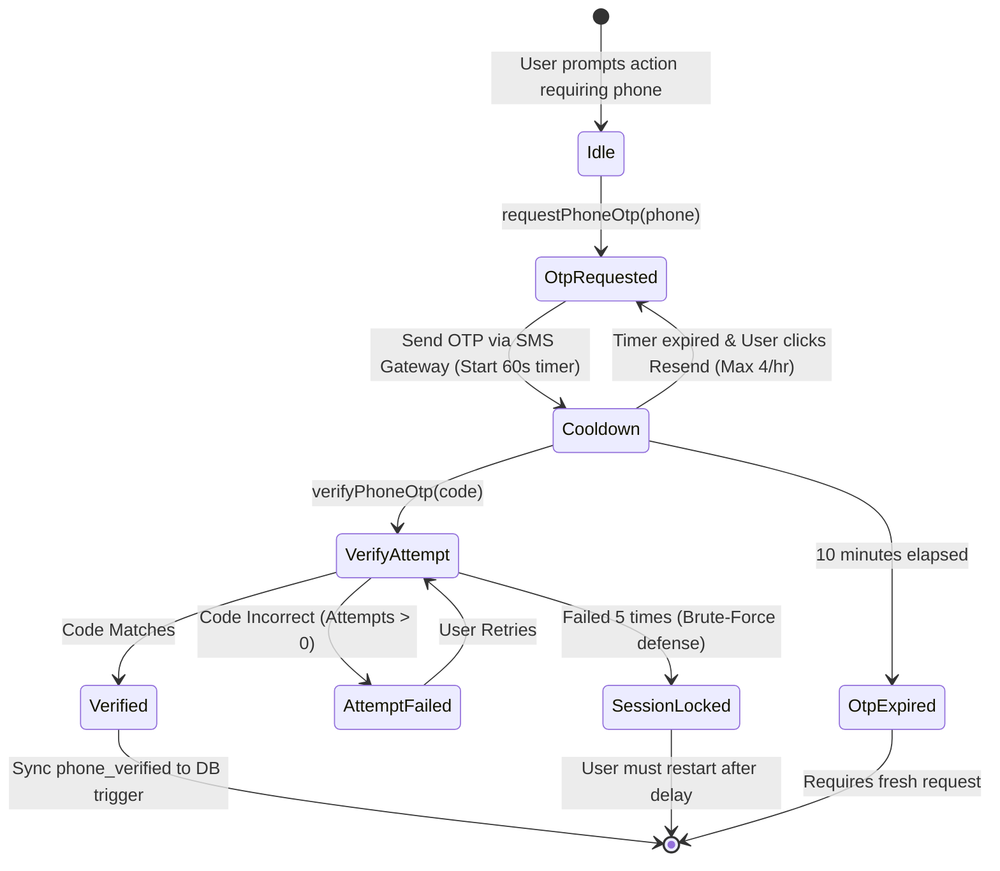

# Aashvo — Technical Architecture & System Design

**Version:** 2.0.0-Nationwide  
**Stack:** React 18 + TypeScript + Vite + Tailwind CSS + Supabase (PostgreSQL 15+, Supabase Auth, Storage)  
**Lead:** Founding CTO & Security Architect, Aashvo  

---

## 1. High-Level System Architecture

```
┌────────────────────────────────────────────────────────────────────────┐
│                        AASHVO WEB CLIENT (React 18)                    │
│                                                                        │
│   ┌──────────────────┐  ┌──────────────────┐  ┌────────────────────┐   │
│   │  Header & Brand  │  │ Nationwide Search│  │ Cost Transparency  │   │
│   └──────────────────┘  └──────────────────┘  └────────────────────┘   │
│   ┌──────────────────┐  ┌──────────────────┐  ┌────────────────────┐   │
│   │ Flats & Rooms    │  │  Flatmate Match  │  │ Family Stay Portal │   │
│   └──────────────────┘  └──────────────────┘  └────────────────────┘   │
│   ┌──────────────────┐  ┌──────────────────┐  ┌────────────────────┐   │
│   │ Progressive Auth │  │ Phone OTP Modal  │  │ Listing Wizard     │   │
│   └──────────────────┘  └──────────────────┘  └────────────────────┘   │
└────────────────────────────────────┬───────────────────────────────────┘
                                     │
                   Pluggable Repository & Service Layer
                (authService, marketplaceService, supabase.ts)
                                     │
            ┌────────────────────────┴────────────────────────┐
            ▼                                                  ▼
 ┌───────────────────────────┐                      ┌─────────────────────┐
 │    Local Mock Store       │                      │  Supabase Platform  │
 │  (Deterministic Test Data │                      │  • Supabase Auth    │
 │   Offline State Machine)  │                      │  • PostgreSQL + RLS │
 └───────────────────────────┘                      │  • Storage Buckets  │
                                                    └─────────────────────┘
```

---

## 2. Authentication & Identity Architecture

### 2.1 Supported Auth Providers
1. **Google OAuth (PKCE Flow):**
   - Implements Proof Key for Code Exchange (PKCE) for browser clients.
   - Origin verification ensures redirect URLs match whitelisted deployment domains.
   - State parameter validation defends against Cross-Site Request Forgery (CSRF).
   - Minimal scope requests only `openid`, `email`, and `profile`.
2. **Email & Password Authentication:**
   - Client validates strong password policies (min 8 chars, 1 digit or symbol).
   - Passwords hashed with bcrypt on the Supabase Auth server.
   - New accounts are created with `email_confirmed_at = null`. Protected actions are gated until the user clicks the confirmation link.
3. **Session Refresh & Token Lifecycle:**
   - Short-lived JWT access tokens (1 hour expiry) paired with rolling refresh tokens stored securely in `httpOnly` cookies or memory.
   - Explicit token revocation upon user logout.

### 2.2 Progressive Profile Completion Engine
Instead of monolithic onboarding forms, profile completion is dynamically computed on the trusted server:

```typescript
// Progressive profile requirement evaluator (src/services/authService.ts)
export function evaluateActionEligibility(
  user: User | null,
  action: ActionType,
  context?: ActionContext
): ProgressiveProfileRequirement;
```

- **Browse:** Always permitted for anonymous visitors.
- **Submit Inquiry:** Evaluates user authentication, email verification, and requires phone verification if the listing mandates it.
- **Publish Listing:** Evaluates host display name, email confirmation, and mandatory phone verification.
- **Publish Family Stay:** Validates that host is a direct owner (`providerType = 'owner'`), asserts `familyLivesOnProperty = true`, and requires meal availability declarations.

### 2.3 Identity Linking & Duplicate Account Defense
- To prevent account pre-hijacking attacks, Aashvo **strictly prohibits automatic merging** of an unverified email/password account with an incoming OAuth account sharing the same email.
- Accounts are linked only when the existing account has verified its email ownership or the user re-authenticates with their existing credentials.

---

## 3. Phone Verification & Gateway State Machine



- **Gateway Decoupling:** Provider credentials (e.g. Twilio SID/Token, Exotel API keys) reside exclusively on the server side / Supabase Edge Functions. The browser never receives gateway secrets.
- **Anti-Tampering:** Database trigger `trg_prevent_verification_forgery` prevents direct SQL or REST mutations of `phone_verified`.

---

## 4. Nationwide Marketplace & Search Architecture

### 4.1 Unconstrained Indian Geography
- Schema supports any Indian locality, city, state, or PIN code via free-text matching, removing rigid enum constraints.
- Optimized PostgreSQL indices:
  ```sql
  CREATE INDEX idx_properties_city ON public.properties(city);
  CREATE INDEX idx_properties_locality ON public.properties(locality);
  CREATE INDEX idx_properties_category ON public.properties(category);
  ```

### 4.2 Location Privacy Masking
- The public view (`public_properties`) automatically strips exact apartment, door, and villa numbers.
- Public representation formats addresses as `[Landmark], [Locality], [City]`. Exact address is only disclosed upon mutual visit approval.

### 4.3 Current-Location Convenience
- Device GPS coordinates are calculated via the Haversine formula in `marketplaceService.ts` for distance display and radius filtering.
- Device location is treated as convenience, **never proof of residence or ownership**.

---

## 5. Security & Authorization Boundaries

| Actor Role | Authentication | RLS Permissions | Business Rule Restrictions |
| :--- | :--- | :--- | :--- |
| **Anonymous Visitor** | None | `SELECT` on `public_properties`, `public_profiles` | Cannot submit inquiries, cannot view private contacts. |
| **Verified Renter** | JWT (`role: renter`) | `SELECT` active properties; `INSERT` interest requests | Must have verified email; phone verified when required by host. |
| **Verified Host / Owner** | JWT (`role: owner`) | `INSERT/UPDATE` own properties; manage own photos | Must have verified phone; Family Stays require resident family declaration. |
| **Admin / Moderator** | JWT (`role: admin`) | Full `ALL` on all tables, views, and reports | Role guarded by `is_admin()` and `trg_prevent_role_escalation`. |

---

## 6. Help & Support System Architecture

### 6.1 Multi-Tenant Support Tickets Core
- **Ticket Reference Generation:** Structured alphanumeric pattern `ASH-TKT-[A-Z0-9]{6}` generated server-side.
- **Bi-Directional Messaging & Internal Staff Notes Isolation:**
  - Support ticket messages carry an `is_internal` boolean flag.
  - Public messages are rendered for end-users and notified via external transactional channels.
  - Staff notes (`is_internal: true`) and audit event histories are strictly stripped from responses to non-admin actors using `sanitizeTicketForClient()` and database Row Level Security.
- **Status State Machine & Transitions:**
  - Valid transitions: `open -> in_review`, `in_review -> awaiting_user / resolved / closed`, `awaiting_user -> in_review / resolved / closed`, `resolved -> in_review / closed`.
  - `closed` status is terminal. Reopening requires creating a new ticket.
  - User replies on `awaiting_user` tickets automatically advance the status back to `in_review`.

### 6.2 Contextual Safety & Fraud Reporting
- **In-Context Flagging:** Directly integrated into `PropertyDetailModal` and `FlatmateDetailModal`.
- **Reason Categorization:** `scam_fraud`, `misleading_charges`, `unavailable_listing`, `duplicate_fake`, `inappropriate_conduct`, `harassment`, `other`.
- **Priority Queuing:** Reports with reason `scam_fraud` and `harassment` are automatically routed to the urgent priority moderation queue.
- **Anti-Spam Duplicate Safeguard:** A 24-hour cooldown per `(reporter, target_id)` prevents automated report flooding.

### 6.3 Decoupled Notification Dispatcher
- Real-time event notifications (`ticket_created`, `ticket_replied`, `status_changed`) dispatch via `dispatchSupportNotification()`.
- Production email provider integration requires:
  - `SMTP_HOST`, `SMTP_PORT`, `SMTP_USER`, `SMTP_PASS` or `RESEND_API_KEY`
  - Zero API keys or secrets are bundled in the client application.

