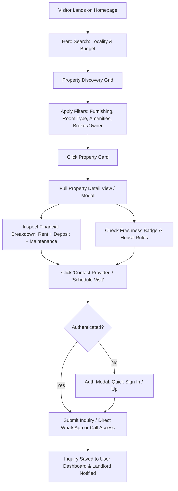
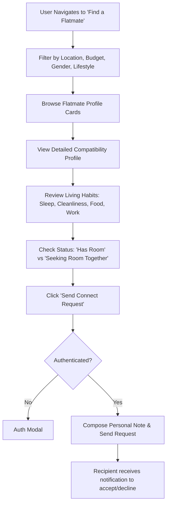
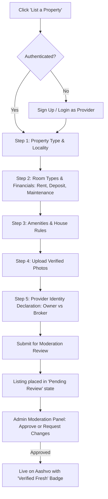

# Aashvo — User Journeys & Experience Architecture

**Platform:** Aashvo Web Platform  
**Target Region:** Delhi NCR  
**Status:** Approved  

---

## 1. Journey 1: Find a Place (Tenant / Flat Seeker)

### Detailed Steps:
1. **Discovery:**
   - User inputs locality (e.g. "DLF Phase 4", "Saket") and selects budget slider or presets.
   - Real-time instant filtering with animated card transitions.
2. **Evaluation:**
   - Listing card showcases primary image, monthly rent, deposit requirement, occupancy type (Private / Shared), verified status, and freshness date.
   - Deep-dive view reveals photo gallery, room specs, transparent breakdown (Rent, Maintenance, Electricity per unit, Deposit, Lock-in period), amenities, and exact location radius (with safety/transit proximity).
3. **Action:**
   - "Schedule Visit" or "Send Message" triggers interest request.
   - User receives immediate confirmation and tracking in their dashboard.

---

## 2. Journey 2: Find a Flatmate (Shared Living / Team-Up)

### Compatibility Dimensions Tracked:
- **Food Habits:** Vegetarian, Eggetarian, Non-Veg, Jain.
- **Sleep & Work Routine:** Early Bird (6 AM - 10 PM), Night Owl (12 PM - 3 AM), Regular 9-to-5.
- **Guests & Social Policy:** Chill with weekend gatherings, Moderate, Quiet/Private space.
- **Cleanliness Expectation:** High / Daily rota, Moderate, Relaxed.
- **Smoking / Alcohol / Pets:** Non-smoker only, Pet friendly, Smoking outside only.

---

## 3. Journey 3: List a Property (Owner / Current Tenant / Broker)

### Provider Verification & Trust Rules:
- If **Owner**: Zero brokerage allowed; requires contact verification.
- If **Tenant looking for Flatmate**: Must list current lease tenure and room type.
- If **Broker / Agent**: Explicit brokerage disclosure (e.g. "15 days brokerage" or "Fixed ₹5,000 service fee"). Unstated fees lead to permanent blacklisting.

---

## 4. Moderation & Safety Journey (Admin & Community)

- Every user can click **"Report Listing"** or **"Report User"** with specific reasons:
  - Bait and switch pricing
  - Inaccurate photos or already rented out
  - Harassment or inappropriate conduct
  - Unregistered broker posing as owner
- Reports feed into the Admin Moderation Console with one-click actions:
  - Auto-flag / Warn provider
  - Request updated photos
  - Pause listing immediately
  - Suspend fraudulent account
