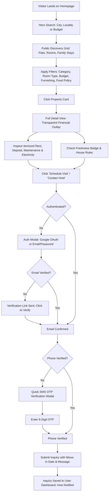
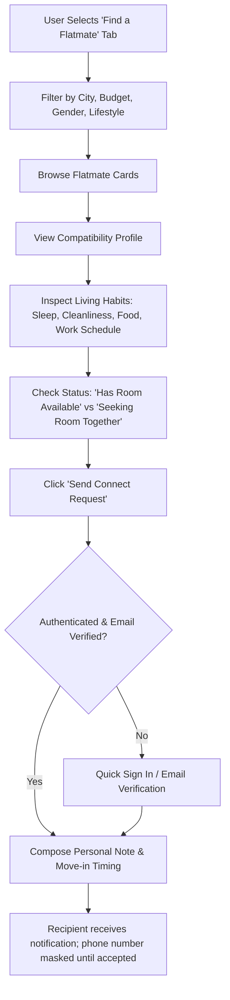
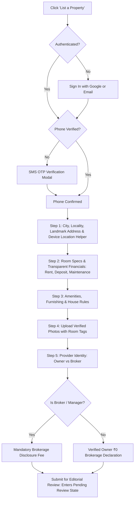
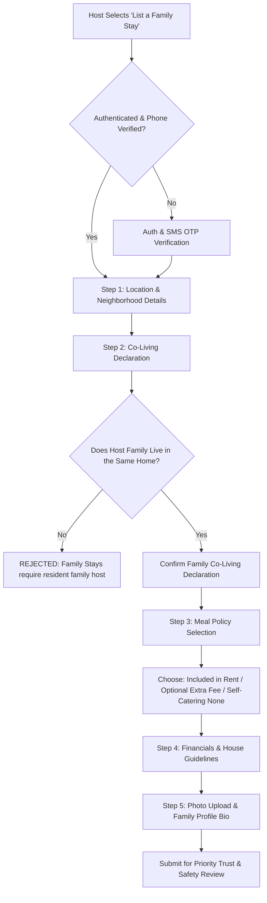
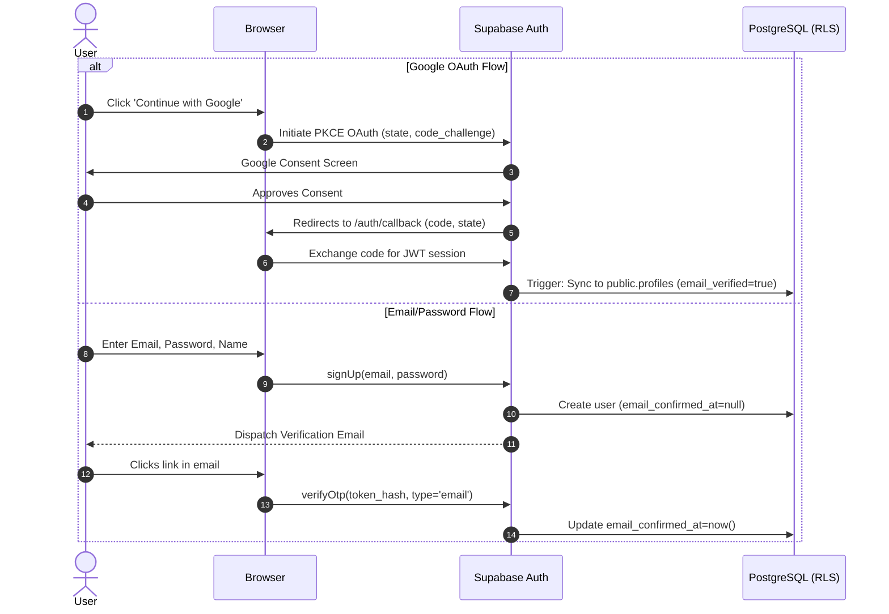

# Aashvo — User Journeys & Experience Architecture

**Platform:** Aashvo Web Platform  
**Target Region:** Nationwide (India)  
**Version:** 2.0.0  
**Status:** Approved  

---

## 1. Journey 1: Find a Place (Renter / Tenant)

### Key Experience Tenets:
1. **Frictionless Anonymous Discovery:** Users can browse listings across India, run multi-city filters, and view total cost calculations without registering.
2. **Just-In-Time Friction:** Authentication is requested only when taking a high-intent action (contacting a host).
3. **Contextual Phone Verification:** The user is prompted for phone verification only when required by the host's policy.

---

## 2. Journey 2: Find a Flatmate (Shared Living / Team-Up)

### Compatibility Dimensions:
- **Food Habits:** Vegetarian, Eggetarian, Non-Vegetarian, Vegan.
- **Sleep & Work Routine:** Early Bird (6 AM – 10 PM), Night Owl (12 PM – 3 AM), Flexible.
- **Cleanliness Expectation:** Spotless (daily routine), Moderate, Relaxed.
- **Social & Guest Policy:** Social / Weekend gatherings, Moderate, Private & Quiet.
- **Smoking & Pets:** Non-smoker only, Pet friendly, Smoking outside only.

---

## 3. Journey 3: List a Property (Flats & Rooms)

---

## 4. Journey 4: List a Family Stay (Resident Family Hosts)

### Safety & Eligibility Guardrails:
1. **Direct Resident Owner Only:** Commercial brokers, real estate agents, and absentee landlords cannot select or submit Family Stays.
2. **Meal Transparency:** Renter knows upfront whether breakfast/dinner is home-cooked and included or costs an extra monthly fee.
3. **Address Masking:** Neighborhood and safety landmarks are highlighted publicly; flat door numbers are withheld until visit approval.

---

## 5. Journey 5: Authentication & Account Lifecycle

---

## 6. Journey 6: Moderation & Trust/Safety (Admin & Community)

- **Community Flagging:** Every user can report listings or profiles for:
  - Bait-and-switch pricing or hidden charges
  - Non-resident landlord falsely posing as Family Stay
  - Misleading photos or property already rented
  - Inappropriate behavior or harassment in flatmate inquiries
- **Admin Moderation Console:**
  - One-click Approve, Request Changes, or Reject.
  - Ban bad actors and revoke phone/email verification flags.
  - Audit Family Stay declarations against community reports.
  - Comply with Indian DPDP Act 2023 for verified account deletion requests.
