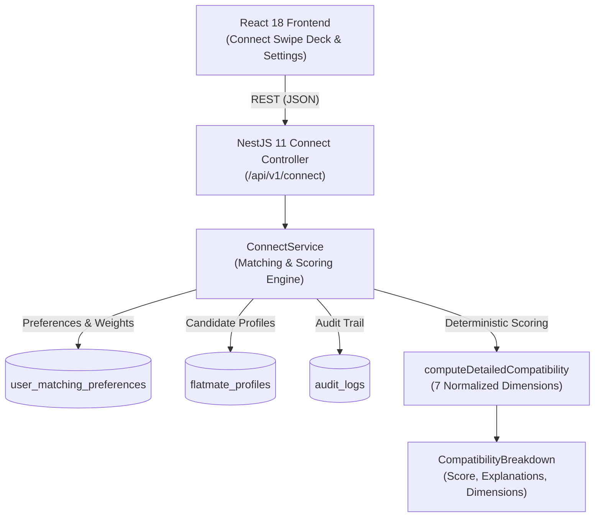

# Connect Intelligence — Architecture & 7-Dimension Matching Engine

## 1. Architectural Topology
The Connect Intelligence subsystem is a high-performance recommendation and matching engine embedded within the NestJS API (`apps/api/src/modules/connect/`). It calculates deterministic, personalized compatibility vectors between verified flatmate seekers on local PostgreSQL 16 (and hosted Supabase).



---

## 2. The 7 Dimension Mathematical Model

Each candidate pair is evaluated across 7 orthogonal dimensions. Every dimension produces a raw ratio $r_i \in [0, 1]$.
Personalized weights $w_i \ge 0$ are normalized such that:

$$\sum_{i=1}^{7} \hat{w}_i = 100$$

Where normalized weight $\hat{w}_i$ is defined as:

$$\hat{w}_i = \frac{w_i}{\sum_{k=1}^{7} w_k} \times 100$$

The total compatibility score $S$ is calculated deterministically:

$$S = \sum_{i=1}^{7} \hat{w}_i \cdot r_i$$

### Dimension Breakdown
1. **Budget Overlap ($w_1 = 20$)**: Evaluates overlap between caller's target range $[B_{\min, 1}, B_{\max, 1}]$ and candidate's $[B_{\min, 2}, B_{\max, 2}]$.
   - Overlap $\ge 1$: $r_1 = 1.0$ (Explanations show overlap range).
   - Within 15% distance: $r_1 = 0.70$.
   - Greater deviation: scaled proportionally down to 0.10.

2. **Location & Neighborhood ($w_2 = 20$)**: Proximity-based matching:
   - Shared target locality / neighborhood: $r_2 = 1.0$.
   - Same city: $r_2 = 0.75$.
   - Same state: $r_2 = 0.50$.
   - Distinct regions: $r_2 = 0.20$.

3. **Cleanliness & Living Habits ($w_3 = 20$)**:
   - Spotless vs Spotless, Moderate vs Moderate, Relaxed vs Relaxed: $r_3 = 1.0$.
   - Spotless vs Moderate or Moderate vs Relaxed: $r_3 = 0.70$.
   - Spotless vs Relaxed: $r_3 = 0.25$.

4. **Food & Dietary Habits ($w_4 = 15$)**:
   - Identical habits (e.g. Vegetarian - Vegetarian): $r_4 = 1.0$.
   - Vegan & Vegetarian: $r_4 = 0.80$.
   - Non-Veg & Eggetarian / Non-Veg: $r_4 = 0.75$.
   - Strict Vegetarian & Non-Veg: $r_4 = 0.20$.

5. **Sleep Schedule & Circadian Alignment ($w_5 = 10$)**:
   - Early Bird vs Early Bird or Night Owl vs Night Owl: $r_5 = 1.0$.
   - Either party Flexible: $r_5 = 0.80$.
   - Early Bird vs Night Owl: $r_5 = 0.25$.

6. **Move-in Timeline & Flexibility ($w_6 = 10$)**:
   - Either party has flexible move-in ($\pm 14$ days): $r_6 = 0.95$.
   - Target dates within 7 days: $r_6 = 1.0$.
   - Target dates within 21 days: $r_6 = 0.85$.
   - Target dates within 45 days: $r_6 = 0.65$.
   - Target dates $> 45$ days: $r_6 = 0.20$.

7. **Shared Hobbies & Interests ($w_7 = 5$)**:
   - $\ge 3$ mutual interests: $r_7 = 1.0$.
   - 2 mutual interests: $r_7 = 0.70$.
   - 1 mutual interest: $r_7 = 0.40$.
   - 0 mutual interests: $r_7 = 0.0$.

---

## 3. Database Schema: `user_matching_preferences`

```sql
CREATE TABLE IF NOT EXISTS "user_matching_preferences" (
    "id" UUID NOT NULL DEFAULT gen_random_uuid(),
    "user_id" UUID NOT NULL,
    "budget_weight" INTEGER NOT NULL DEFAULT 20,
    "location_weight" INTEGER NOT NULL DEFAULT 20,
    "lifestyle_weight" INTEGER NOT NULL DEFAULT 20,
    "food_weight" INTEGER NOT NULL DEFAULT 15,
    "sleep_weight" INTEGER NOT NULL DEFAULT 10,
    "move_in_weight" INTEGER NOT NULL DEFAULT 10,
    "interests_weight" INTEGER NOT NULL DEFAULT 5,
    "created_at" TIMESTAMPTZ(6) NOT NULL DEFAULT CURRENT_TIMESTAMP,
    "updated_at" TIMESTAMPTZ(6) NOT NULL DEFAULT CURRENT_TIMESTAMP,

    CONSTRAINT "user_matching_preferences_pkey" PRIMARY KEY ("id")
);

CREATE UNIQUE INDEX "user_matching_preferences_user_id_key" ON "user_matching_preferences"("user_id");
```
