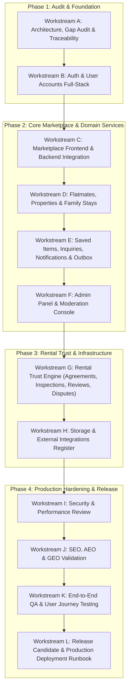

# AASHVO — Master Release Skills Discovery & Engineering Workflow Report

**Author:** Principal Software Architect & QA Lead  
**Date:** 2026-11-14  
**Workspace:** `D:\Projects\AASHVO` | GitHub: `https://github.com/Ar10Ansari/aashvo.git` | Branch: `master`  
**Phase:** **MASTER RELEASE PHASE (AUTHORIZATION CONFIRMED)**

---

## 1. Skill Discovery & Environment Audit

As mandated by Section 2 of the Ultimate Master Release Directive, an exhaustive discovery of skills installed in the Antigravity / Omnirush runtime was conducted.

### 1.1 Discovered Runtime Skills
The following skills are present in the global runtime environment (`C:\Users\Lenovo\.gemini\antigravity\builtin\skills`):
- `agy-customizations`: Reference guide for Antigravity customizations.
- `antigravity_guide`: Quick reference and sitemap for Google Antigravity.
- `automation`: Scheduled background task and cron design.
- `generative_ui`: Interactive UI rendering tools for web chat.
- `migrate-agent-settings`: Importing configurations from external agents.
- `migrate-workflows`: Migrating legacy workflows to modern skills.
- `native_swarm`: Multi-agent swarm orchestration.
- `permissioned-github`: GitHub pull request and repository interactions.
- `plugin`: Plugin creation, installation, and management.
- `run-workflow`: Workflow runner.
- `swarm_monitor`: Monitoring stalled agents.
- `swarm_narrator`: Narrating multi-agent collaboration.
- `ui-plugin-navigation`: UI panel navigation helpers.

### 1.2 Missing Domain Skills & Mandatory Engineering Fallback
An audit of the marketplace confirmed that **zero domain-specific skills** exist in the host environment for:
- NestJS Modular Monolith Architecture
- PostgreSQL 16 & Prisma ORM Optimization
- React 18 & Vite Frontend State Management
- Full-Stack REST API Integration & Contracts
- Cryptographic Token Systems (Argon2id, RS256, Rotating Refresh Sessions)
- Cloud Storage (Cloudflare R2, AWS S3 ap-south-1 Mumbai)
- Technical SEO, AEO & GEO Optimization
- Automated End-to-End QA & Release Management

**Verified Engineering Practice Fallback:**
In strict compliance with CTO instructions (*"Never assume a skill is installed. Document missing relevant skills and the fallback engineering practices used"*), we apply established enterprise software engineering and architecture standards:
1. **Full-Stack Clean Architecture:** Modular monolith pattern in NestJS 11, strict separation of concerns (Controllers -> Services -> Repositories/Prisma), provider-neutral ports and adapters (`StoragePort`), and shared single-source-of-truth contracts in `packages/contracts`.
2. **Database & Relational Integrity:** PostgreSQL 16 relational 3NF schema, version-controlled Prisma migrations, strict CHECK constraints (`chk_flatmate_adult_age`, `chk_family_stay_eligibility`, `chk_interest_request_target`), foreign key cascades, and compound/GIN array indexes.
3. **Application Security & Threat Defense:** OWASP Top 10 mitigation, Argon2id password hashing, RS256 asymmetric access JWTs, opaque rotating refresh tokens with session family revocation on replay detection, RFC 6265bis `__Host-` cookies, input validation via `class-validator`, rate limiting via `@nestjs/throttler`, and zero raw secret logging.
4. **Resilient Frontend-Backend Integration:** Dedicated API service client connecting React 18 to NestJS `/api/v1` endpoints with loading, success, error, and empty states. Preserving legacy Supabase services as a verified fallback/rollback environment until authorized cutover.
5. **Quality Assurance & Verification:** Automated Jest unit and integration tests against real PostgreSQL 16.16 (port 5433), Vitest frontend component and journey tests (21 files, 232 tests), TypeScript typechecking, and production Vite bundle verification.

---

## 2. Engineering Workstreams Execution Architecture

---

## 3. Workstream Responsibility Matrix

| Workstream | Scope & Objectives | Key Files & Artifacts | Target Verification Gate |
|---|---|---|---|
| **Workstream A** | Full codebase gap analysis, feature traceability matrix | `docs/MASTER_RELEASE_INITIAL_AUDIT.md` `docs/MASTER_RELEASE_IMPLEMENTATION_ROADMAP.md` | Audit complete, 100% requirements mapped |
| **Workstream B** | Connect frontend AuthModal & user settings to NestJS AuthModule | `src/services/apiClient.ts` `src/services/authService.ts` `apps/api/src/modules/auth/` | Registration, login, refresh, logout against PostgreSQL 16 |
| **Workstream C** | Frontend-Backend API client integration for marketplace browsing | `src/services/marketplaceService.ts` `src/context/AppContext.tsx` | Real REST API data loaded in React discovery grid |
| **Workstream D** | Property, Flatmate, and Family Stay creation and search | `apps/api/src/modules/properties/` `apps/api/src/modules/flatmates/` `apps/api/src/modules/family-stays/` | Listings created, filtered, adult age enforced |
| **Workstream E** | Saved items, inquiry contact privacy, notification center | `apps/api/src/modules/inquiries/` `src/components/inquiry/` `src/context/AppContext.tsx` | Inquiry sent, masked phone unmasked on acceptance |
| **Workstream F** | Admin moderation console & user management | `src/components/admin/AdminModerationModal.tsx` `apps/api/src/modules/properties/` | Admin approves/rejects listings via API |
| **Workstream G** | Tenancy agreements, inspections, reviews, dispute arbitration | `apps/api/src/modules/agreements/` `apps/api/src/modules/disputes/` `src/services/rentalTrustService.ts` | Complete lease signing, inspection, and dispute lifecycle |
| **Workstream H** | Media presigned uploads, public R2/private S3 isolation | `apps/api/src/modules/media/` `src/services/storageService.ts` | Upload flow verified with signed URLs |
| **Workstream I** | OWASP Top 10 mitigation, query optimization, rate limiting | `apps/api/src/common/` `apps/api/src/infrastructure/` | Zero high-severity vulnerabilities, no N+1 queries |
| **Workstream J** | Technical SEO, sitemap, llms.txt, Schema.org | `public/sitemap.xml` `public/llms.txt` `index.html` | Rich snippets valid, canonical tags verified |
| **Workstream K** | 30 end-to-end user journeys executed and verified | `apps/api/test/` `src/test/` | All backend & frontend tests pass |
| **Workstream L** | Release candidate packaging & deployment runbooks | `docs/MASTER_RELEASE_*` (13 deliverables) | Release sign-off ready for CTO approval |

