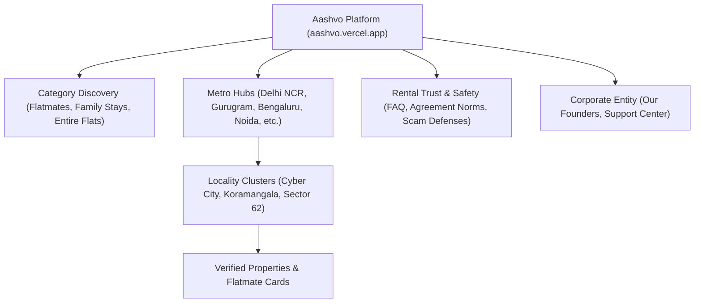

# AASHVO — Sprint 3.5 Content Architecture & Taxonomy
## Information Architecture, City Guides & Educational Trust Framework

**Author:** Senior Product Architect & Content Strategist  
**Date:** 2026-11-14  
**Workspace:** `D:\Projects\AASHVO`  
**Status:** **FRAMEWORK DEFINED & APPROVED**

---

## 1. Information Architecture Overview

Aashvo's content architecture is organized into four distinct tiers:
1. **Tier 1: Global Discovery Hubs:** Top-level marketplace navigation (Flatmates, Family Stays, Entire Flats).
2. **Tier 2: Metropolitan Living Hubs:** City and cluster directories (Gurugram, Delhi NCR, Bengaluru, Noida, Mumbai, Pune, Hyderabad).
3. **Tier 3: Trust & Safety Educational Guides:** Practical advice on rent agreements, deposit safety, and flatmate compatibility.
4. **Tier 4: Dynamic Listing Detail Views:** Verified property cards, room specifications, and flatmate lifestyle profiles.

---

## 2. Content Taxonomy & Classification Standards

### 2.1 Metropolitan City Hubs
Each city hub must reflect real local housing patterns:
- **Gurugram:** Focused on corporate professionals near DLF Cyber City, Golf Course Road, and Sector 48. Emphasizes modern apartments, gated societies, and metro transit proximity.
- **Delhi NCR:** Focused on university students (Delhi University North/South Campus) and professionals in South Delhi and Dwarka. Emphasizes builder floors, budget flatmates, and family homestays.
- **Bengaluru:** Focused on tech engineers in Koramangala, HSR Layout, Indiranagar, and Whitefield. Emphasizes deposit norms and shared techie apartments.
- **Noida:** Focused on IT corridor professionals in Sector 62, Sector 18, and Greater Noida university zones.

### 2.2 Category Taxonomies
- **Flatmates:** Filterable by gender preference (`any`, `female_only`, `male_only`), food habit (`Vegetarian`, `Non-Vegetarian`, `Eggetarian`, `Vegan`), sleep routine (`Early Bird`, `Night Owl`, `Flexible`), and cleanliness (`Spotless`, `Moderate`, `Relaxed`).
- **Family Stays:** Filterable by meal inclusion (`included`, `optional_extra`, `none`), city, and budget. Requires `familyLivesOnProperty === true`.
- **Direct-Owner Properties:** Filterable by furnishing (`fully_furnished`, `semi_furnished`, `unfurnished`), room type (`private_room`, `shared_room`, `entire_flat`), and budget.

---

## 3. Educational Trust & Safety Guides

To serve user intent and answer engines, Aashvo provides four standardized trust guides:

### Guide 1: How to Find and Choose a Compatible Flatmate
- **Core Principle:** Shared living success depends on daily lifestyle compatibility, not just budget.
- **Checklist:**
  - Dietary comfort (shared vs separate cookware for non-veg food).
  - Sleep habits (lights-out time, remote work schedules).
  - Guest and visitor policies.
  - Chore division and shared expense tracking.

### Guide 2: What to Expect from an Aashvo Family Stay
- **Core Principle:** Cultural immersion, safety, and homecooked meals in a family environment.
- **Checklist:**
  - Understand meal timing and dietary scope.
  - Review curfew or building access guidelines.
  - Confirm host family presence on-site.

### Guide 3: The Indian Rental Agreement Checklist
- **Core Principle:** Legal clarity before handing over any money.
- **Checklist:**
  - Dual signatures with verified government ID.
  - Exact security deposit amount and refund timeline upon move-out.
  - Clear notice period (standard 30 days).
  - Itemized electricity and maintenance responsibility.

### Guide 4: Zero Advance Payment Safety Rule
- **Core Principle:** Absolute protection against rental fraud.
- **Rule:** Never transfer token money, booking deposits, or UPI payments to unverified hosts before physical property inspection.

---

## 4. Content Editorial Guidelines

1. **Jargon-Free Language:** Use direct, natural phrasing (*"No broker fees"*, *"Homecooked meals"*, *"Itemized rent and deposits"*). Avoid decorative corporate clichés.
2. **Authenticity Guarantee:** Never manufacture fake testimonials, synthetic reviews, artificial host ratings, or fictitious properties. If an area has zero verified listings, it displays an honest empty state with notification signup rather than phantom inventory.
3. **Attribution & Verification:** Leadership and founder details are transparently attributed in `src/components/about/OurFounders.tsx`.

---

## 5. Maintenance & Freshness Governance

- **Listing Freshness:** Property listings must be reconfirmed by owners every 14 days; stale listings automatically revert to `pending_review` status.
- **Regulatory Updates:** Legal templates and rental documentation rules are reviewed quarterly against relevant state tenancy acts.

