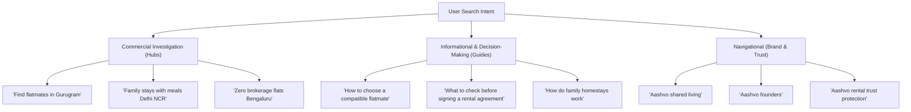

# AASHVO — Sprint 3.5 Search Discovery Strategy
## Organic Search, Search Intent Architecture & Measurement Readiness

**Author:** Senior Technical SEO Strategist & Product Architect  
**Date:** 2026-11-14  
**Workspace:** `D:\Projects\AASHVO`  
**Status:** **STRATEGIC BLUEPRINT COMPLETED**

---

## 1. Search Intent Taxonomy & Keyword Mapping

Aashvo serves university students, young professionals, and relocating individuals across India. Organic discovery is structured around high-intent, problem-solving search queries:

---

## 2. Scalable Hub-and-Spoke Page Architecture

### 2.1 The Anti-Doorway Page Principle
In strict adherence to Google Search Essentials and CTO instructions (*"Never generate hundreds of thin, duplicate or doorway pages simply to target keywords. Do not claim that properties or flatmates are available in a location unless actual verified inventory exists"*):
- Landing hubs are generated **only for metropolitan areas with active, verified inventory** (Delhi NCR, Gurugram, Bengaluru, Noida, Mumbai, Pune, Hyderabad).
- Locations with zero active listings are not indexed as public doorway pages.

### 2.2 Hub URL & Metadata Blueprint

| Page Type | Canonical URL Structure | Title Pattern | Target Search Intent |
|---|---|---|---|
| **Category Hub: Flatmates** | `/?tab=flatmates` | `Verified Flatmates & Room-Sharing in India — Zero Brokerage \| Aashvo` | Renter seeking roommates with verified lifestyle compatibility |
| **Category Hub: Family Stays** | `/?tab=family_stays` | `Family Stays with Homecooked Meals across India \| Aashvo` | Students/professionals seeking safe, resident family homes |
| **City Hub: Gurugram** | `/?city=Gurugram` | `Shared Flats & Flatmates in Gurugram — Cyber City & Golf Course Rd \| Aashvo` | Relocating corporate professionals near Cyber City / DLF |
| **City Hub: Bengaluru** | `/?city=Bengaluru` | `Student & Tech Living in Bengaluru — Koramangala & HSR Layout \| Aashvo` | Tech engineers and students near Koramangala and Whitefield |
| **City Hub: Delhi NCR** | `/?city=Delhi%20NCR` | `Verified Flatmates & Rooms in Delhi NCR — Zero Brokerage \| Aashvo` | Delhi University students and South Delhi professionals |

---

## 3. Answer Engine Optimization (AEO) Playbook

To optimize for conversational search engines (Google AI Overviews, Perplexity, Gemini, ChatGPT Search):

### 3.1 Content Structure Formula
Every informational section must follow the **3-tier answer hierarchy**:
1. **Direct Answer (40–50 words):** A concise, factual answer in the first paragraph immediately under an `H2` or `H3` question heading.
2. **Detailed Breakdown (Bulleted List or Table):** 3 to 5 actionable bullet points or a comparison matrix detailing nuances (e.g., meal inclusion options, deposit ranges).
3. **Internal Contextual Link:** A link to real inventory or verification tools on Aashvo.

### 3.2 High-Value AEO Content Matrix

| Target Question Query | Answer-First Summary | Structured Format |
|---|---|---|
| **"How do I find a compatible flatmate in India?"** | Finding a compatible flatmate requires aligning on 5 lifestyle dimensions: food habits (Vegetarian vs Non-Vegetarian), sleep routines (Early Bird vs Night Owl), cleanliness standards, budget limits, and pet friendliness before committing. | Comparison checklist table |
| **"What is an Aashvo Family Stay?"** | An Aashvo Family Stay is a verified private room inside the primary residence of an on-site host family, offering homecooked meals and zero commercial broker fees. | 3-tier meal classification list |
| **"What should a standard rental agreement include?"** | An Indian rental agreement must itemize monthly rent, security deposit terms, notice period, maintenance charges, electricity meter rates, and move-out inspection rules. | Itemized list with statutory references |

---

## 4. Generative Engine Optimization (GEO) Playbook

Generative engines synthesize brand information across multiple sources:
- **Entity Consistency:** Aashvo's corporate identity is uniformly defined across `index.html`, `public/llms.txt`, and footer metadata as:  
  *“India's verified shared-living, flatmate discovery, and family homestay platform with zero brokerage and rental trust protection.”*
- **Supplementary File (`public/llms.txt`):** Provides a machine-readable summary of categories, operating cities, privacy guarantees, and contact channels.
- **Structured Data:** Unified JSON-LD graph linking `Organization`, `WebSite`, `BreadcrumbList`, and `FAQPage`.

---

## 5. Analytics & Measurement Readiness

### 5.1 Google Search Console Setup
- XML Sitemap submitted at: `https://aashvo.vercel.app/sitemap.xml`.
- Ownership verification prepared via HTML `<meta name="google-site-verification" content="..." />` tag upon founder provision of credentials.

### 5.2 Google Analytics 4 (GA4) Event Taxonomy
Prepared dataLayer structure for key user conversion events:
- `view_item_list`: Triggered when discovery grid loads listings.
- `select_item`: Triggered when user opens a property or flatmate modal.
- `submit_inquiry`: Triggered when an inquiry is dispatched to a homeowner or flatmate.
- `filter_applied`: Triggered when filtering by city, meal option, or budget.

### 5.3 Core Web Vitals Targets
- **Largest Contentful Paint (LCP):** < 2.5 seconds (achieved via compressed WebP assets, hero architectural SVG inline rendering, and font preconnections).
- **Interaction to Next Paint (INP):** < 200 ms (achieved via lightweight React state and zero blocking third-party scripts).
- **Cumulative Layout Shift (CLS):** < 0.1 (achieved by reserving explicit dimensional containers for modal backdrops and property images).

