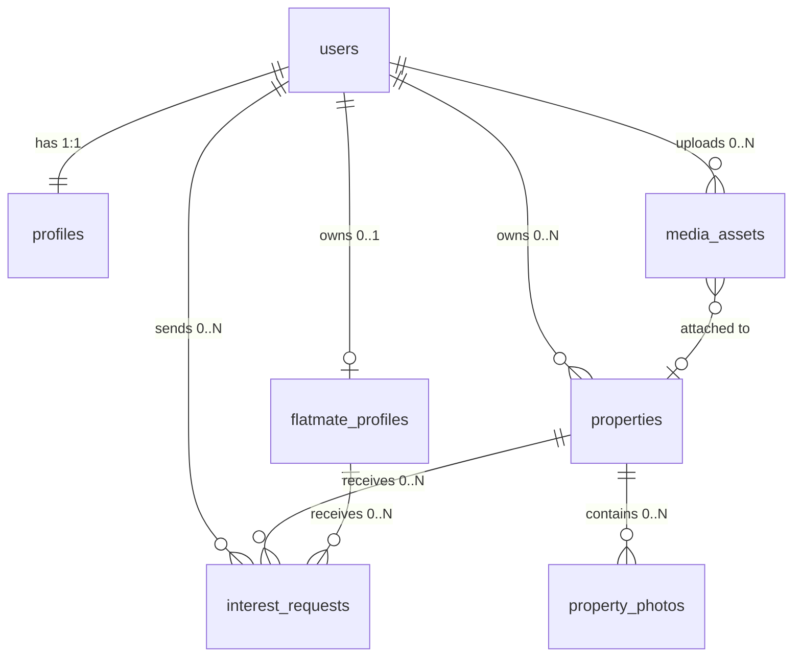

# AASHVO — Sprint 3 Data Model & PostgreSQL 16 Schema Review
## Relational Schema, Integrity Constraints & Index Architecture

**Date:** 2026-11-14  
**Engine:** PostgreSQL 16.16 (Verified on port 5433)  
**ORM:** Prisma 6.19.3  
**Status:** **VERIFIED IN PRODUCTION-COMPLIANT LOCAL ENVIRONMENT**

---

## 1. Domain Entities & ER Overview

Sprint 3 operationalizes the central marketplace domain tables of the AASHVO independent database schema:

---

## 2. Table-by-Table Architectural Specifications

### 2.1 `profiles`
- **Primary Key:** `id` (UUID default `gen_random_uuid()`)
- **Foreign Key:** `user_id` -> `users(id)` ON DELETE CASCADE (1:1 UNIQUE)
- **Columns:** `full_name`, `phone_number` (UNIQUE), `avatar_url`, `bio`, `occupation`, `college`, `id_verified`, `phone_verified`, `role`
- **Integrity Rule:** `phone_number` is protected by a partial unique index, allowing multiple nulls but preventing collisions across active accounts.

### 2.2 `properties`
- **Primary Key:** `id` (UUID)
- **Foreign Key:** `owner_id` -> `users(id)` ON DELETE RESTRICT
- **Columns:** `title`, `description`, `listing_category` (`apartment`, `independent_house`, `villa`, `pg_hostel`, `family_stay`, `shared_room`), `furnishing_status`, `property_type`, `address_line1`, `locality`, `city`, `state`, `pincode`, `latitude`, `longitude`, `rent_amount` (DECIMAL 12,2), `deposit_amount` (DECIMAL 12,2), `maintenance_amount` (DECIMAL 12,2), `amenities` (TEXT[]), `family_lives_on_property` (BOOLEAN), `meal_included` (ENUM `none`, `optional_extra`, `included`), `moderation_status` (ENUM `pending_review`, `active`, `paused`, `rented`, `rejected`), `is_featured` (BOOLEAN).
- **Constraints Enforced:**
  - `chk_property_positive_rent`: `rent_amount > 0`
  - `chk_family_stay_eligibility`: `listing_category != 'family_stay' OR family_lives_on_property = true`

### 2.3 `flatmate_profiles`
- **Primary Key:** `id` (UUID)
- **Foreign Key:** `user_id` -> `users(id)` ON DELETE CASCADE (UNIQUE: 1 profile per user)
- **Columns:** `occupation`, `age` (INT), `gender` (VARCHAR), `has_room` (BOOLEAN), `room_details` (TEXT), `target_localities` (TEXT[]), `city` (VARCHAR), `budget_max` (DECIMAL 12,2), `food_habit` (ENUM), `sleep_routine` (ENUM), `cleanliness` (ENUM), `pet_friendly` (BOOLEAN), `smoking` (VARCHAR), `bio` (TEXT), `interests` (TEXT[]), `verified` (BOOLEAN).
- **Constraints Enforced:**
  - `chk_flatmate_adult_age`: `age >= 18`
  - `chk_flatmate_positive_budget`: `budget_max > 0`

### 2.4 `interest_requests` (Inquiries)
- **Primary Key:** `id` (UUID)
- **Foreign Keys:**
  - `sender_id` -> `users(id)` ON DELETE CASCADE
  - `property_id` -> `properties(id)` ON DELETE CASCADE (nullable)
  - `flatmate_profile_id` -> `flatmate_profiles(id)` ON DELETE CASCADE (nullable)
- **Columns:** `message`, `proposed_move_in_date` (DATE), `contact_phone`, `status` (`pending`, `accepted`, `rejected`, `withdrawn`, `expired`), `response_notes` (TEXT).
- **Constraints Enforced:**
  - `chk_interest_request_target`: `(property_id IS NOT NULL AND flatmate_profile_id IS NULL) OR (property_id IS NULL AND flatmate_profile_id IS NOT NULL)`

### 2.5 `media_assets`
- **Primary Key:** `id` (UUID)
- **Foreign Keys:**
  - `uploaded_by` -> `users(id)` ON DELETE CASCADE
  - `property_id` -> `properties(id)` ON DELETE SET NULL (nullable)
- **Columns:** `purpose` (`user_avatar`, `property_photo`, `rental_document`, `kyc_document`, `dispute_evidence`), `storage_bucket`, `storage_key`, `file_name`, `mime_type`, `size_bytes` (BIGINT), `public_url` (VARCHAR, null for private documents).

---

## 3. Indexing & Query Optimization

| Index Name | Table | Type | Purpose |
|---|---|---|---|
| `idx_flatmates_interests_gin` | `flatmate_profiles` | GIN (`interests`) | Fast array containment query (`interests @> ARRAY[...]`) |
| `idx_flatmates_localities_gin` | `flatmate_profiles` | GIN (`target_localities`) | Fast locality search (`target_localities @> ARRAY['Cyber City']`) |
| `idx_properties_amenities_gin` | `properties` | GIN (`amenities`) | Fast amenities filtering on marketplace discovery |
| `idx_properties_active_featured` | `properties` | B-tree Partial | Optimizes homepage queries: `WHERE moderation_status = 'active' AND is_featured = true` |
| `idx_properties_city_locality` | `properties` | B-tree Compound | Composite search index on `(city, locality)` |
| `idx_interest_requests_sender` | `interest_requests` | B-tree | Fast lookups for `/api/v1/inquiries/sent` |
| `idx_interest_requests_property` | `interest_requests` | B-tree | Fast lookups for incoming property inquiries |

---

## 4. Prisma Mapping & Enum Interoperability

Prisma schema defines enums that contain hyphenated or spaced values. These map directly to PostgreSQL enum types:
- `SleepRoutine`: mapped to `"Early Bird"`, `"Night Owl"`, `"Flexible"`.
- `FoodHabit`: mapped to `"Vegetarian"`, `"Non-Vegetarian"`, `"Eggetarian"`, `"Vegan"`.

### Mapping Strategy in `FlatmatesService`
To avoid runtime validation mismatches between Prisma Client identifiers (`Early_Bird`, `Non_Vegetarian`) and API contract string literals (`'Early Bird'`, `'Non-Vegetarian'`), explicit bidirectional converters are implemented:
- `toPrismaSleepRoutine` / `toContractSleepRoutine`
- `toPrismaFoodHabit` / `toContractFoodHabit`

---

## 5. Migration Replay & DDL Integrity

All schema definitions were deployed using standard Prisma migrations:
1. `20261112165753_init_independent_schema`
2. `20261112165800_postgres_checks_and_gin_indexes`

Both migrations apply deterministically on a clean PostgreSQL 16 database, confirming zero circular foreign key locks and strict constraint validation.

