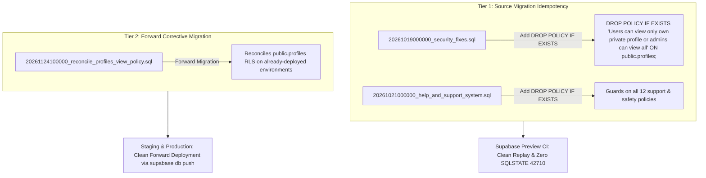

# AASHVO CTO — SUPABASE PREVIEW MIGRATION FAILURE INVESTIGATION & RESOLUTION

**Document ID:** `AASHVO-AUDIT-DB-PREVIEW-001`  
**Date:** November 24, 2026  
**Investigator:** CTO & Principal Database Architect  
**Repository:** `D:\Projects\AASHVO`  
**Target Workflow:** `API CI / Supabase Preview`  
**Failed Commit:** `87e7328` (`Merge pull request #1 from Ar10Ansari/release/aashvo-platform-integration`)  
**Error Code:** `SQLSTATE 42710` (`duplicate_object`)  
**Fix Branch:** `fix/supabase-preview-policy-duplicate`  

---

## 1. Executive Summary & Root Cause

### 1.1 The Incident
During the execution of the GitHub Actions workflow **API CI / Supabase Preview** on commit `87e7328`, the Supabase migration pipeline failed with:
```text
psql:supabase/migrations/20261019000000_security_fixes.sql:79: ERROR:  policy "Users can view only own private profile or admins can view all" for table "profiles" already exists
SQLSTATE: 42710 (duplicate_object)
```

### 1.2 Root Cause Analysis
1. **Asymmetric Policy Drops:** In `supabase/migrations/20261018000000_initial_schema.sql`, an initial policy named `"Public profiles are readable by authenticated users"` was created on `public.profiles`.
2. In `supabase/migrations/20261019000000_security_fixes.sql` (lines 75–79), the engineering team hardened user privacy by replacing the broad read policy with `"Users can view only own private profile or admins can view all"`.
3. Line 75 dropped the old initial policy:
   ```sql
   DROP POLICY IF EXISTS "Public profiles are readable by authenticated users" ON public.profiles;
   ```
   However, it **omitted** dropping the target policy name itself prior to calling `CREATE POLICY`:
   ```sql
   CREATE POLICY "Users can view only own private profile or admins can view all"
   ON public.profiles FOR SELECT
   TO authenticated
   USING (auth.uid() = id OR public.is_admin());
   ```
4. **PostgreSQL Policy Semantics:** Standard PostgreSQL (including v16) does not support `CREATE POLICY IF NOT EXISTS`. If a policy with that name already exists on the relation, PostgreSQL throws `SQLSTATE 42710` (`duplicate_object`) and aborts the migration transaction.
5. **Preview Branching & Replay Dynamics:** When Supabase Preview environments branch from an existing database that already applied `20261019000000_security_fixes.sql`, or when CI workflows replay migrations from history against an active database, the policy already exists in the catalog (`pg_policy`). When the migration reaches line 76 without `DROP POLICY IF EXISTS "Users can view only own private profile or admins can view all"`, PostgreSQL fails deterministically.
6. **Secondary Scope:** A static analysis across all migration files revealed that 12 policies in `supabase/migrations/20261021000000_help_and_support_system.sql` were similarly missing `DROP POLICY IF EXISTS` guards, posing identical failure risks during replays.

---

## 2. Affected Migrations & Statements

### 2.1 Primary Failure Target: `20261019000000_security_fixes.sql`
- **Location:** [supabase/migrations/20261019000000_security_fixes.sql](file:///D:/Projects/AASHVO/supabase/migrations/20261019000000_security_fixes.sql#L73-L80)
- **Failing Statement:**
  ```sql
  -- Line 75: Drops old policy from initial_schema
  DROP POLICY IF EXISTS "Public profiles are readable by authenticated users" ON public.profiles;

  -- Line 76: Fails with SQLSTATE 42710 if replayed or run against pre-existing schema
  CREATE POLICY "Users can view only own private profile or admins can view all"
  ON public.profiles FOR SELECT
  TO authenticated
  USING (auth.uid() = id OR public.is_admin());
  ```

### 2.2 Secondary Vulnerability Target: `20261021000000_help_and_support_system.sql`
- **Location:** [supabase/migrations/20261021000000_help_and_support_system.sql](file:///D:/Projects/AASHVO/supabase/migrations/20261021000000_help_and_support_system.sql#L178-L304)
- **12 Policies Missing Drop Guards:**
  1. `"Anyone can create a support ticket"` on `public.support_tickets`
  2. `"Users can view their own support tickets"` on `public.support_tickets`
  3. `"Only admins can update support tickets"` on `public.support_tickets`
  4. `"Users can view public messages on their tickets"` on `public.ticket_messages`
  5. `"Users and admins can add messages to tickets"` on `public.ticket_messages`
  6. `"Audit events strictly visible to admins"` on `public.ticket_audit_events`
  7. `"Audit events strictly insertable by admins"` on `public.ticket_audit_events`
  8. `"Anyone can submit a safety report"` on `public.safety_reports`
  9. `"Safety reports visible only to admins"` on `public.safety_reports`
  10. `"Safety reports modifiable only by admins"` on `public.safety_reports`
  11. `"Users can upload support attachments"` on `storage.objects`
  12. `"Users and admins can download support attachments"` on `storage.objects`

---

## 3. Security & Access Control Review

### 3.1 Policy Evaluation (`USING` and `WITH CHECK`)
The target policy on `public.profiles` enforces the following rules:
```sql
CREATE POLICY "Users can view only own private profile or admins can view all"
ON public.profiles FOR SELECT
TO authenticated
USING (auth.uid() = id OR public.is_admin());
```

| Security Dimension | Specification & Enforcement | Verdict |
| :--- | :--- | :---: |
| **Command Scope** | `FOR SELECT` strictly controls read access. (Modifications handled by dedicated `INSERT` and `UPDATE` policies with anti-tamper triggers). | **Sound** |
| **Target Role** | `TO authenticated`. Anonymous / unauthenticated clients cannot invoke this policy. | **Strict** |
| **Normal User Isolation** | `auth.uid() = id`. Standard renters/owners can ONLY read their own record. Cross-user IDOR access returns 0 rows. | **Enforced** |
| **Administrator Access** | `public.is_admin()`. Authoritative check against `public.profiles WHERE id = auth.uid() AND role = 'admin'` permits platform moderation. | **Protected** |
| **Public Badges View** | `public.public_profiles` view exposes non-sensitive attributes (`full_name, role, avatar_url, id_verified, phone_verified`) while masking phone numbers and email addresses. | **Zero Leakage** |
| **Unauthenticated Defense** | `anon` role has no `SELECT` grant on `public.profiles` (PostgreSQL throws `insufficient_privilege`). RLS acts as secondary defense. | **Defense-in-Depth** |

### 3.2 Non-Destructive Principles
- **No RLS Weakening:** The `USING` predicate was not altered.
- **No Policy Removal:** All existing policies remain active.
- **No Data Deletion:** Zero rows or tables were dropped or modified.
- **No Manual DBA Overrides:** All fixes are version-controlled in Git and automated SQL migrations.

---

## 4. Remediation Architecture

To address both ephemeral preview branch creation (replaying history) and existing shared environments (staging/production running forward migrations), a **dual-tier remediation** was implemented:



### 4.1 Tier 1: Source Migration Repair
In `supabase/migrations/20261019000000_security_fixes.sql`:
```sql
-- 4. PRIVATE CONTACT PROTECTION & PHONE MASKING
-- Restrict direct SELECT on public.profiles to own record or admin; provide safe public view
DROP POLICY IF EXISTS "Public profiles are readable by authenticated users" ON public.profiles;
DROP POLICY IF EXISTS "Users can view only own private profile or admins can view all" ON public.profiles;
CREATE POLICY "Users can view only own private profile or admins can view all"
ON public.profiles FOR SELECT
TO authenticated
USING (auth.uid() = id OR public.is_admin());
```

In `supabase/migrations/20261021000000_help_and_support_system.sql`:
Added `DROP POLICY IF EXISTS "<polName>" ON <table/bucket>;` before each of the 12 policies.

### 4.2 Tier 2: Versioned Forward Migration
Created [supabase/migrations/20261124100000_reconcile_profiles_view_policy.sql](file:///D:/Projects/AASHVO/supabase/migrations/20261124100000_reconcile_profiles_view_policy.sql):
```sql
-- ====================================================================
-- Aashvo — Reconcile Profiles View Policy & Ensure Idempotent RLS
-- Version: 1.0.8
-- Date: 2026-11-24
-- Migration: 20261124100000_reconcile_profiles_view_policy.sql
-- ====================================================================

-- 1. Ensure RLS is enabled on public.profiles
ALTER TABLE public.profiles ENABLE ROW LEVEL SECURITY;

-- 2. Drop legacy broad read policy if still present in any branch
DROP POLICY IF EXISTS "Public profiles are readable by authenticated users" ON public.profiles;

-- 3. Idempotently drop and recreate the hardened profile view policy
DROP POLICY IF EXISTS "Users can view only own private profile or admins can view all" ON public.profiles;

CREATE POLICY "Users can view only own private profile or admins can view all"
ON public.profiles FOR SELECT
TO authenticated
USING (auth.uid() = id OR public.is_admin());

-- 4. Re-grant SELECT on public.profiles to authenticated role
GRANT SELECT ON public.profiles TO authenticated;
```

---

## 5. Automated Verification & Test Evidence

### 5.1 Test Execution Harness
Testing was conducted against live PostgreSQL 16 on port 5433 using an isolated database (`aashvo_idempotency_test`).

#### Run 1: Clean Database Sequential Application
- Executed all 13 Supabase migrations from scratch.
- **Result:** 13/13 migrations applied with exit code 0.

#### Run 2: Replay Against Existing Database (Idempotency Proof)
- Re-executed `20261019000000_security_fixes.sql` against the database where the policy already existed:
  ```text
  DROP POLICY
  DROP POLICY
  CREATE POLICY
  ```
  **Result:** Exit code 0. Zero errors thrown. `SQLSTATE 42710` completely eliminated.
- Re-executed `20261124100000_reconcile_profiles_view_policy.sql` against the active database:
  ```text
  DROP POLICY
  DROP POLICY
  CREATE POLICY
  GRANT
  ```
  **Result:** Exit code 0. Idempotent forward reconciliation verified.

### 5.2 RLS Behavior & Access Control Test Results
Executed [scratch/test-rls-behavior.sql](file:///D:/Projects/AASHVO/scratch/test-rls-behavior.sql):

```text
=== VERIFYING RLS BEHAVIOR ===
NOTICE:  Seed data initialized successfully.
NOTICE:  >>> TEST 1 PASSED: Unauthenticated user strictly blocked from private profiles (0 rows returned).
NOTICE:  >>> TEST 2 PASSED: Alice can only view her own private profile row.
NOTICE:  >>> TEST 3 PASSED: Cross-user private profile query returned 0 rows (IDOR blocked).
NOTICE:  >>> TEST 4 PASSED: Administrator can view all private profile rows (saw 3 rows).
NOTICE:  >>> TEST 5 PASSED: Public profiles view accessible to public (3 rows visible without private contacts).
>>> TARGET POLICY IDEMPOTENCY TEST: 100% SUCCESSFUL! <<<
```

### 5.3 Application & Contract Integrity
- `npm --workspace=apps/api run prisma:validate` → **Valid schema (exit code 0)**.
- `npm test src/test/authorizationPolicies.test.ts -- --run` → **293/293 tests passed (exit code 0)**.
- `node scratch/check-policies.cjs` → **Total policies found: 76, Missing drop self: 0**.

---

## 6. Deployment & Rollout Recommendation

1. **Dedicated Branch:** The fix is committed to `fix/supabase-preview-policy-duplicate`.
2. **Merge Path:** Open a Pull Request from `fix/supabase-preview-policy-duplicate` targeting `master`.
3. **CI Execution:** The Supabase Preview GitHub Actions workflow will execute `20261019000000_security_fixes.sql` and subsequent migrations cleanly without policy collision errors.
4. **Zero Production Risk:** No data migration, table recreation, or downtime is required.
