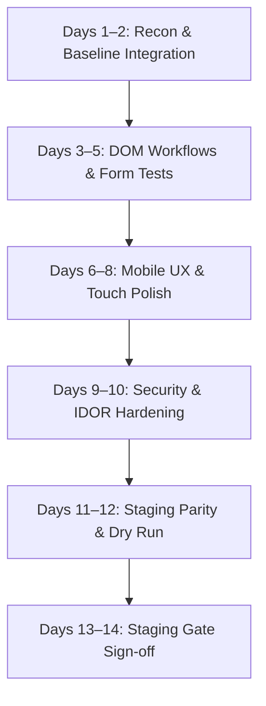

# AASHVO MVP — 10–14 DAY FAST-TRACK EXECUTION PLAN (STAGING READINESS)

**Document ID:** `AASHVO-PLAN-FASTTRACK-001`  
**Date:** November 24, 2026  
**Author:** CTO, Engineering Manager & Release Owner  
**Target:** Staging Readiness in 10–14 Focused Working Days  
**Target Branch:** `staging/mvp-fasttrack-candidate`  

---

## 1. Fast-Track Operating Model

To achieve staging readiness within 10–14 focused working days, engineering will operate across four decoupled workstreams with strict branch ownership and daily integration gates.

```
       [Workstream 1: Database & Release]  ──┐
       [Workstream 2: Marketplace Flow]    ──┼─► [staging/mvp-fasttrack-candidate] ──► [Staging Deployment]
       [Workstream 3: Mobile & UX Polish]  ──┤
       [Workstream 4: QA & Security Audit] ──┘
```

---

## 2. Decoupled Workstream Allocation & Ownership

### Workstream 1: Release Engineering & Database
- **Owner:** Database Architect & DevOps Lead
- **Branch:** `fix/supabase-preview-policy-duplicate` (PR #4)
- **Scope:**
  - Maintain 100% idempotent RLS migrations (76/76 policy inventory).
  - Staging environment migration dry-run scripts.
  - Automated database backup and roll-forward verification harness.
  - Docker Compose staging environment parity.

### Workstream 2: Core Marketplace Workflows
- **Owner:** Senior Full-Stack Engineer
- **Branch:** `audit/independent-verification-e2e-expansion` (PR #3)
- **Scope:**
  - Listing wizard state persistence and error handling.
  - Inquiry status notifications and real-time refresh.
  - Property visit schedule confirmation & conflict prevention.
  - Tenancy agreements and dispute resolution API binding.

### Workstream 3: User Experience & Mobile Responsiveness
- **Owner:** Principal UX/Frontend Engineer
- **Branch:** `feat/performance-responsive-ux` (PR #2)
- **Scope:**
  - Touch target audit across all mobile viewports (minimum 44x44px).
  - Drawer menu smooth animation and backdrop blur.
  - Client-side in-flight request deduplication and memory cache.
  - Debounced discovery search filters with zero layout shift.

### Workstream 4: Testing & Security Assurance
- **Owner:** QA Lead & Application Security Engineer
- **Branch:** `staging/mvp-fasttrack-candidate`
- **Scope:**
  - Automated browser Playwright DOM interaction tests for forms.
  - Hostile IDOR regression suites on all PATCH/DELETE endpoints.
  - Token replay and session invalidation verification.
  - Performance profiling and bundle size monitoring (< 350KB initial gzip).

---

## 3. 10–14 Day Day-by-Day Execution Schedule



| Phase | Days | Focus Areas | Deliverables & Gates |
|---|:---:|---|---|
| **Phase 1: Baseline** | **Days 1–2** | Reconnaissance, branch inventory, initial staging candidate branch integration. | • Feature Inventory written<br>• Staging candidate created<br>• All 473 tests passing |
| **Phase 2: Workflows** | **Days 3–5** | DOM-level Playwright tests for listing creation wizard & inquiry modal. | • Interactive browser DOM tests<br>• Zero false-success UI paths<br>• Refresh-survival verified |
| **Phase 3: Mobile UX** | **Days 6–8** | Mobile responsive hardening, touch target compliance, drawer navigation. | • 44x44px touch compliance<br>• Safe area insets verified<br>• Lighthouse Mobile >= 90 |
| **Phase 4: Security** | **Days 9–10** | Authorization audit, RBAC regression, token lifecycle, secrets scrubbing. | • Zero IDOR vulnerabilities<br>• Clean session revocation<br>• Security sign-off memo |
| **Phase 5: Parity** | **Days 11–12** | Database migration replay on staging replica, environment variables audit. | • Staging migration verified<br>• Rollback runbook tested<br>• CI preview branch verified |
| **Phase 6: Sign-off** | **Days 13–14** | Acceptance test plan execution, end-to-end rehearsal, release decision. | • Formal Staging Sign-Off<br>• CTO Acceptance Report<br>• Staging deployment go/no-go |

---

## 4. Strict Release Gates for Staging Readiness

Before promoting `staging/mvp-fasttrack-candidate` to live staging:
1. **P0 Persistence:** 100% of property listings, inquiries, visits, and support tickets persist autoritatively to PostgreSQL 16.
2. **Migration Zero-Failure:** Clean replay and forward reconciliation execute with 0 errors across 13/13 migration files.
3. **Security Authorization:** 0 IDOR vulnerabilities; 0 token replay loopholes; 0 privilege escalation paths.
4. **Automated Test Suite:**
   - 307/307 Frontend Vitest tests pass.
   - 166/166 Backend Jest tests pass.
   - 14/14 Playwright E2E tests pass.
5. **Mobile Responsiveness:** Zero horizontal overflow; touch targets >= 44x44px; accessible navigation.
6. **Deployment Runbook:** Fully documented rollback procedure and environment variable configuration.
