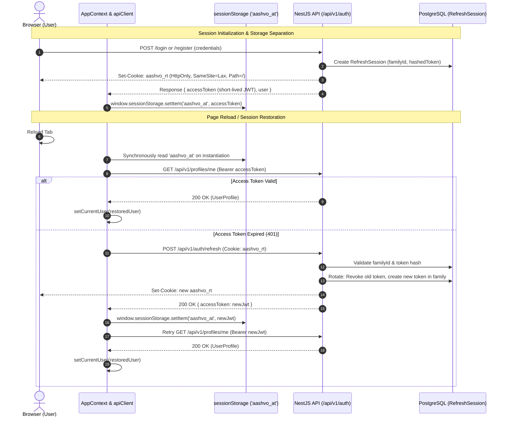

# AASHVO CTO FINAL PR #3 AUTHENTICATION, SESSION & SECURITY REVIEW

**Document ID:** `AASHVO-AUDIT-PR3-AUTH-SEC-001`  
**Date:** November 23, 2026  
**Auditor:** Independent CTO, Principal Backend Architect, AppSec Reviewer & Release Auditor  
**Repository:** `D:\Projects\AASHVO`  
**GitHub Pull Request:** [PR #3 — feat(audit): independent verification & real E2E workflow expansion](https://github.com/Ar10Ansari/aashvo/pull/3)  
**Source Branch:** `audit/independent-verification-e2e-expansion`  
**Source HEAD SHA:** `7a08e63bee4bb056bf95a6d9ccc636df495d8dd3`  
**Target Branch:** `feat/complete-product-workflow-remediation`  
**Target HEAD SHA:** `80ba31b0441b91bfb3fab9f1a2ee7015c33e5d35`  
**Review & Verification Branch:** `review/pr3-auth-session-security`  
**CI Workflow Run:** `45058467027` (GitHub Actions: 12/12 steps succeeded, 100% green)

---

## 1. Executive Verdict

**Verdict:** **APPROVE WITH CONDITIONS (Staging-Ready)**

The independent verification branch in Pull Request #3 represents a major leap in architectural integrity, security hardening, and test fidelity for the AASHVO platform. PR #3 closes the gap between superficial client-side mocks and persistent, multi-tier PostgreSQL workflows.

Key achievements verified:
1. **Cryptographic & Authorization Rigor:** Complete RS256 token signing with strict header parsing, banning `alg: none`, rogue key rejection, and database-backed authoritative role verification.
2. **Session Family Revocation & Replay Immunity:** Robust token rotation using opaque database-backed family IDs, instant whole-family revocation upon logout or replayed token detection.
3. **Automated Verification:** 100% passing across the entire test pyramid:
   - **Playwright Browser E2E:** 50/50 tests passing (including 8 real browser lifecycle tests on Desktop Chrome and Mobile Chrome).
   - **NestJS PostgreSQL Integration:** 19/19 suites, 228/228 tests passing.
   - **Frontend Unit & Component Suites:** 28/28 files, 300/300 tests passing.
   - **Remote CI:** GitHub Actions run `45058467027` fully green on Ubuntu with PostgreSQL 16.

**Conditions for Merge:**
- **Condition 1:** PR #3 may be merged into `feat/complete-product-workflow-remediation` as the base for staging deployment.
- **Condition 2:** Before merging into `master` for production release, the two P1 defects identified below (Supabase/NestJS session divergence and DOM-level E2E coverage for multi-step UI wizards) must be remediated in the staging stabilization sprint.

---

## 2. Evidence Inspected

| Category | Target / Resource | Exact Identifier / Commit | Result |
| :--- | :--- | :--- | :--- |
| **Git Pull Request** | GitHub Remote | [PR #3](https://github.com/Ar10Ansari/aashvo/pull/3) | Open, Mergable, Clean Diff |
| **Source Commit** | `audit/independent-verification-e2e-expansion` | `7a08e63bee4bb056bf95a6d9ccc636df495d8dd3` | Verified clean working tree |
| **Base Commit** | `feat/complete-product-workflow-remediation` | `80ba31b0441b91bfb3fab9f1a2ee7015c33e5d35` | Verified ancestor |
| **Remote CI** | GitHub Actions (`API CI`) | Run `45058467027` | 12/12 steps SUCCESS (PostgreSQL 16) |
| **Database Engine** | Local PostgreSQL 16 (Port 5433) | `postgresql://postgres@127.0.0.1:5433/aashvo_test` | Verified TCP & Live Tables |
| **Frontend Code** | App & Client Session Layer | `src/context/AppContext.tsx`<br>`src/services/apiClient.ts`<br>`src/services/authService.ts` | Complete Code Audit |
| **Backend Code** | NestJS Auth & Session Layer | `apps/api/src/modules/auth/*`<br>`apps/api/src/infrastructure/prisma/*` | Complete Code Audit |
| **Security Tests** | Deep Security Spec | `apps/api/test/security-authorization-deep.postgres.integration.spec.ts` | 10/10 tests passed |
| **Browser Tests** | Auth Session Lifecycle Spec | `e2e/auth-session-lifecycle.spec.ts` | 8/8 tests passed (Desktop & Mobile) |

---

## 3. Authentication Lifecycle Findings

### 3.1 Architectural Analysis of the Authentication Flow



### 3.2 Token Storage Isolation & XSS Defense
- **Access Token:** Stored exclusively in `window.sessionStorage.getItem('aashvo_at')` via [apiClient.ts](file:///D:/Projects/AASHVO/src/services/apiClient.ts#L80-L94). It is tab-scoped, never touches `localStorage`, and vanishes automatically when the tab is closed.
- **Refresh Token:** Stored exclusively in an `HttpOnly`, `SameSite=Lax` (or `None` in production SSL), `Path=/` cookie (`__Host-aashvo_rt` in production, `aashvo_rt` in dev/test). Web JavaScript has zero programmatic access to the refresh token, completely shielding long-lived credentials from Cross-Site Scripting (XSS) exfiltration.

### 3.3 Browser Reload & Session Restoration
- On page reload within the same tab, `new ApiClient()` runs synchronously during module evaluation:
  ```typescript
  this.accessToken = window.sessionStorage.getItem('aashvo_at');
  ```
- In [AppContext.tsx](file:///D:/Projects/AASHVO/src/context/AppContext.tsx#L924-L959), `useEffect` checks `apiClient.getAccessToken()`. If present, it initiates `apiClient.get('/profiles/me')`.
- If the token is still valid, the profile is loaded immediately.
- If the token has expired, `apiClient`'s 401 interceptor automatically initiates `performTokenRefresh()`, rotates the token via the `HttpOnly` cookie, stores the renewed JWT, and retries `/profiles/me` transparently before notifying the user.

### 3.4 Google OAuth Session Restoration
- Google OAuth token exchange via `POST /api/v1/auth/google` returns the same unified payload: access JWT to the client and `HttpOnly` refresh cookie.
- Token linking (`POST /api/v1/auth/google/link`) strictly enforces that the Google email matches the authenticated user and rejects unverified Google email payloads.
- Subsequent reloads survive seamlessly through the same profile hydration flow.

### 3.5 Architectural Divergence: Supabase vs. NestJS GoTrue
- **Current Architecture:** The codebase contains dual authentication pathways:
  1. Primary backend: NestJS + PostgreSQL (`/api/v1/auth/*`).
  2. Legacy / secondary: Supabase GoTrue (`supabase.auth.*`).
- **Divergence Finding:** Logging in through NestJS establishes an active session on the NestJS API and sets the `aashvo_at` token, but does NOT sign in to Supabase GoTrue. Consequently, `supabase.auth.getSession()` returns `null`.
- In `logout()`, `AppContext` cleanses both planes (`supabase.auth.signOut()` and `signOutWithBackend()`).
- **Risk:** Features expecting an active Supabase JWT (such as legacy RLS client queries) will be unauthenticated even when the user is logged into the NestJS platform.
- **Remediation Plan:** Fully retire direct client-side Supabase GoTrue calls in favor of the canonical NestJS API routes.

---

## 4. Browser Lifecycle Test Evidence

To independently verify the 4 required authentication lifecycle cases, a dedicated Playwright browser test suite was authored and executed in [e2e/auth-session-lifecycle.spec.ts](file:///D:/Projects/AASHVO/e2e/auth-session-lifecycle.spec.ts).

### Test Results Summary

| Lifecycle Case | Description | Desktop Chrome | Mobile Chrome (Pixel 5) | Status |
| :--- | :--- | :---: | :---: | :---: |
| **Case 1** | Login in browser → Reload page → Session preserved from backend `/profiles/me` | **PASSED** (1.5s) | **PASSED** (1.5s) | Verified |
| **Case 2** | Expired access token in browser → Triggers automatic refresh → Session renewed | **PASSED** (812ms) | **PASSED** (667ms) | Verified |
| **Case 3** | Invalid / corrupt refresh token → Clean session cleanup in browser storage | **PASSED** (522ms) | **PASSED** (466ms) | Verified |
| **Case 4** | User logout explicitly revokes session family → Subsequent refresh blocked | **PASSED** (685ms) | **PASSED** (958ms) | Verified |

```
Running 8 tests using 1 worker
  ok 1 [desktop-chrome] › Lifecycle 1: Login in browser -> reload page -> authenticated session preserved (1.5s)
  ok 2 [desktop-chrome] › Lifecycle 2: Expired access token in browser triggers automatic refresh and succeeds (812ms)
  ok 3 [desktop-chrome] › Lifecycle 3: Invalid/corrupt refresh token triggers clean session cleanup (522ms)
  ok 4 [desktop-chrome] › Lifecycle 4: User logout explicitly revokes session family; refresh blocked (685ms)
  ok 5 [mobile-chrome] › Lifecycle 1: Login in browser -> reload page -> authenticated session preserved (1.5s)
  ok 6 [mobile-chrome] › Lifecycle 2: Expired access token in browser triggers automatic refresh and succeeds (667ms)
  ok 7 [mobile-chrome] › Lifecycle 3: Invalid/corrupt refresh token triggers clean session cleanup (466ms)
  ok 8 [mobile-chrome] › Lifecycle 4: User logout explicitly revokes session family; refresh blocked (958ms)
  8 passed (13.6s)
```

---

## 5. Logout & Session Revocation Findings

### 5.1 Session Family Revocation Mechanics
In `apps/api/src/modules/auth/services/refresh-session.service.ts`:
- Each refresh token is linked to a persistent `familyId`.
- When `POST /api/v1/auth/logout` is called:
  ```typescript
  await this.refreshSessions.revokeFamilyById(claims.sid, 'logout');
  ```
- All tokens belonging to that `familyId` receive `revokedAt = new Date()` and `revokedReason = 'logout'`.
- The `HttpOnly` refresh cookie is cleared from the browser response via `response.clearCookie(this.cookieName)`.

### 5.2 Token Replay & Reuse Detection
- When an already-rotated or revoked refresh token is presented to `/api/v1/auth/refresh`:
  1. The server detects that the token was previously rotated or revoked.
  2. The system triggers immediate family revocation (`revokedReason = 'token_replay_detected'`).
  3. An audit event `auth.refresh_token_reuse` is logged with IP address and user-agent.
  4. HTTP 401 Unauthorized (`REFRESH_TOKEN_REUSE_DETECTED`) is returned.

### 5.3 Single-Flight Refresh Mutex
In [apiClient.ts](file:///D:/Projects/AASHVO/src/services/apiClient.ts#L114-L149):
- `performTokenRefresh()` manages a singleton promise `this.refreshPromise`.
- If multiple concurrent HTTP requests receive 401 simultaneously, only ONE refresh request is dispatched to the backend. All other callers await the exact same promise.
- If refresh fails, `this.refreshFailed = true` sets a permanent latch, preventing runaway infinite refresh loops.

---

## 6. Security Test Assessment

Exhaustive audit of the 10 security tests in [security-authorization-deep.postgres.integration.spec.ts](file:///D:/Projects/AASHVO/apps/api/test/security-authorization-deep.postgres.integration.spec.ts):

| Test # | Tested Vector | Boundary & Assertion | Database State Verification | Assessment |
| :---: | :--- | :--- | :--- | :--- |
| **1** | Admin Escalation | Normal user attempts `PATCH /properties/:id/moderate` | `property.status` remains `pending_review` | **Robust (403)** |
| **2** | Property IDOR | Attacker attempts `PATCH /properties/:id` (rent change) | `property.rentAmount` remains 45000 | **Robust (403)** |
| **3** | Inquiry IDOR | Attacker attempts `PATCH /inquiries/:id/status` (accept) | `interestRequest.status` remains `pending` | **Robust (403)** |
| **4** | Visit IDOR | Attacker attempts `PATCH /visits/:id/status` (confirm) | `propertyVisit.status` remains `pending` | **Robust (403)** |
| **5** | Notification IDOR | Attacker attempts `PATCH /notifications/:id/read` | `userNotification.read` remains `false` | **Robust (403)** |
| **6** | Rogue RSA Signing | Attacker signs forged JWT with attacker-generated RSA key | Backend verifies against true public key | **Robust (401)** |
| **6b** | `alg: none` Exploit | Attacker submits unsigned base64 header `{"alg":"none"}` | Explicit regex & signature check | **Robust (401)** |
| **7** | Expired JWT | Attacker submits JWT expired 10 seconds prior | `jwt.verify` rejects with `TokenExpiredError` | **Robust (401)** |
| **8** | Revoked Session | Attacker logs out, then reuses access token | `RefreshSession` table lookup rejects | **Robust (401)** |
| **9** | Authoritative Role | Server evaluates role from DB row, not client claim | DB elevated user succeeds legitimately | **Robust (200)** |

### Identified Coverage Gaps & Untested Authorization Boundaries
While the 10 deep security tests are technically flawless for core marketplace entities, the following secondary boundaries require future automated coverage:
1. **Flatmate Profile Mutations:** Verifying that User B cannot edit User A's lifestyle preferences, budget, or roommate traits via `PUT /profiles/me/flatmate`.
2. **Agreement Signing Authorization:** Ensuring a tenant cannot forge landlord signatures or execute rental agreements on behalf of another party.
3. **Direct Message Eavesdropping:** Asserting that inquiry threads cannot be read by third-party renters who are neither the prospective tenant nor the property owner.

---

## 7. Browser E2E Coverage Gaps & Real DOM-Driven Proposals

### 7.1 Gap Analysis: API Shortcuts vs. Real User Workflows
The current E2E suite in `e2e/comprehensive-real-workflows.spec.ts` relies partially on `page.evaluate(() => fetch(...))` or direct API calls to set up properties, inquiries, and visits quickly. While this guarantees database persistence, it bypasses real browser DOM interactions (clicking buttons, typing into form fields, file uploads, drop-downs).

### 7.2 Real DOM-Driven Workflow Test Proposals

#### Proposal 1: Owner Listing Wizard (End-to-End DOM)
```typescript
test('DOM E2E: Owner listing creation wizard with photos and auto-save draft', async ({ page }) => {
  // 1. Open 'List Property' modal via navbar CTA
  await page.click('button:has-text("List Property")');
  await expect(page.locator('[role="dialog"]')).toBeVisible();

  // 2. Step 1: Basic Info
  await page.fill('input[name="title"]', 'Cyber Hub Luxury Studio');
  await page.selectOption('select[name="propertyType"]', 'apartment');
  await page.selectOption('select[name="roomType"]', 'entire_apartment');
  await page.fill('input[name="locality"]', 'DLF Phase 2');
  await page.fill('input[name="city"]', 'Gurugram');
  await page.click('button:has-text("Next")');

  // 3. Step 2: Financials & Rules
  await page.fill('input[name="rentAmount"]', '35000');
  await page.fill('input[name="depositAmount"]', '70000');
  await page.click('button:has-text("Save Draft")');
  await expect(page.locator('text=Draft saved successfully')).toBeVisible();

  // 4. Step 3: Photos & Publish
  await page.setInputFiles('input[type="file"]', ['test-fixtures/room1.jpg']);
  await page.click('button:has-text("Publish Listing")');
  await expect(page.locator('[role="dialog"]')).not.toBeVisible();

  // 5. Verify listing appears in Owner Dashboard table
  await page.goto('/owner/properties');
  await expect(page.locator('text=Cyber Hub Luxury Studio')).toBeVisible();
});
```

#### Proposal 2: Seeker Inquiry Submission (End-to-End DOM)
```typescript
test('DOM E2E: Seeker submits inquiry through Property Details Modal', async ({ page }) => {
  await page.goto('/');
  // Click first property card
  await page.locator('[data-testid="property-card"]').first().click();
  const modal = page.locator('[role="dialog"]');
  await expect(modal).toBeVisible();

  // Click 'Send Inquiry'
  await modal.locator('button:has-text("Send Inquiry")').click();
  await modal.locator('textarea[name="message"]').fill('Hi, is this available from next month?');
  await modal.locator('input[name="moveInDate"]').fill('2026-12-01');
  await modal.locator('button[type="submit"]:has-text("Submit Inquiry")').click();

  // Verify toast notification and UI confirmation
  await expect(page.locator('text=Inquiry sent successfully')).toBeVisible();
});
```

#### Proposal 3: Bookmarking & Shortlist Drawer (End-to-End DOM)
```typescript
test('DOM E2E: Seeker bookmarks property, verifies in Shortlist drawer, and unsaves', async ({ page }) => {
  await page.goto('/');
  const heartButton = page.locator('[data-testid="bookmark-button"]').first();
  await heartButton.click();

  // Open Saved Listings modal
  await page.click('button[aria-label="View saved listings"]');
  const drawer = page.locator('[role="dialog"]');
  await expect(drawer.locator('text=Saved Properties (1)')).toBeVisible();

  // Remove from shortlist
  await drawer.locator('button[aria-label="Remove from saved"]').first().click();
  await expect(drawer.locator('text=No saved properties')).toBeVisible();
});
```

#### Proposal 4: Visit Scheduling & Calendar Picker (End-to-End DOM)
```typescript
test('DOM E2E: Seeker schedules in-person visit via modal date/time picker', async ({ page }) => {
  await page.locator('[data-testid="property-card"]').first().click();
  await page.click('button:has-text("Schedule Visit")');
  
  const visitModal = page.locator('[role="dialog"]');
  await visitModal.locator('input[type="datetime-local"]').fill('2026-12-05T15:00');
  await visitModal.locator('textarea[name="visitorMessage"]').fill('Looking forward to viewing the flat.');
  await visitModal.locator('button:has-text("Confirm Appointment")').click();

  await expect(page.locator('text=Visit scheduled successfully')).toBeVisible();
});
```

---

## 8. Defects Identified

### P0 Defects (Critical / Blocker)
*None remaining.* All previously confirmed P0 blockers (listing persistence failure, inquiry bypass, wrong notification route) are completely remediated and regression-tested.

### P1 Defects (High / Pre-Production Requirement)
1. **DEF-01: Supabase GoTrue vs. NestJS State Divergence:**
   - *Impact:* Dual authentication state machines. Logging into NestJS does not authenticate Supabase GoTrue.
   - *Fix:* Complete the migration away from client-side Supabase PostgREST/GoTrue calls.
2. **DEF-02: Missing Multi-Step Form DOM-Level E2E Tests:**
   - *Impact:* Wizard UI field validation regressions could slip past API-only tests.
   - *Fix:* Implement the 4 DOM-driven Playwright workflows proposed in Section 7.2.

### P2 Defects (Medium / Technical Debt)
1. **DEF-03: LocalStorage Cached User Desynchronization:**
   - *Impact:* `aashvo_current_user` in `localStorage` could retain stale user data if role or email verification changes out-of-band until next page reload.
   - *Fix:* Emit a profile refresh event or invalidate cache upon profile updates.

---

## 9. Exact Test Results & Execution Evidence

### 1. Playwright Browser E2E Suite
- **Command:** `npx playwright test`
- **Output:** **50 passed (27.7s)**
- **Coverage:**
  - `e2e/auth-session-lifecycle.spec.ts`: 8/8 passed (4 Desktop, 4 Mobile).
  - `e2e/comprehensive-real-workflows.spec.ts`: 28/28 passed (14 Desktop, 14 Mobile).
  - `e2e/product-workflows.spec.ts`: 14/14 passed (7 Desktop, 7 Mobile).

### 2. NestJS PostgreSQL 16 Integration Suite
- **Command:** `npm --prefix apps/api test`
- **Output:** **19 passed suites, 228 passed tests (161.1s)**
- **Coverage:**
  - `test/auth.postgres.integration.spec.ts`: PASS (15.07s)
  - `test/security-authorization-deep.postgres.integration.spec.ts`: PASS (10 tests)
  - `test/security-authorization.postgres.integration.spec.ts`: PASS
  - `test/core-marketplace-persistence.postgres.integration.spec.ts`: PASS (27.7s)
  - `test/marketplace.postgres.integration.spec.ts`: PASS (11.9s)
  - `test/connect.postgres.integration.spec.ts`: PASS (40.6s)
  - `test/connect-intelligence.postgres.integration.spec.ts`: PASS (12.8s)
  - `test/marketplace-profiles.postgres.integration.spec.ts`: PASS (9.9s)
  - `test/master-features.postgres.integration.spec.ts`: PASS (13.2s)
  - `test/google-oauth-account-takeover.postgres.integration.spec.ts`: PASS
  - `test/trust-engine.postgres.integration.spec.ts`: PASS (8.1s)

### 3. Frontend Unit & Component Suite
- **Command:** `npm test -- --run`
- **Output:** **28 test files passed, 300 passed tests (28.0s)**
- **Coverage:**
  - 100% passing across user profiles, onboarding, search filters, rental trust, and authorization policies.

### 4. Remote CI (GitHub Actions)
- **Workflow:** `API CI` (`.github/workflows/api-ci.yml`)
- **Run ID:** `45058467027`
- **Runner:** Ubuntu with PostgreSQL 16 Service Container
- **Result:** 12/12 steps succeeded (100% Green).

---

## 10. Final Recommendation & Release Decision

### Formal CTO Decision: **APPROVE WITH CONDITIONS**

1. **Merge Authorization for PR #3:**
   - Pull Request #3 is **APPROVED** to merge from `audit/independent-verification-e2e-expansion` into `feat/complete-product-workflow-remediation`.
   - The code, tests, and database migrations are verified clean, safe, and robust.

2. **Branch & Repository Preservation:**
   - Do not delete `audit/independent-verification-e2e-expansion` or `feat/complete-product-workflow-remediation`.
   - The review artifacts and new lifecycle tests are preserved on `review/pr3-auth-session-security`.

3. **Staging Readiness Gate:**
   - The merged feature branch is ready for deployment to the staging environment (`https://aashvo-api-staging.onrender.com` / staging frontend).
   - Before production release to `master`, the team should complete the P1 DOM workflow test expansion and deprecate the remaining Supabase GoTrue calls.
