# AASHVO CTO Strategic Architecture & Release Recommendations

**Audit Date:** November 20, 2026  
**Author:** AASHVO CTO & Principal Platform Architect  
**Audience:** AASHVO Executive Team, Product Stakeholders, and Core Engineering Leads

---

## 1. Executive Summary & Strategic Directive

AASHVO has achieved remarkable engineering milestones: an intelligent 6-dimension compatibility matching engine, multi-persona marketplace profiles with dynamic onboarding, and hardened PostgreSQL concurrency transactions. 

However, the platform stands at a critical architectural juncture. The coexistence of legacy Supabase direct client calls alongside a production-grade NestJS REST backend creates a **split-brain failure mode** where primary workflows (listing creation, property inquiries, tenancy agreements) fail to reach the primary database.

**The CTO Directive is simple: Complete the migration. Deprecate the legacy Supabase client immediately, unify the frontend onto the NestJS REST API via `apiClient`, mount orphaned inspection workflows, and establish automated Playwright E2E coverage before production general availability.**

---

## 2. Architectural Unification Blueprint

### 2.1 Complete Deprecation of `supabase.ts`
- **Action:** Delete `src/services/supabase.ts` and remove `@supabase/supabase-js` from `package.json`.
- **Rationale:** 
  1. Having two database connection pathways confuses developers and leads to fractured state.
  2. The NestJS backend provides centralized authorization, business logic, validation pipes, and logging that direct client-side DB calls bypass completely.
  3. Eliminates unnecessary bundle weight (~140KB uncompressed).

### 2.2 Standardizing the Frontend Data Layer
- **Action:** Adopt a unified query and mutation pattern backed by [apiClient.ts](file:///d:/Projects/AASHVO/src/services/apiClient.ts).
- **Architecture:**
  - Standardize all data services to return `Promise<ApiResponse<T>>`.
  - Introduce TanStack React Query (or standardized SWR hooks) for caching, optimistic updates, background revalidation, and automatic deduplication of search queries.

### 2.3 Unifying the Messaging Infrastructure
- **Action:** Elevate the flatmate messaging system in `ConnectModule` into a platform-wide `MessagingModule`.
- **Architecture:**
  - One unified conversational schema supporting `threadType: 'FLATMATE_MATCH' | 'PROPERTY_INQUIRY' | 'SUPPORT'`.
  - Enables a single "Messages" inbox in the top navigation bar where renters can track both their flatmate chats and their landlord property negotiations in one place.

---

## 3. Quality & Release Engineering Hardening

### 3.1 End-to-End (E2E) Verification Pipeline
- As exposed in [TEST_COVERAGE_GAP.md](file:///d:/Projects/AASHVO/docs/audits/product-workflow-audit/TEST_COVERAGE_GAP.md), 492 passing unit/integration tests failed to catch broken frontend-backend wiring.
- **Mandate:** Introduce a Playwright test suite in GitHub Actions (`e2e-quality.yml`).
- **Required Gates for Merge:**
  - Suite executes in headless Chromium against compiled Vite preview and live NestJS + PostgreSQL container.
  - Tests verify real user flows: user registration, listing creation, visit scheduling, and notification read-all.

### 3.2 OpenAPI / Swagger Type Generation
- Configure `@nestjs/swagger` on the NestJS backend to automatically emit `swagger.json` on build.
- Use `openapi-typescript-codegen` to automatically generate TypeScript interfaces and Axios clients for the frontend, making route typos (like `/mark-all-read`) impossible to compile.

---

## 4. 30-60-90 Day Engineering Roadmap

```mermaid
flowchart LR
    subgraph Phase1["Phase 1: Sprint 1-2 (Days 1-30)"]
        A1["P0 Blockers: Listing & Inquiry to NestJS"]
        A2["Fix Notification 404 Route"]
        A3["Mount MoveInChecklistModal"]
        A4["Playwright E2E Suite Setup"]
    end
    subgraph Phase2["Phase 2: Sprint 3-4 (Days 31-60)"]
        B1["Deprecate Supabase SDK completely"]
        B2["Unified Renter & Landlord Inbox"]
        B3["Server-Side Paginated Property Search"]
        B4["Landlord Property Management Dashboard"]
    end
    subgraph Phase3["Phase 3: Sprint 5-6 (Days 61-90)"]
        C1["Interactive Mapbox Pin Search"]
        C2["Stripe Escrow & Deposit Payments"]
        C3["Verified User & Property Reviews UI"]
        C4["Production Launch & Public Release"]
    end
    Phase1 --> Phase2 --> Phase3
```

---

## 5. Release Readiness Decision

| Release Milestone | Status | Requirements to Clear |
| :--- | :---: | :--- |
| **Alpha / Internal Dogfooding** | **CLEARED** | Multi-persona onboarding and AASHVO Connect matching are production-ready. |
| **Public Staging Release** | **BLOCKED** | Resolve P0 items (ENG-P0-01, ENG-P0-02, ENG-P0-03). Verify listing persistence to PostgreSQL. |
| **General Availability (GA)** | **BLOCKED** | Complete Supabase deprecation, mount move-in inspections, and pass Playwright E2E test suite. |
