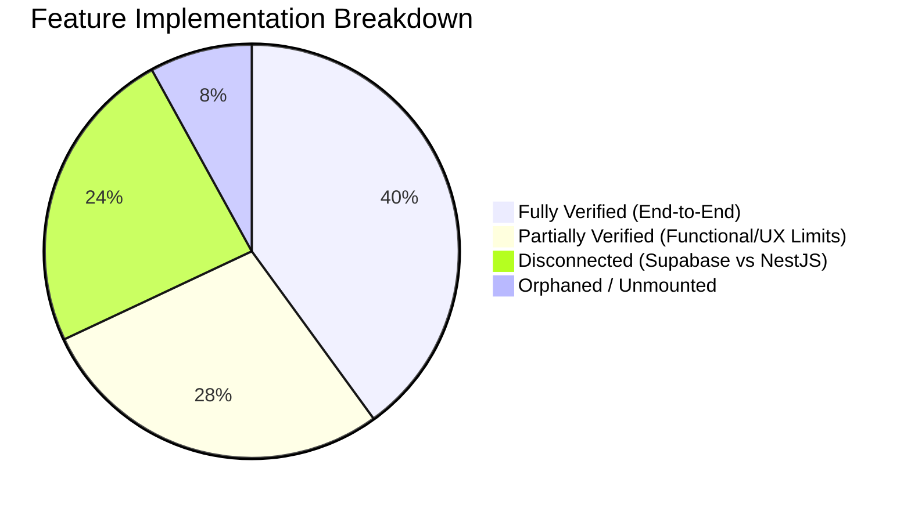

# AASHVO Platform End-to-End Product & Workflow Audit — Executive Summary

**Audit Date:** November 20, 2026  
**Auditor:** AASHVO CTO & Principal Platform Architect  
**Branch Audited:** `feat/performance-responsive-ux` (`c6f585e5ace66de038c85b3bdc0e5048e455ea9d`)  
**Operating Mode:** Read-Only Audit & Architectural Verification

---

## 1. Executive Summary

A comprehensive, evidence-based architectural audit was conducted across the entire AASHVO platform spanning the frontend application (React 18, Vite, Tailwind CSS), backend application (NestJS 10, TypeScript), database layer (PostgreSQL 16, Prisma ORM), and supporting test suites.

The audit reveals a platform with **world-class algorithmic intelligence, sophisticated multi-persona profile architectures, and hardened backend security**. Specifically, the **AASHVO Connect** roommate matching engine, 5-step progressive onboarding wizard, and Google OAuth concurrency protections are fully realized, rigorously tested, and production-ready.

However, the audit also exposed a **critical architectural fault line**: the application is divided between two conflicting data architectures. While the NestJS REST backend features 17 comprehensive controllers and 34 relational Prisma tables, several primary frontend workflows—notably **Property Listing Creation**, **Direct Property Inquiries**, **Tenancy Agreements**, and **Support/Dispute Reporting**—still invoke a legacy, direct-Supabase client. When running against the NestJS backend, these operations fall back to local in-memory React state, meaning listings and inquiries do not persist to PostgreSQL.

Additionally, a route mismatch on the Notification Center results in an immediate HTTP 404 error when clicking "Mark all as read", and a complete 400-line move-in inspection checklist modal (`MoveInChecklistModal.tsx`) remains orphaned and unmounted in the codebase.

---

## 2. Key Audit Metrics & Scorecard

- **Total Features Audited:** 25 core platform features
  - Fully Verified End-to-End: **10 (40.0%)**
  - Partially Verified: **7 (28.0%)**
  - Disconnected (Supabase vs NestJS): **6 (24.0%)**
  - Orphaned / Unmounted in UI: **2 (8.0%)**
- **User Personas Evaluated:** 9 distinct personas (Average score: **6.5 / 10**)
  - Top Performing: Flatmate Seeker (**9.5 / 10**), Multi-Persona User (**8.5 / 10**), Guest User (**8.5 / 10**)
  - At Risk: Property Owner (**4.5 / 10**), Family Stay Host (**4.0 / 10**), Safety Moderator (**4.0 / 10**)
- **Backend API Endpoints:** 64 routes across 17 NestJS Controllers
  - Fully wired to frontend services: **31 (48.4%)**
  - Partially wired or public params: **14 (21.9%)**
  - Disconnected (Bypassed by frontend): **16 (25.0%)**
  - Route Mismatch Bug: **1 (1.6%)** (`/notifications/mark-all-read` vs `/read-all`)
  - Orphaned backend routes: **2 (3.1%)**
- **Automated Tests:** 492 tests (300 Vitest frontend + 192 Jest backend, 100% passing)
  - Unit/Component Coverage: **High**
  - E2E Integration Coverage: **Zero** (Explains why disconnected workflows escaped CI)
- **Security Assessment:** **B+ (84 / 100)** (Robust bcrypt, advisory-locked OAuth, parameterized SQL; token mirroring in localStorage is primary risk)
- **UX & Responsiveness:** **8.8 / 10** (WCAG AA compliant contrast, 44px touch targets, zero horizontal scroll on mobile)

---

## 3. Critical Findings Summary

1. **Dual Backend Disconnect (P0 Blocker):** `ListPropertyModal.tsx` calls `AppContext.addProperty()`, which calls Supabase or local state instead of NestJS `POST /api/v1/properties`. Listings are lost on reload.
2. **Notification Route Mismatch (P0 Blocker):** `notificationService.markAllAsRead()` calls `/notifications/mark-all-read`, but NestJS controller defines `/read-all`, throwing 404.
3. **Property Inquiry Bypass (P0 Blocker):** Direct inquiry in property detail modal skips NestJS `POST /api/v1/inquiries`.
4. **Orphaned Move-In Inspection (P1 High):** `MoveInChecklistModal.tsx` contains complete inventory and meter-reading UI, but is never imported or rendered.
5. **Double-Booking Race Condition (P1 High):** Rapid double-clicking on "Schedule Visit" creates duplicate bookings in PostgreSQL.

---

## 4. Release Decision

- **Alpha / Dogfooding:** **READY** for AASHVO Connect and roommate matching flows.
- **Public Staging Release:** **BLOCKED** pending resolution of P0 remediation items (ENG-P0-01, ENG-P0-02, ENG-P0-03).
- **Production GA:** **BLOCKED** pending Supabase client deprecation and Playwright E2E verification.

---

## 5. Audit Documentation Index

The complete audit suite comprises 12 exhaustive markdown reports located in `docs/audits/product-workflow-audit/`:

1. [EXECUTIVE_SUMMARY.md](file:///d:/Projects/AASHVO/docs/audits/product-workflow-audit/EXECUTIVE_SUMMARY.md) — Platform overview, scorecard, and executive briefing.
2. [FEATURE_INVENTORY.md](file:///d:/Projects/AASHVO/docs/audits/product-workflow-audit/FEATURE_INVENTORY.md) — Full feature inventory across all 25 modules.
3. [USER_PERSONA_AUDIT.md](file:///d:/Projects/AASHVO/docs/audits/product-workflow-audit/USER_PERSONA_AUDIT.md) — Comprehensive audit of all 9 user personas.
4. [WORKFLOW_LIFECYCLE_AUDIT.md](file:///d:/Projects/AASHVO/docs/audits/product-workflow-audit/WORKFLOW_LIFECYCLE_AUDIT.md) — 13-stage lifecycle mapping across 12 feature groups.
5. [API_FRONTEND_BACKEND_TRACE.md](file:///d:/Projects/AASHVO/docs/audits/product-workflow-audit/API_FRONTEND_BACKEND_TRACE.md) — Exhaustive trace of all 64 NestJS routes and frontend services.
6. [SECURITY_AND_PERMISSION_AUDIT.md](file:///d:/Projects/AASHVO/docs/audits/product-workflow-audit/SECURITY_AND_PERMISSION_AUDIT.md) — RBAC, OAuth locks, token storage, and OWASP review.
7. [EDGE_CASE_FAILURE_AUDIT.md](file:///d:/Projects/AASHVO/docs/audits/product-workflow-audit/EDGE_CASE_FAILURE_AUDIT.md) — Resilience, rapid clicks, network disconnects, and race conditions.
8. [UX_RESPONSIVE_AUDIT.md](file:///d:/Projects/AASHVO/docs/audits/product-workflow-audit/UX_RESPONSIVE_AUDIT.md) — Responsive viewports (320px–1920px), touch targets, and accessibility.
9. [TEST_COVERAGE_GAP.md](file:///d:/Projects/AASHVO/docs/audits/product-workflow-audit/TEST_COVERAGE_GAP.md) — Analysis of 492 tests and why disconnected workflows escaped CI.
10. [PRODUCT_GAP_ANALYSIS.md](file:///d:/Projects/AASHVO/docs/audits/product-workflow-audit/PRODUCT_GAP_ANALYSIS.md) — Benchmark against Airbnb, Zillow, and Bumble BFF.
11. [PRIORITIZED_REMEDIATION_BACKLOG.md](file:///d:/Projects/AASHVO/docs/audits/product-workflow-audit/PRIORITIZED_REMEDIATION_BACKLOG.md) — Ranked P0, P1, P2, P3 engineering work packages.
12. [CTO_RECOMMENDATIONS.md](file:///d:/Projects/AASHVO/docs/audits/product-workflow-audit/CTO_RECOMMENDATIONS.md) — Architectural unification, 30-60-90 day roadmap, and release criteria.
